<!-- next-readme:begin — this block is stripped by scripts/promote-readme.sh -->
> [!NOTE]
> **Draft README for the next release.** It may describe features that the latest release does not have yet. The README of the current release is [`README.md`](README.md).
<!-- next-readme:end -->

<div align="center">


# Moonlight‑Web

**Stream your PC games from any browser.**\
Install it on the gaming PC — it captures and encodes that machine **itself**, no second streaming server to set up.\
Nothing to install on the client either: just a URL, from your LAN or from anywhere.\
Under **20 ms** glass‑to‑glass over Wi‑Fi on a LAN, ~**25 ms** over the Internet.

**🌐 Website: [moonlightweb.top](https://moonlightweb.top/)** — screenshots, [install guides](https://moonlightweb.top/guides/windows.html) & [FAQ](https://moonlightweb.top/faq.html)\
**💬 Community: [Discord](https://discord.gg/wfbesPx4UB)** — questions, help and new‑release announcements

[](https://discord.gg/wfbesPx4UB)
[](LICENSE)


</div>

---

## What it does

Moonlight‑Web turns your gaming PC into a stream, and **any device with a modern browser** (PC, Mac, tablet, phone, TV) into the client. Only the server gets installed.

*Moonlight‑Web ([moonlightweb.top](https://moonlightweb.top/)) and [moonlight-web-stream](https://github.com/MrCreativ3001/moonlight-web-stream) are two separate projects with close names: moonlight-web-stream is a web client for a Sunshine host; Moonlight‑Web streams the PC it is installed on by itself, and pairs with Sunshine too.*

- 🖥️ **Its own capture & encode engine** — the machine it runs on is a host straight away: no Sunshine, no pairing, no PIN. One card per display. Windows, Linux and macOS.
- 🎮 **Low‑latency streaming** up to 4K HDR, 240 FPS, **H.264 / HEVC / AV1**, on **NVENC · AMF · Quick Sync · VA‑API · VideoToolbox** (software fallback).
- 🌐 **WebRTC transport** (DataChannels + RTP media tracks), direct, UDP first with an automatic TCP fallback; WSS on the host's direct address.
- 🔊 **Opus audio**, adaptive jitter buffer, stereo.
- 🎙️ **Your microphone on the host** (opt‑in, Settings → *Send my microphone*): your voice reaches the host's games and chat apps as a microphone, with a mute button in the stream. "MoonlightWeb Microphone" on Linux, a virtual cable such as VB‑CABLE on Windows; for the PC MoonlightWeb runs on ([details](docs/wiki/05-Streaming-and-Transports.md#54-audio-path)).
- ⌨️🖱️🎮 **Full input**: keyboard, mouse (pointer‑lock), touch trackpad, **Xbox/PS gamepads** with rumble. A phone's keyboard types into every window of a Windows host, classic consoles included. On Windows it reaches the lock screen and UAC prompts too, and **Ctrl+Alt+Del** works from the touch keyboard bar (Ctrl, Alt, then Del), and its Win key latches like Shift, Ctrl and Alt, for Win+L or Win+R. A Windows PC with no mouse plugged in shows its pointer in the stream too, and its games see a mouse. **Racing wheels, flight sticks and RC radios** too, as an Xbox pad or sent to the game as themselves, force feedback included ([see below](#controllers)).
- 🤝 **Pairs with other hosts too** — Sunshine/Apollo, Wolf, MultiSeat: [see below](#other-hosts-it-can-pair-with). mDNS discovery, PIN pairing, multi‑host.
- 🌍 **Internet access** opt‑in, at a `stream.moonlightweb.top/「id」` address, with nothing published in your name.
- 🪄 **Video Enhancement** (bonus): GPU upscaling & sharpening in the browser.
- 👥 **Session sharing**: invite up to 3 people as viewer, gamepad player or full control.

<div align="center">

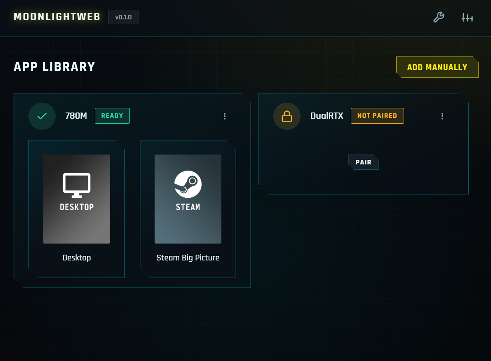

| 🖥️ Desktop | 📱 Mobile |
|:---:|:---:|
| 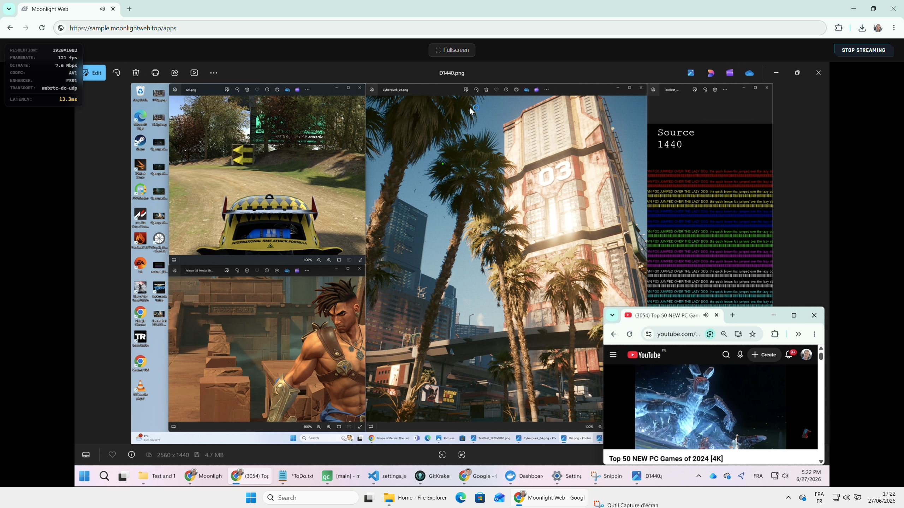 | 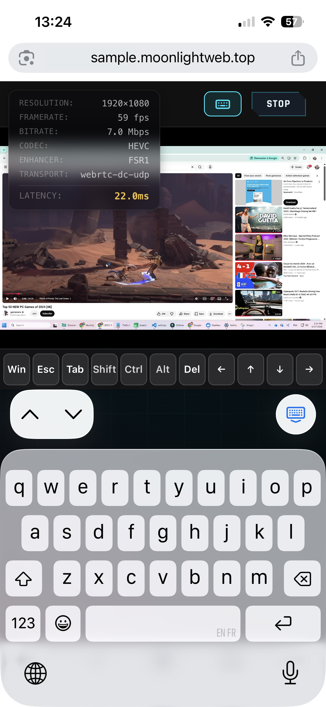 |

</div>

---

## How it works

1. **Install the server on the gaming PC.**
2. **Open a browser** at `https://localhost`, at the PC's LAN IP, or at your [entry link](#internet-access) from outside.
3. **The PC is already in the list** as `<hostname> — MoonlightWeb Host`, one card per display. Nothing to pair.
4. **Click a display and stream.** Other hosts on the LAN are discovered next to it and can be [paired too](#other-hosts-it-can-pair-with).

**The native engine** hands the captured GPU surface straight to the GPU encoder, in the process that holds the WebRTC connection: `capture → encode (zero‑copy) → SCTP/DTLS → browser`. No loopback hop, RTSP, RTP or FEC. On an RTX 5060 Ti at 1440p: **0.06 ms** to acquire a frame, **3.46 ms** to encode it, **one** memory copy.\
The browser decodes with **WebCodecs + WebGPU/canvas** and plays audio through its own **WebRTC** player (an **AudioWorklet** on the WSS fallback).

**On an Intel GPU, the picture takes a D3D12 chain**: conversion and encoding on queues that stay ahead of a game, and a rate control of its own. On an Arc A380 under a game, the host time falls by half. NVIDIA and AMD keep their D3D11 path, which measured faster there. **On Linux with an AMD GPU**, HEVC and AV1 go through Vulkan Video from end to end, once the driver has proved on real pictures that it encodes correctly: a desktop that barely moves then takes under 1 Mbit/s, where VA-API under Mesa 26 kept close to the full bitrate. VA-API, which still carries H.264, now keeps a quality floor too: a still desktop no longer takes the whole bitrate. Otherwise, and in H.264, the conversion runs in Vulkan in front of VA-API: under a game that saturates the iGPU, 8 ms from the screen to the encoded picture, against 15 to 38 through GL depending on the Mesa version. Any failure falls back to the older path without cutting the stream. **Admin → Advanced → Video pipeline** picks a chain by hand (`native_video_pipeline`: `auto`, `d3d11`, `d3d12`; on Linux `auto`, `vaapi`, `vulkan`).

**PyroWave (Wired LAN only)** joins the codec menu, for a device on Ethernet streaming a Windows native host: every frame travels whole, about 130 Mbit/s at 120 fps, and the page decodes it on the GPU — WebGPU, or WebGL2 where WebGPU is off (Chrome on Linux, Safari 18), both checked against the reference decoder. On an NVIDIA PC its picture arrives about 1 ms after HEVC's, with less sharp text, and without HDR. The option is greyed out, with the reason, where no host codes it; a choice that cannot run streams as Auto.

> The engine also runs under the Windows service, in the logged‑on user's session. Where it cannot run (no usable encoder, Windows ARM64), the card is hidden and the app offers a host to pair with. A **headless** PC keeps its card through **"MoonlightWeb Virtual Display"**, a signed virtual monitor offered by the installer (a Mac creates its own). It turns on for a stream and your displays are restored when it ends. On Windows it runs faster than your screen, at a whole multiple of its measured rate: 239.744 Hz for a "120 Hz" panel that really runs at 119.872, up to 330 Hz, and 240 Hz when no multiple fits. What the PC draws reaches the stream sooner (6 to 17 ms less behind an Intel or AMD GPU), the stream keeps your screen's rate, and no picture is lost to a beat between the two. A PC whose capture does not hold such a rate goes back to your screen's own from its next stream on. On Windows, **Admin › Turn off the other screens during the stream** darkens the PC's other screens while a stream runs on the virtual display; they come back on when it ends.

**With the FPS on Auto, the stream can go faster than your screen.** When the picture on the host changes faster than your screen refreshes and your device keeps up, a Windows host steps the stream up, to 240 at most. The step stays only while what you see gets younger: 1 to 14 ms younger on a PC on Ethernet, 3 to 15 ms on a Mac on Wi-Fi. A device that falls behind is back at its own rate within three seconds, and remembers it: its next streams to that PC do not try again in their first quarter of an hour. A TV keeps its own rate.

**A Windows host keeps a steadier rhythm.** Its frames now line up with its display's refreshes. On a screen that paints on vsync (a Mac, an iPhone, an iPad, a TV, Firefox), the small hitches that came back for half a minute every two minutes, a frame a little early then one a little late, are gone: they touched 4 to 6 % of refreshes, about 1 % now, which comes from the game or the page itself. Latency and bitrate do not change.

**A click shows sooner.** When a Windows host streams slower than its display (60 or 120 fps on the 240 Hz virtual display), the frames right after a key, a click or a pad button go out at once, instead of waiting for the stream's next slot. At 60 fps in our tests, a click's picture came 5.8 ms sooner in median, and 72 % of clicks showed within 20 ms instead of 18 %. It costs about three frames per press, and steps aside on a busy link. It is on for Chrome and Edge on Windows with **Allow tearing** ticked, their default; a screen that paints on vsync keeps the stream's own rhythm.

**Against v0.3.1, on the same machines** (a Windows host on an RTX 5060 Ti, a Windows client on Ethernet, 1080p in H.264, HEVC and AV1 at 60, 120 and 240 fps): what you see is 2 to 5 ms younger at 120 fps, and the slowest frames 6 to 13 ms younger at 60 and 120 fps. A click shows 3 ms sooner over all clicks, 8 ms at 120 fps. Encoding and decoding take the same time; the bitrate is 5 to 10 % higher.

**On Wi-Fi, the picture waits less on its way out.** A host running MoonlightWeb (Windows, Linux or macOS) no longer holds frames back in its own network stack between two acknowledgements: from a click to its picture, about 8 ms less on a Mac on Wi-Fi; behind a cable, the picture arrives 4 to 6 ms younger. A Windows host also lowers the bitrate the moment the Wi-Fi starts resending, before the delay shows.

**The sound comes sooner.** The browser no longer holds every sound back by a fixed 60 ms: it keeps only what the link needs. In Chrome on a Mac on Wi-Fi, each sound plays 15 to 35 ms earlier and sits closer to its picture, and a blind listening heard no crackle more. **A Windows host no longer crackles:** its capture used to put a few milliseconds of silence in place of sound that came a little late, one to four times a second under music; it now waits for it, and the sound leaves the PC 1 to 2 ms sooner as well.

**On Wi-Fi, the stream goes ahead of the house's downloads.** Its packets are marked for the Wi-Fi's video queue (AF41): with a download running on the same access point as your device, each click came back 32 to 40 ms sooner in our tests, where the unmarked stream fell to a few Mbit/s. If your other devices struggle while you stream (a video call, a download), untick **Give the stream priority on the network** in the admin page: the stream then queues like any other device, and its picture can turn less steady on a busy network.

**On Linux, Steam gets a screen of its own.** With gamescope 3.16.22 or later (Fedora 43+, Arch, Bazzite, SteamOS, Ubuntu 26.10+), a **Steam Big Picture** card opens Steam in its own screen, at the size of the device that streams it, without touching the desktop — an X11 session included. The apps you list in **Admin → Apps on this PC** open there too.

**Your apps on the host, on every OS.** **Admin → Apps on this PC** gives any program or link a card on the host: a name, a command (`steam://open/bigpicture`, a path to a game, `lutris lutris:rungameid/3`) and an image. On Windows and macOS it opens on the virtual display, at the size of the device that streams it, as the user at the desktop. If Steam is installed, a **Steam Big Picture** card is there after installing or updating MoonlightWeb, like Sunshine's; Playnite's full-screen mode too on Windows. When the stream ends, Big Picture closes with the virtual display, as with Sunshine; **Quit** closes it too.

### Stream settings

From the in‑app overlay: **bitrate** (1–150 Mbps or auto), **resolution** (720p–2160p),\
**FPS** (15–240), **codec** (auto / H.264 / HEVC / AV1 / **PyroWave (Wired LAN only)**, unsupported options greyed out),\
**HDR**, **4:4:4 chroma**, **Mouse Gaming Mode** (pointer‑lock), perf stats and aspect ratio.

**Settings → Start streams in fullscreen** (off by default) opens every stream in fullscreen. On an iPhone, Safari keeps its bars and the stream fills the page; added to the Home Screen, MoonlightWeb is fullscreen anyway.

<div align="center">

| Video settings | Advanced options |
|:---:|:---:|
| 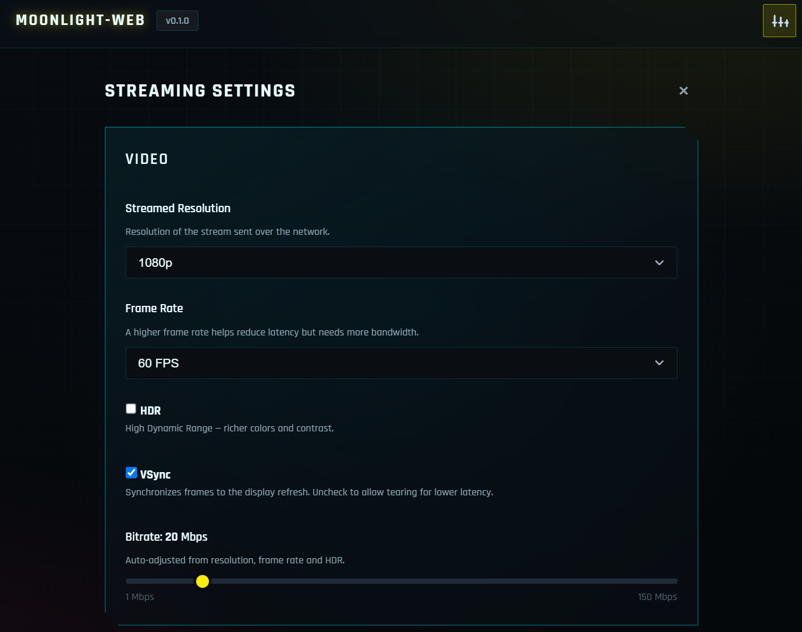 | 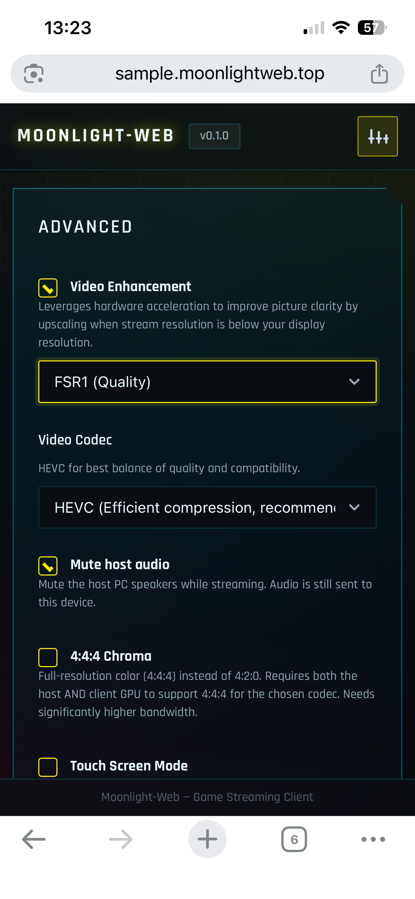 |

</div>

### Controllers

Standard pads just work. Others are recognized from [SDL_GameControllerDB](https://github.com/mdqinc/SDL_GameControllerDB), and any pad can be remapped in **Settings → Controllers**. Tested on Windows + Chrome:

| Controller | Connection / mode | Result |
|---|---|---|
| Xbox One S Controller | Bluetooth | ✅ |
| Switch Pro Controller | USB‑C | ✅ |
| Switch Pro Controller | Bluetooth | ❌ not read correctly by browsers |
| GameSir X2 Lightning | — | ✅ |
| 8BitDo SN30 Pro | USB‑C (Xbox 360) | ✅ |
| 8BitDo SN30 Pro | Bluetooth, Start+X (Xbox One S) | ✅ |
| 8BitDo SN30 Pro | Bluetooth, Start+A (PS4) | ✅ |
| 8BitDo SN30 Pro | Bluetooth, Start+B (8BitDo) | ✅ |
| 8BitDo SN30 Pro | Bluetooth, Start+Y (Switch Pro) | ❌ not read correctly by browsers |
| Radiomaster TX12 (EdgeTX) | USB Joystick (HID) | ✅ recognized on plug-in, like any EdgeTX/OpenTX radio |
| Logitech G923 for Xbox One and PC | USB, with G HUB on the client | ✅ recognized on plug-in |

**Wheels and radios as themselves** (Chrome or Edge on a computer, MoonlightWeb native host): in **Settings → Controllers**, switch **As itself** on the wheel's or radio's row (the browser asks for the device the first time), or accept the offer when a stream starts. The game then sees the real wheel or radio instead of an Xbox pad: every axis, clutch included, and all 8 channels of a TX12. Force feedback works on Windows and Linux hosts, tested with the G923 in ACC; wheels that speak USB PID (Moza, Simucube, Fanatec…) are supported but not tried yet. An invited player gets it only when you tick **Wheel / Radio** on their sharing row. A Linux host needs nothing more. On a Windows host (x64), the installer sets up the **MoonlightWeb Virtual HID** driver: no test mode, Secure Boot stays on ([details](docs/wiki/04-Frontend.md#49-wheels-and-radios-as-themselves)). A Mac host cannot. Where the host cannot, the switch says why and what to do. On a Windows host, a game left running keeps the wheel and its force feedback when you stop the stream and start a new one within 10 minutes. With Medal on the host, start Medal before the game: started after it, Medal leaves the game without force feedback until it restarts ([details](docs/wiki/04-Frontend.md#49-wheels-and-radios-as-themselves)).

Details and test notes in the [wiki](docs/wiki/04-Frontend.md#48-controller-compatibility).

### On a TV

An Android TV box is a client too, from a TV browser — tested with **TV Bro** on a Mi TV and on a Freebox Player POP. The stream is sized for what the TV's decoder and browser can show — Auto streams 720p at most there, for the lowest latency — and shown by the TV browser's own video player: every frame, where drawing them in the page held a TV to about 30 a second. A decoder that freezes on the PC's loss-healing stream (the Freebox's does) is noticed, and the stream comes back on keyframes: once, and that TV remembers it.\
**With the remote:** switch TV Bro to **Direct navigation** (hold OK on a link, then pick the D‑pad icon). The arrows then move between the cards and OK launches. In a stream, the arrows and OK go to the PC, and **holding OK** opens the stream's menu (Resume, Mouse, Statistics, Stop): a TV browser keeps Back for itself. Its **Mouse** turns the remote into the PC's mouse: the arrows move the pointer, OK clicks, Ch+ / Ch− scroll. A pad paired to the TV gets around the pages too, and **Select + Start + LB + RB** opens the same menu.\
**With TV Bro's own cursor** (its default mode), the pages scroll at the screen's edge and a click in a stream lands right under the cursor. Every page has an on‑screen way out (✕, Close). A TV asked for more than its Auto would pick (1080p60 on a Mi TV) says so at launch, and streams as asked.

---

## Other hosts it can pair with

The native engine streams **the machine MoonlightWeb runs on**. Moonlight‑Web is also a full GameStream client: other hosts are paired and streamed through the embedded `moonlight-common-c`.

```
  MoonlightWeb server (C++/Qt)                   A paired host on your LAN
┌─────────────────────────────────┐  HTTPS   ┌──────────────────────────────┐
│  moonlight-common-c (embedded)  │◄────────►│  GameStream API              │
│  RTSP / RTP / ENet  →  relay    │   RTSP   │  /serverinfo /applist /pair  │
│  re-packetised onto WebRTC      │◄════════►│  GPU encoder                 │
└─────────────────────────────────┘  RTP/UDP └──────────────────────────────┘
```

| Host | What it is | How it pairs |
|---|---|---|
| **[Sunshine](https://github.com/LizardByte/Sunshine)** · **Apollo** | The reference GameStream host, and its fork | mDNS or by IP, with the PIN MoonlightWeb shows, typed into the host's web page. |
| **[Wolf](https://games-on-whales.github.io/wolf/)** (Games‑on‑Whales) | Containerised host: profiles, Docker catalogue, lobbies and co‑op | Automatic: MoonlightWeb posts the PIN through Wolf's `/api/v1`. One certificate per device, so two players are two clients. |
| **MultiSeat** | One Windows box split into independent seats, each with its own Apollo | Seats are provisioned through MultiSeat's API, then each is paired on its own. |

**On Sunshine and Apollo, Stop leaves the game running, as in Moonlight.** Its card then shows **Running**: click it to resume, or **Quit** to close it. Launching another app while one runs asks first: quit it and launch, or resume it instead. **Settings → Quit the app when the stream stops** brings back the old behaviour. A game Sunshine started detached (a Steam launch, for instance) still survives Quit: Sunshine no longer tracks it, in Moonlight too.

> ⚠️ MultiSeat's per‑seat stream path is **not yet tested end to end**: provisioning a seat needs a free Windows session the bench cannot offer.

Using MoonlightWeb only as a front end? Set `"native_host_enabled": false` in [`settings.json`](#advanced-config--settingsjson) to hide this machine's card.

---

## Session sharing

The **sharing board** invites up to three people into your session, each with their own stream, resolution and bitrate. Open it from the **Share** button of a running stream, or from a host's ⋯ menu before anything is streaming (the first guest's PIN then starts the app).

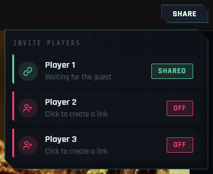

Each player row gives **a link and a 6‑digit PIN**. Send them separately: the link alone opens nothing.

| Level | They can |
|---|---|
| **Viewer** (default) | watch and listen |
| **Gamer** | watch and play with a gamepad |
| **Desktop** | watch, and use the keyboard and mouse of your PC |
| **Full** | all of it — gamepad, keyboard and mouse |

| 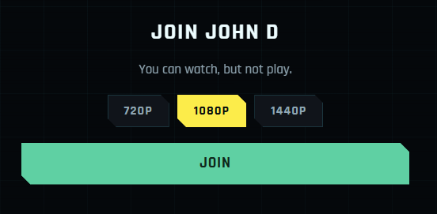 | 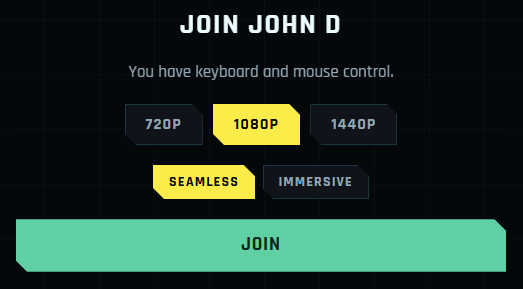 |
|---|---|
| A **Viewer** just watches and listens. | **Full control** hands over the keyboard and mouse. |

- **The level can change mid‑game**, and keys held by the guest are released. Permissions are enforced by the server, and clipboard sync is off for guests.
- **Administrator windows** of a Windows host (an elevated console, a game run as administrator) stay closed to guests unless you open them in `settings.json` ([how, and the risk](docs/wiki/06-Security.md#64c-invited-players-and-administrator-windows)).
- **One invitation, one machine.** The first device to enter the PIN owns the link; any other attempt is refused and shown on the board.
- **Regenerate** issues a new link and PIN and disconnects the old one.
- **The link's address**: Automatic (your entry link, or the LAN when the PC has no internet access), or pinned per host from the board to the LAN, Tailscale or another network.
- **Lifetime:** 1 h, 4 h, 8 h, 24 h, 48 h or unlimited. A guest can rejoin until you close the row, press Stop, or time runs out.
- **Your quality stays fixed** while a link is live, so the auto ladder never restarts the stream under your guests.
- **Stop** asks: **Leave** (the game and players carry on) or **Stop everything**.
- **Ten wrong PINs** destroy the invitation, and failed attempts count towards the login ban.
- A session left running elsewhere can be ended from the host card's **⋯ → Stop session**.

> Session sharing is a build‑time switch (`kSessionSharingEnabled` in
> `backend/src/server/ShareManager.h`). Turned off, every share route answers
> 404 and no entry point appears in the UI.

---

## Install

Grab the installer from the **[latest release](https://github.com/linckosz/moonlight-web/releases/latest)** or **[moonlightweb.top](https://moonlightweb.top/#download)**, which picks the right file. Guides with screenshots: [Windows](https://moonlightweb.top/guides/windows.html) · [macOS](https://moonlightweb.top/guides/macos.html) · [Linux](https://moonlightweb.top/guides/linux.html).

> ✅ **Nothing else to install.** Install it **on the gaming PC** — that is the whole setup.

> ℹ️ It also runs on **another LAN machine** (NAS, mini PC, container) to stream the hosts you pair with, without the native engine.

### Windows 10 / 11

**`MoonlightWeb-installer-<version>-win-x64.exe`** (or `-win-arm64.exe` on ARM devices). The wizard (English / Français / 简体中文) does everything:

| Step | What it does |
|---|---|
| **Install** | App + Start‑Menu/Desktop shortcuts, firewall rule, optional **start at logon**. |
| **Gamepad driver** | ViGEmBus installed silently — what lets a browser's gamepad appear as a real controller on this PC. |
| **Internet link** | Opt‑in (unchecked by default): allows remote streaming sessions (per‑session router port via UPnP). |
| **Checklist** | Live progress, then opens the admin page. |

Sunshine is no longer installed (since September 2026); an existing Sunshine is discovered and paired like any other host.

**Updates:** rerun the installer or use the in‑app button (no UAC prompt); settings and pairings are kept.\
**Service (optional):** `backend/packaging/windows/install-service.bat` installs a session‑0 service via NSSM.

### macOS (Apple Silicon)

**`moonlightweb-<version>-macos-arm64.pkg`** — installs to `/Applications` with an optional **start at login**.

The `.pkg` is not notarized, so a downloaded copy is blocked by Gatekeeper. Either command installs it without the prompt:

```sh
brew install --cask linckosz/tap/moonlightweb
curl -fsSL https://moonlightweb.top/install.sh | bash
```

For a downloaded file on macOS 15+: *System Settings → Privacy & Security → **Open Anyway***, or `xattr -dr com.apple.quarantine ~/Downloads/moonlightweb-*.pkg`.

⚠️ Allow **MoonlightWeb** in *Privacy & Security → Screen Recording* at first launch; the setup page (`https://localhost/setup`) opens that pane for you.\
*Intel Macs:* no prebuilt package — [build from source](#fork--build).

### Linux (x64)

**One command, updates included:**

```sh
curl -fsSL https://moonlightweb.top/install.sh | bash
```

It adds the signed **APT** or **DNF** repository, so MoonlightWeb updates with the system and appears in GNOME Software, KDE Discover and App Center. Arch uses [`moonlightweb-bin`](https://aur.archlinux.org/packages/moonlightweb-bin) from the AUR. Manual setup: [Linux guide](https://moonlightweb.top/guides/linux.html#one-line-install).

Or install a package directly. All are **self‑contained** (Qt + OpenSSL bundled), install to `/opt/moonlightweb`, open the firewall ports (80/tcp, 443/tcp, 48550‑48573/udp) and start the app.

| Distro family | Package | Command |
|---|---|---|
| **Debian · Ubuntu · Mint · Pop!\_OS · elementary · Zorin · Kali** | **`.deb`** | `sudo apt install ./moonlightweb-<ver>-linux-x64.deb` |
| **Fedora · RHEL · CentOS Stream · Rocky · Alma · Nobara** | **`.rpm`** | `sudo dnf install ./moonlightweb-<ver>-linux-x64.rpm` |
| **openSUSE · SLE** | **`.rpm`** | `sudo zypper install --allow-unsigned-rpm ./moonlightweb-<ver>-linux-x64.rpm` |
| **Arch · Manjaro · EndeavourOS · SteamOS · Bazzite · anything else** | **`.AppImage`** | `chmod +x moonlightweb-<ver>-x86_64.AppImage && ./moonlightweb-<ver>-x86_64.AppImage` |

> 💡 **On Debian/Ubuntu, prefer the `.deb`.** The AppImage needs `chmod +x` and **FUSE 2**
> (`sudo apt install libfuse2t64`, or `libfuse2` before 24.04).

> ⚠️ **To stream *this* machine, use the `.deb`, `.rpm` or AUR package.** Screen capture needs a file
> capability that an AppImage cannot keep; the AppImage only streams paired hosts.

**Nothing else to install.** Capture uses **KMS** (zero‑copy DMA‑BUF → VA‑API or Vulkan Video), or the **ScreenCast portal** where the compositor requires it. Audio comes from PipeWire and input goes through `uinput`. The first launch opens `https://localhost/setup`.

**Autostart** uses an XDG autostart entry; for a headless server use the systemd unit in
[`backend/packaging/systemd/`](backend/packaging/systemd/).

### Docker — servers, NAS boxes and mini PCs

Official **`linux/amd64` + `linux/arm64`** images on GHCR, for a headless box (Raspberry Pi, N100, NAS) on the gaming PC's LAN.

```sh
docker run -d --name moonlightweb \
  --network host \
  --cap-drop ALL --cap-add NET_BIND_SERVICE \
  -v mw-data:/data \
  --restart unless-stopped \
  ghcr.io/linckosz/moonlight-web:latest
```

```sh
docker exec moonlightweb moonlightweb --new-pin        # required — see below
docker exec -it moonlightweb moonlightweb --set-admin-password
docker exec moonlightweb moonlightweb --status         # URLs, PIN, internet state
```

Then open **`https://<server-ip>`** and accept the self‑signed certificate.
Compose files: [`docker/docker-compose.yml`](docker/docker-compose.yml) (host networking) and
[`docker/docker-compose.bridge.yml`](docker/docker-compose.bridge.yml) (published ports, with
caveats).

> ⚠️ **Set a PIN and an admin password.** A container never sees a local browser, so without
> them the page stays behind the login wall and the admin page cannot be opened.

| | |
|---|---|
| **Tags** | `latest` · `0.4.1` · `0.4` · `sha-<commit>`. Release tags only — no `edge`, no nightly, so `latest` can never be work in progress. |
| **Ports to open** | **443/tcp** (web UI + signalling) and **80/tcp** (HTTP→HTTPS redirect). WebRTC media takes **48550‑48573/udp**, one port per stream slot, with or without UPnP. A GameStream host is reached *outbound* on 47989/47984/47990 tcp, 47998‑48000 udp, 48010 tcp/udp. |
| **Volume** | `/data` — settings, TLS material, paired hosts and the **client identity**. Losing it un‑pairs every host. |
| **Env** | `MW_HTTPS_PORT` · `MW_HTTP_PORT` · `MW_UPNP` · `TZ` |
| **GPU** | **None required.** The paired host encodes and the browser decodes; no `/dev/dri`, `/dev/input` or privileged container. |

> ⚠️ **Use `--network host`.** WebRTC, mDNS discovery and UPnP all stop at a bridge. The bridged
> file works, but hosts must be added by IP and the stream may fall back to TCP.

**This image cannot host a screen**: add the gaming PC from the hosts page instead.

Full reference — ports, volume, backups, non‑root, systemd, troubleshooting: **[`docker/README.md`](docker/README.md)**.

### First launch (all platforms)

1. The server starts with a **tray icon** and opens the setup or admin page.
2. Open **`https://localhost`** in a recent Chrome / Edge / Safari.
   - Default ports: **HTTP :80** (redirected) and **HTTPS :443**.
   - The certificate is **self‑signed** — accept the browser warning (normal on LAN).
3. **This machine is already in the list** — click a display and stream. From another LAN device: `https://<PC-LAN-IP>`. From outside, see [Internet access](#internet-access). To stream another machine, [pair it](#other-hosts-it-can-pair-with).

Prefer to build it yourself? See [Fork & build](#fork--build).

---

## Video Enhancement (bonus)

Browser‑side image enhancement on the GPU (WebGL2, or WebGPU in HDR and on iPhone): **MoonlightWeb's own upscaler**, FSR1's sharpness for less than SGSRv1's cost, its sharpening following the scale, to gain sharpness when the stream resolution differs from the display resolution.

The upscaler, **MWSR**, is under the MIT License and packaged for other programs in [`mwsr/`](mwsr/README.md): its WebGPU, WebGL2 and Direct3D shaders, a C++ header, their parameters and examples.

<div align="center">

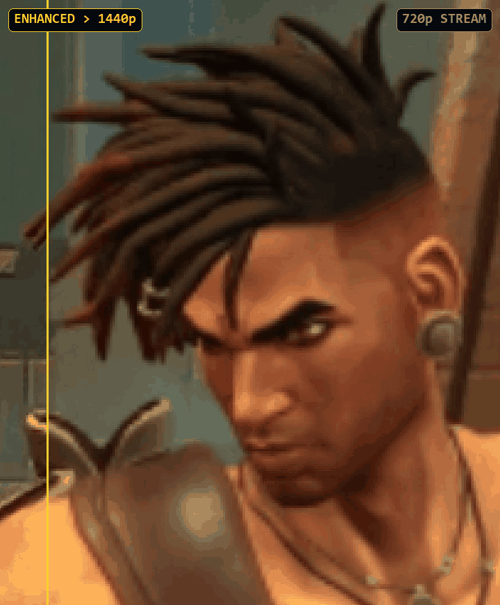

</div>

---

## Admin page

The **Admin** page configures the server itself. It opens on the local machine (`https://localhost/admin`, or tray icon → *Server Settings*), and on another device only once you set a **Remote administration** password: from your LAN, or through your entry link if you tick that too.\
Any other request to `/api/admin/*` gets **403**.

It controls: admin **PIN**, active **sessions**, HTTP/HTTPS **ports**, **transport** (WebRTC/WSS), **Internet access**, and the **certificate token**.

<div align="center">

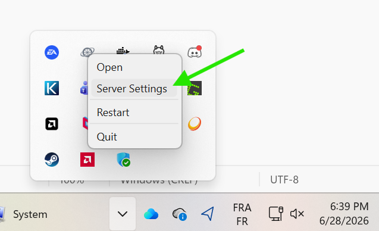

</div>

### Internet access

**Internet Access is opt‑in, off by default.** While it is on, the server:

1. **Detects your public IP** over STUN (ours first, `stream.moonlightweb.top:3478`, then Google/Cloudflare) and reports CGNAT or double NAT. A LAN stream uses no STUN at all.
2. **Opens ports on the router via UPnP**: one per stream slot, kept from one stream to the next (an invited player's closes when they leave), and up to four for the entry link's tunnel. The two peers see each other's public IP.

Nothing is published: **no DNS record, no certificate, ports 80/443 stay closed**. Turning it off closes the entry link at once, and the next streams announce no public address; the router ports already opened stay mapped until MoonlightWeb quits.

**Remote access.** Your PC keeps one outgoing connection to an introduction server and is reached at `https://stream.moonlightweb.top/「id」` (shown on the admin page and in the tray). Visitors still need the access PIN.

The browser loads a few kilobytes of entry page, opens WebRTC straight to your machine, checks its identity key, then loads the interface and API over that connection. Video never touches the server. The entry page is [published byte for byte](https://app.moonlightweb.top) and [checked on a schedule](.github/workflows/bootstrap-watch.yml).

**Installs from v0.2.4 or earlier** keep their `「id」.moonlightweb.top` sub‑domain and forwards **until February 2027**, as the admin page notes.

<div align="center">

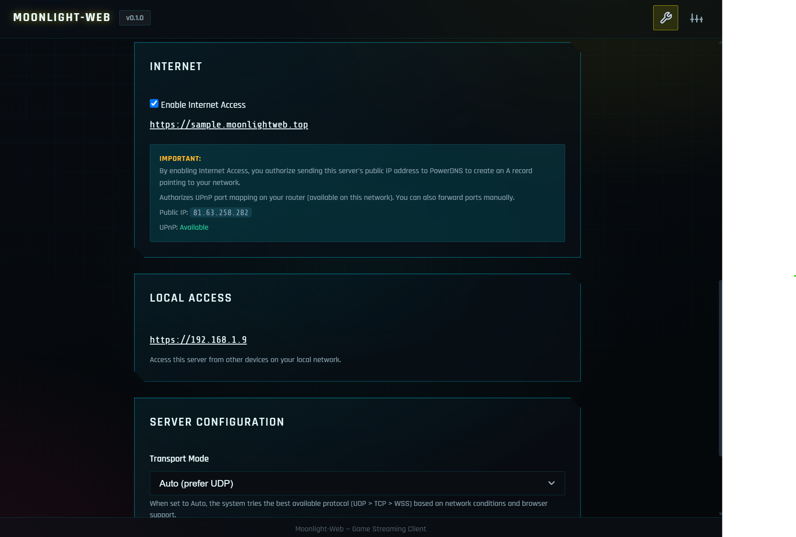

</div>

**Possible limitations:** UPnP disabled (forward the media ports 48550‑48573 manually), CGNAT/double‑NAT (detected and reported — port forwarding won't work), or a port already mapped by another device.

---

## Architecture

```
      BROWSER (any device, anywhere)                RENDEZVOUS SERVER
 ┌────────────────────────────────────┐        ┌────────────────────────────┐
 │  Entry page (a few KB)             │ https  │  stream.moonlightweb.top   │
 │  Web App (Vanilla JS)              │◄──────►│  · serves the entry page   │
 │  Video : WebCodecs + WebGPU        │  SDP   │  · passes SDP / ICE along  │
 │  Audio : Opus / WebRTC track       │  ICE   │  · never sees your video   │
 │  Input : kbd / mouse / gamepad     │        └─────────────┬──────────────┘
 │  Video Enhancement (GPU)           │                      │ ONE outgoing
 └─────────────────┬──────────────────┘                      │ connection,
                   │                                         │ held open by
                   │  WebRTC — peer to peer, DTLS encrypted  │ your PC. No
                   │  video · audio · input · the whole REST │ open port, no
                   │  API. TCP fallback if UDP is blocked.   │ DNS record.
                   ▼                                         ▼
 ┌────────────────────────────────────────────────────────────────────────┐
 │  YOUR GAMING PC — MoonlightWeb server (C++/Qt)                         │
 │  HTTP :80 → HTTPS :443 · static files · REST API · session manager     │
 │                                                                        │
 │  ┌──────────────────────────────┐    ┌──────────────────────────────┐  │
 │  │  NATIVE ENGINE (default)     │    │  moonlight-common-c          │  │
 │  │  capture  DXGI · WGC         │    │  for the hosts you PAIR with │  │
 │  │           KMS · ScreenCast   │ or │  RTSP / RTP / ENet  ────────►│  │
 │  │           ScreenCaptureKit   │    │  Sunshine · Wolf · MultiSeat │  │
 │  │  encode   NVENC · AMF · QSV  │    └──────────────────────────────┘  │
 │  │           VA-API · VideoTB   │                                      │
 │  │  audio    WASAPI · PipeWire  │    zero-copy: capture → encode →     │
 │  │           SCK tap   → Opus   │    fragment → DTLS → browser         │
 │  └──────────────────────────────┘    (no loopback, no RTP, no FEC)     │
 └────────────────────────────────────────────────────────────────────────┘
```

The server is a **web server** (frontend + REST API), a **streaming engine** for its own machine, and a **bridge** to paired GameStream hosts. Video and Opus audio reach the browser over **WebRTC**, with **WSS** fallback.

**The rendezvous server introduces, it does not relay.** After the entry page, everything flows peer to peer. On the LAN, `https://<PC-LAN-IP>` skips it entirely. Its domain is served by the DNS stack in [`deploy/powerdns/`](deploy/powerdns/) — the server your tips help keep alive.

Paired hosts get their input AES‑128‑GCM encrypted over **ENet**, as GameStream requires. The native engine relies on DTLS alone.

---

## Advanced config — `settings.json`

Most settings live in the UI and are stored **server‑side** in `settings.json`:

| OS | Path |
|---|---|
| **Windows** | `%APPDATA%\MoonlightWeb\MoonlightWeb\settings.json` |
| **macOS** | `~/Library/Application Support/MoonlightWeb/MoonlightWeb/settings.json` |
| **Linux** | `~/.local/share/MoonlightWeb/MoonlightWeb/settings.json` |

Notable keys not exposed in the UI: `domain` (custom FQDN), `cert_pem` / `cert_key` (your own cert, path or env‑var name), `audio_time_stretch`, `latency_flag_enabled`, `keyboard_layout_fidelity`, `keyboard_debug`, `http_port` / `https_port`, `stun_server`, `update_relay_enabled`, `session_metrics_enabled`, `session_location_enabled`, `metrics_consent`, `native_host_enabled`, `share_guests_admin_windows`, `share_in_booth_mode`.\
Restart the server after a manual edit. Every key is described in the [settings reference](docs/wiki/07-Settings-Reference.md).

`keyboard_layout_fidelity` (default `"auto"`) decides when the host types the character **your** layout produced rather than the key's position. `"auto"` types your characters in the desktop mouse mode (`azerty` on an AZERTY board shows `azerty` on a QWERTY host) and plays gaming mode by key positions, so movement keys and weapon slots stay put; `"always"` keeps your characters in games too; `"never"` sends positions everywhere, as Moonlight does. Every key stays a real key press. The **MoonlightWeb host** corrects every key, AltGr and a Mac's Option layer included; a **Sunshine Windows host** corrects letters; Sunshine macOS, Linux and Wolf hosts stay positional. A shortcut keeps its letter (Ctrl+A is the host's A) and sends any other key by position (Ctrl+1 stays Ctrl+1), as the numeric keypad always does. A `true` or `false` from 0.4.0 becomes `"always"` or `"auto"`.

`keyboard_debug` (default `false`, add it by hand) logs how each printable key was resolved, with two verdicts: **Notepad** (the character typed) and **Game** (the physical key). The log then holds what you type, so nothing is written while the lock screen or a UAC prompt has the keyboard. Remove it once the diagnosis is done.

`native_host_enabled` (default `true`) shows this machine as a host. Set it to `false` to use MoonlightWeb only as a front end for Sunshine, Wolf or your own rig; the engine stays installed.

#### Update check & version counts

Every few hours, official builds check for updates through `https://updates.{MW_DOMAIN}`, a mirror of the GitHub release that counts **version, OS and architecture** only.

`"update_relay_enabled": false` asks GitHub directly and reports nothing. `MW_NO_TELEMETRY=1` disables the check entirely. Self‑compiled builds never use the relay.

#### Session counts

At the start and end of a stream, official builds send its **shape** to `https://metrics.{MW_DOMAIN}`: resolution, frame rate, codec, HDR/4:4:4, bitrate band, backend, transport, LAN or Internet, device class, owner or guest, and duration.

Never sent: host name, account, pairing identity, **the application launched**, or any address (only a daily‑rotating hash is kept). Every value is a number or a fixed word.

#### No question is put to you, and you can switch it off

Neither count identifies anyone, and nothing is written to the viewer's device, so there is no consent banner.

**Settings → Privacy** lists what is sent and switches it off instantly; nothing else changes. Every signed‑in user sees it, and guests see it from the **Cookies** button of their join page. Only a local session can change it.

Under the hood the switch writes `"session_metrics_enabled"` and `"update_relay_enabled"`; `MW_NO_TELEMETRY=1` overrides both. A leftover `metrics_consent` is ignored.

#### Where a session came from

The admin sessions list can show a city and country, looked up by sending the **visitor's** IP to `ipwho.is`. It is **off** unless you set `"session_location_enabled": true`; private addresses are never sent.

### SSL — your own domain & certificate

On the LAN the server uses a **self‑signed** certificate. For a real name and certificate, set them in `settings.json`:

```json
{
  "domain":   "stream.mydomain.com",
  "cert_pem": "C:/path/to/fullchain.pem",
  "cert_key": "C:/path/to/privkey.pem"
}
```

The cert's **CN must match** `domain`. It is **not** auto‑renewed.\
Point your DNS (`A`/`CNAME`) to your IP and **forward TCP 443** to this machine yourself.

---

## Fork & build

Cross‑platform build via **CMake** — the single, canonical build system (qmake removed).
CMake also generates `compile_commands.json` for clangd / IDEs.

```bash
git clone https://github.com/linckosz/moonlight-web.git
cd moonlight-web
git submodule update --init --recursive   # moonlight-common-c, qmdnsengine, libdatachannel...

# Windows (MSVC) — detects VS 2022 + Qt, configures Ninja, builds Release:
cmd //c backend/build_msvc.bat
# Linux / macOS — same, via CMake (Ninja if available):
./backend/build.sh
#   …or the raw CMake call the scripts wrap:
#   cmake -S backend -B build -DCMAKE_BUILD_TYPE=Release && cmake --build build -j

./build/MoonlightWeb   # Windows: build\MoonlightWeb.exe → open https://localhost
```

> Both scripts auto‑init the git submodules on first run and drop the binary in `build/`.
> If CMake can't find Qt, pass `-DCMAKE_PREFIX_PATH=<Qt kit>` (or set `QTDIR`), e.g. `C:/Qt/6.11.0/msvc2022_64`.

👉 **Full developer setup** — tools, Qt components, **Qt Creator** kit, frontend tests and the PR workflow — is in **[CONTRIBUTING.md](CONTRIBUTING.md)**.

### LAN‑only dev environment for a fork (with Claude Code)

**[`CLAUDE-LAN-DEV-SETUP.md`](CLAUDE-LAN-DEV-SETUP.md)** is a setup plan for **Claude Code (Opus)** that builds a full dev environment on one PC, **Windows 11 Home included**, with no VM, Docker, domain or Internet access. The instance runs with `MW_LAN_ONLY=1` and is reached by IP on your LAN.

1. Fork the repository, clone **your fork**, and start **Claude Code** at its root with **Opus**.
2. Ask: *“Read CLAUDE-LAN-DEV-SETUP.md and set up my LAN-only dev environment.”*
3. Claude installs the toolchain (asking first), builds, starts a `--dev` instance and runs the test gates once.
4. The file ends with **short prompts** for the daily loop — *“Rebuild and relaunch.”*, *“Run the full PR gate.”*, *“Sync with upstream.”*, *“Open the PR.”*

Linux and macOS work too; the file lists what differs.

**DNS stack (rendezvous server).** [`deploy/powerdns/`](deploy/powerdns/) is a turnkey Docker stack (dnsdist + PowerDNS + Caddy) a fork can run for its own users. It also serves v0.2.4 sub‑domains until **February 2027**.\
Install on a small Linux VM with `sudo ./install.sh`, open ports 53 (UDP/TCP), 80 and 443, register your nameservers, then set `MW_DOMAIN` in the app's `.env`. See [`deploy/powerdns/README.md`](deploy/powerdns/README.md).

---

## About the author

I'm a web developer with **15+ years** of experience and a long‑time **Moonlight** contributor: I built and upstreamed **Video Super Resolution** (real‑time GPU upscaling) in every major Moonlight client. Moonlight‑Web brings that low‑latency streaming to any browser.

| Platform | Contribution |
|---|---|
| **Windows (x64 / ARM), Linux, macOS** | [moonlight‑qt #1557](https://github.com/moonlight-stream/moonlight-qt/pull/1557) |
| **Android** | [moonlight‑android #1567](https://github.com/moonlight-stream/moonlight-android/pull/1567) |
| **iOS & tvOS** | [moonlight‑ios #704](https://github.com/moonlight-stream/moonlight-ios/pull/704) |
| **Xbox** | [moonlight‑xbox #267](https://github.com/TheElixZammuto/moonlight-xbox/pull/267) |

---

## Support

If MoonlightWeb is useful to you,\
a coffee helps keep the shared servers online and the domain running 🙏

<div align="center">

<a href="https://buymeacoffee.com/brunoocto">
  
</a>

</div>

---

## License

GNU **GPL‑3.0**. Free to use, study, modify, fork and redistribute, provided it stays open‑source under the same license and **keeps the copyright notice and credits the original author**.

> Copyright © 2026 Bruno Martin &lt;brunoocto@gmail.com&gt;

See [LICENSE](LICENSE) and [COPYRIGHT](COPYRIGHT) for third‑party component licenses.

---

<div align="center">

**Like this project?** Leave a ⭐, [join the Discord](https://discord.gg/wfbesPx4UB) 💬 and [buy the servers a coffee](#support) ☕

</div>
