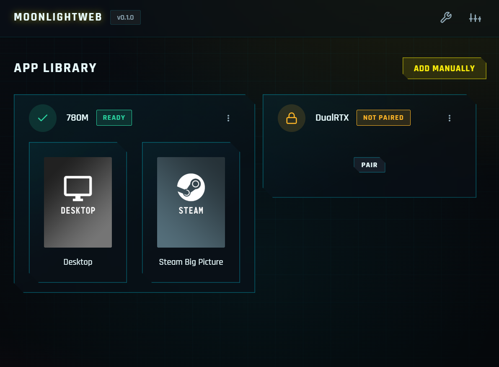
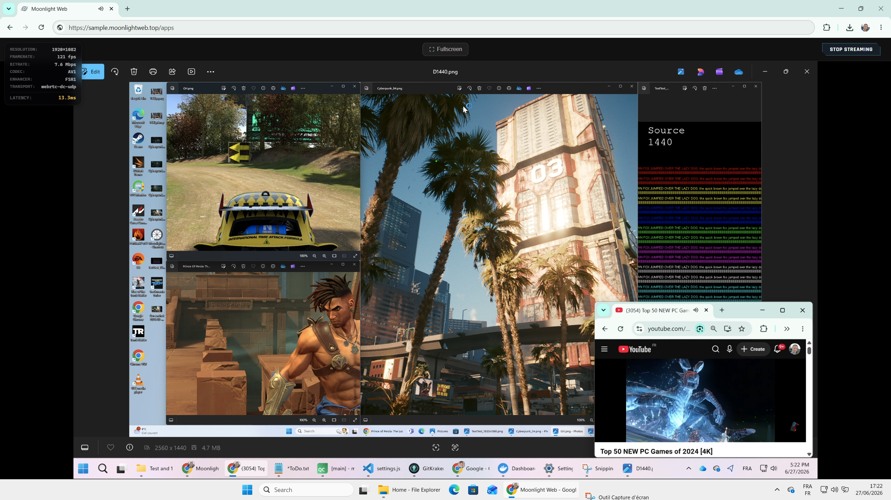
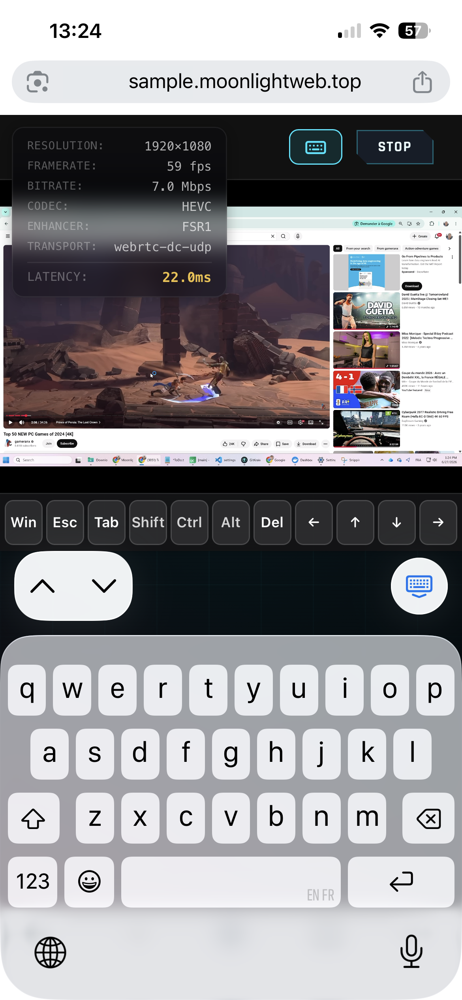
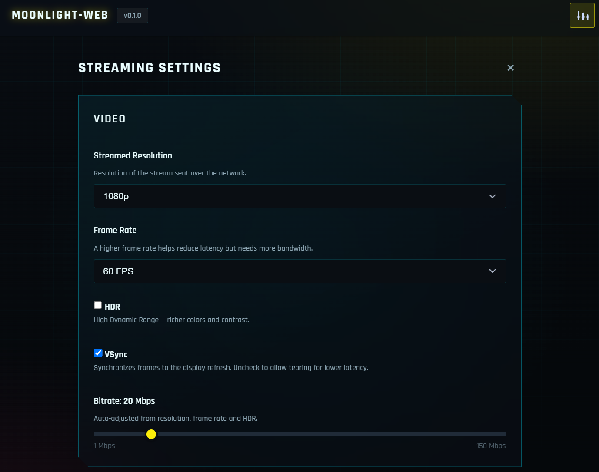
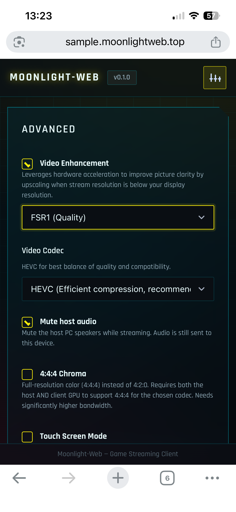
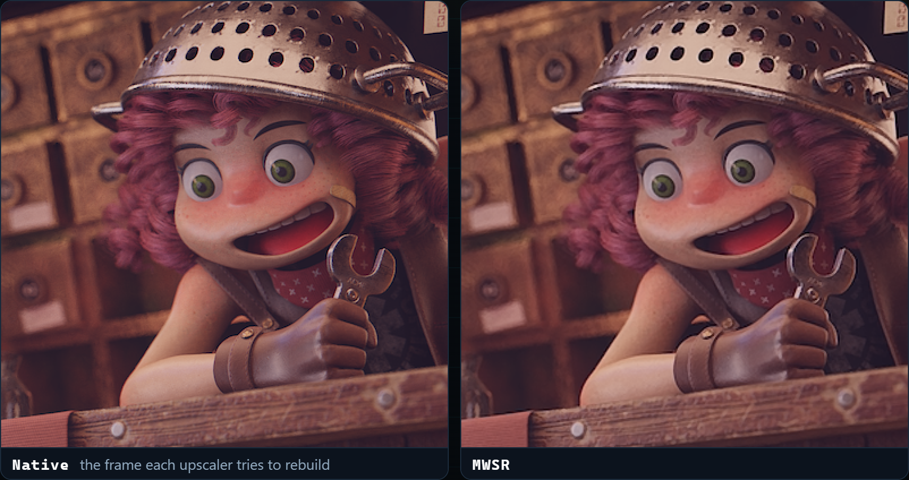
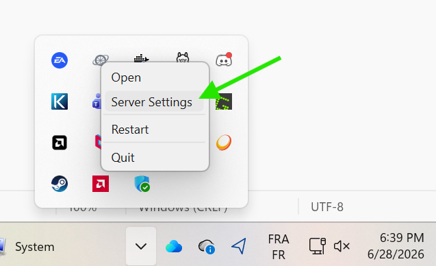
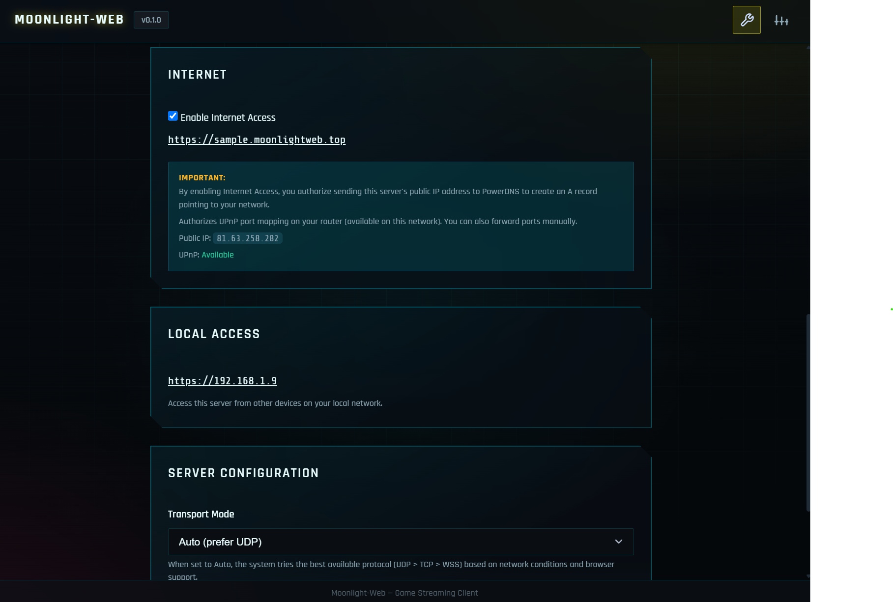

[← Home](Home.md) · **Overview** · [Next: Architecture →](02-Architecture.md)

---

# 1. Overview — MoonlightWeb from the outside

MoonlightWeb turns a gaming PC into a stream and **any device with a modern browser** (PC, Mac, tablet, phone, TV) into the client — with nothing to install on the client side. It is installed on the gaming PC itself, where it **captures and encodes that machine directly**; it is also a full GameStream client, so the Sunshine, Wolf and MultiSeat hosts on the network are paired and streamed from the same page.

Headline capabilities:

- **Its own capture & encode engine** — the machine the server runs on is a host with no pairing, no PIN and no second streaming server: one card per display. Windows, Linux and macOS (design doc: `docs/design/native-capture-encoder.md`).
- **Low-latency streaming** up to 4K HDR, 120+ FPS, with **H.264 / HEVC / AV1**, on NVENC · AMF · Quick Sync · VA-API · VideoToolbox, with a software stage when no GPU will encode.
- **WebRTC transport** (DataChannels + RTP media tracks) with automatic WSS fallback — a five-step fallback chain guarantees a connection on almost any network.
- **Opus audio** encoded on the host, decoded in the browser with an adaptive jitter buffer.
- **Full input**: keyboard, mouse (pointer-lock), touch trackpad, Xbox/PS **gamepads** with rumble, **wheels, flight sticks and RC radios** — as an Xbox pad or sent to the game as themselves, force feedback included ([§4.9](04-Frontend.md#49-wheels-and-radios-as-themselves)) — bidirectional **clipboard**.
- **Other hosts too** — Sunshine/Apollo, Wolf (Games-on-Whales) and MultiSeat, found on the LAN by mDNS or added by IP.
- **Internet access** (opt-in consent): per-session UPnP media mapping for remote streams, plus the **remote entry link** — one outgoing connection to an introduction server, which is how the instance is reached from outside without publishing anything: no DNS record, no certificate in its name, no open web port.
- **Video Enhancement**: GPU upscaling & sharpening in the browser, MoonlightWeb's own upscaler (MWSR) on WebGL2, or WebGPU in HDR and on iPhone.

## 1.1 The User's journey

### Open, click, stream

The home page opens on **this machine**, listed as `<hostname> — MoonlightWeb Host`, with one card per display. Beside it sit every GameStream host found on the LAN (mDNS) plus any manually added IP. Each host box carries its own app grid inline — an app is launched directly from its host box.

1. **This machine, straight away** — no discovery, no pairing, no PIN: the native host answers `ensurePaired()` immediately, because there are no two parties to authenticate. Its "app list" is its displays.
2. **Discovery** — the server scans the LAN via mDNS (`_nvstream._tcp`); hosts can also be added by IP.
3. **Pairing** (other hosts only) — click *Pair*, a PIN dialog appears; type that PIN into the host's web UI. Pairing uses the standard GameStream challenge-response with a generated RSA identity (see [Security](06-Security.md)). Wolf is paired without a human in the loop — MoonlightWeb posts the PIN itself.
4. **Streaming** — pick a display, an app or *Desktop*; the stream overlay opens (fullscreen with **Settings → Start streams in fullscreen**).

### The stream

Desktop and mobile get the same pipeline with adapted input:

| 🖥️ Desktop | 📱 Mobile |
|:---:|:---:|
|  |  |

- **Desktop**: pointer-lock ("gaming mode") or absolute mouse, keyboard capture (Escape is forwarded as a normal key; with `Ctrl+Alt+Shift` — `Cmd+Option+Ctrl` on a Mac — `Z` releases the mouse and leaves fullscreen, `Q` quits, `I` toggles stats, `X` fullscreen, `M` mouse mode, `S` sound off/on).
- **Mobile**: the whole screen is a **relative trackpad** — 1 finger moves the mouse, 2 fingers scroll/pinch, 3 fingers pan; taps click; a toolbar summons the virtual keyboard (input captured by diffing `input` events with a sentinel, the only reliable technique across iOS/Gboard).
- An **overlay header** exposes stats, fullscreen, settings and quit.

### Stream settings

Per-browser preferences (stored in `localStorage`, with server defaults) are edited in the Settings overlay:

| Video settings | Advanced options |
|:---:|:---:|
|  |  |

- **Bitrate** 1–150 Mbps or auto (recommendation derived from resolution/FPS/HDR), **resolution** 720p–2160p or *Native Host*, **FPS** 15–240, **codec** auto/H.264/HEVC/AV1 (unsupported options greyed out live via `VideoDecoder.isConfigSupported`), plus **PyroWave (Wired LAN only)** for a device on Ethernet streaming a native Windows host (greyed out, with the reason, where no host here codes it, the browser has neither WebGPU nor WebGL2, or HDR is ticked), **HDR**, **4:4:4 chroma**, aspect ratio, allow-tearing (on by default where the browser can tear; off = VSync pacing), performance stats, gaming mode, touch sensitivity / touch-screen mode (mobile & tablet only), and a mobile **Power Saving** mode that forces the lightest pipeline.
- Changing quality mid-stream is **seamless**: a second stream is prepared in the background and the display switches on its first frame — no loader, no reconnection (the same mechanism the automatic congestion ladder uses).
- **Video Enhancement** (GPU upscaling + sharpening): one switch, MoonlightWeb's own upscaler (MWSR) in the flavour the device runs best (WebGL2 on a computer and on Android, WebGPU on iPhone and iPad and in HDR), none on an entry-level Mali GPU:

*The opening view of the [comparison page](https://moonlightweb.top/mwsr/), where you can compare the upscalers on your own GPU: the native frame against MWSR, from a 1080p 4:2:0 input to 1440p. The picture is Blender 2.81's splash screen, by Alex Treviño and Anaïs Maamar (original concept) / Blender Cloud, [CC BY 4.0](https://creativecommons.org/licenses/by/4.0/), reduced to 2560×1440 and cropped.*

MWSR is also packaged for other programs, under the MIT License, in [`mwsr/`](../../mwsr/README.md). Each text there is generated from the module the client runs:

| System | Graphics API | Text | Checked so far |
|---|---|---|---|
| Any browser | WebGPU, WebGL2 | WGSL, GLSL ES 3.00 | MoonlightWeb's client, measured on the comparison page and on three GPUs and two phones |
| Windows | Direct3D 12, Direct3D 11 | HLSL, with the C++ header | Moonlight-qt on Windows (pull request #1557), the Direct3D 11 example on WARP |
| Linux | Vulkan, through libplacebo or mpv | a libplacebo user shader | in testing for Moonlight-qt, on Mesa's CPU Vulkan only |
| macOS | Vulkan through MoltenVK, or Metal | the same user shader, or MSL | in testing for Moonlight-qt; Metal run once on an M1 Pro |

## 1.2 The Administrator's journey

The **Admin page** (`https://localhost/admin`, also reachable from the tray icon → *Server Settings*) configures the server itself. It is **only functional from the host machine**: all `/api/admin/*` routes return 403 for non-localhost requests (a *host-key* mechanism extends this to the host's own browser when it arrives through the remote entry link, and a LAN machine — or a device on the internet, when the owner allows it — can unlock it with the admin password; see [Security](06-Security.md)).

The admin page controls:

- **Access PIN** — generate/clear the 6-digit PIN remote devices must enter once; each successful use auto-regenerates it.
- **Sessions table** — every authenticated device with IP, geolocation (city/country, only with `session_location_enabled`), last-seen, streaming flag; sessions can be renamed or revoked (revoking a streaming session kills the stream immediately).
- **Certificate authentication** — download/regenerate a token file that remote users can upload instead of typing a PIN.
- **HTTPS port** (rebinds live; the HTTP port is displayed only), **transport mode** (auto or forced), and the **Internet Access** toggle.
- **Stream notifications** — a desktop notification when someone starts or stops streaming *this* screen through the native host (server-side setting; the tray obeys it, and the tray may live in another process).
- **Instance name** — the name this install shows in the header of every browser paired with it, and in the switcher those browsers use to reach the others.
- **Give the stream priority on the network** (DSCP marking, on by default), the **remote administration** password; under **Advanced**, the **video pipeline**, debug mode and **Download logs**; on the native host, **Apps on this PC** (the cards it shows, Steam Big Picture's among them).

### Internet access

**Internet Access** is an explicit, versioned, logged consent — the master switch for being reachable from the internet. While it is on, the server:

1. **Detects the public IP** (STUN — our own server at `stream.{MW_DOMAIN}:3478` first, public ones behind it; HTTPS fallback via ipify/icanhazip), and reports CGNAT/double-NAT when it sees one.
2. **Asks the router (UPnP) for a streaming port per stream slot**, kept from one stream to the next (an invited player's is removed when they leave); every mapping is removed when MoonlightWeb quits. Withdrawing the consent keeps the next streams from announcing a public address; the ports already mapped stay until that exit. Peers connect directly, so each side of a WebRTC connection sees the other's public IP.

3. **Holds one outgoing connection to the introduction server** — the **remote entry link** — which makes the instance reachable at `https://stream.{MW_DOMAIN}/{id}` while the line is up. That server learns the host's public address and when it is online, and nothing else: the signalling it copies is signed with a key it has never seen ([Infrastructure §10.7](10-Infrastructure-Stack.md#107-the-introduction-server-mw-rendezvous)).

Nothing else is opened or published: no DNS record, no certificate, ports 80/443 stay closed.

That address is **the** address, and it is published nowhere — the admin page is where its owner reads it (there is a copy button, since it is the one thing on that page a user actually has to move to another device). It is a locator, not a credential: holding it lets nobody in, and a visitor still faces the access PIN. It never rotates either, so it can be bookmarked.

Known limitations are detected and reported in the UI: UPnP disabled (manual forwarding needed), CGNAT/double-NAT (port forwarding cannot work), port already mapped by another device. Want the web UI itself on the internet under your own name and certificate (`stream.example.com`)? See [Settings Reference §7.5](07-Settings-Reference.md#75-bring-your-own-domain--certificate).

### First-run setup

- **Windows**: the Inno Setup installer wizard collects the Internet-access consent, then drops a `provisioning.json` the server consumes on first boot (see [Installers](09-Installers-and-Packaging.md)). Since September 2026 it no longer installs Sunshine — the app hosts the machine itself.
- **macOS / Linux**: an in-app **setup wizard** (`/setup`) opens automatically on first launch and performs the same steps via `/api/setup/{status,apply}`. It asks about Sunshine **only** on a machine that cannot host itself (`status.native.possible` is the whole switch); on macOS it points at the Screen Recording permission instead — the first of the two TCC grants only the user can give, Accessibility being the other ([§9.2](09-Installers-and-Packaging.md)).

### Day-2 operations

- A **tray icon** exposes the app/admin URLs. Its entries are resolved **at the click**, which is what lets them hand out the remote entry link with a single-use host key in the fragment when the line is up, and fall back to `https://localhost:<port>` when it is not.
- A **desktop shortcut** self-heals on every startup to point at the right port. It stays on loopback deliberately: a file written down ahead of any click cannot hold a single-use key, and an address that is sometimes right is worse than one that is always plain.
- Launching the app twice never spawns a duplicate: the second launch asks the running instance to surface the admin page (single-instance lock + `/api/local/focus` + a `/ws/control` channel that redirects an already-open tab).
- An **update banner** on the hosts page polls `/api/update/check` (GitHub Releases) and links the right installer for the platform.
- Logs live in the per-user data dir (`…/MoonlightWeb/MoonlightWeb/logs/moonlightweb.log`); on Windows a crash writes a **minidump** next to them.

## 1.3 What runs where

| Piece | Runs on | Distribution |
|---|---|---|
| **MoonlightWeb server** | The gaming PC (it hosts that machine itself); or any machine on the LAN, as a front end for paired hosts | Native installers per platform |
| **Native capture engine** | Inside the server process, on the machine being streamed | Ships with the server — nothing to install or enable |
| **Web app** | The client browser | Served by the MoonlightWeb server itself |
| **Sunshine · Wolf · MultiSeat** | Any other host on the LAN, optional | Third-party; found by mDNS or added by IP, then paired |
| **Bootstrap entry page** | The client browser, for its first few kilobytes only | Served at `stream.{domain}/{id}`; it opens the tunnel and then fetches the app from the user's own machine |
| **Infrastructure stack** (introduction server, STUN, DNS, relay) | A small Linux VM with a public IP | `deploy/powerdns/` Docker stack — no media ever crosses it; a fork can run its own (see [Infrastructure Stack](10-Infrastructure-Stack.md)) |

---

[← Home](Home.md) · [Next: Architecture →](02-Architecture.md)
