[← Client Presentation Benchmarks](15-Client-Presentation-Benchmarks.md) · **Auto Bitrate Benchmarks**

---

# 16. Auto Bitrate Benchmarks — picture quality and latency against bitrate

This chapter records the measurements made in November 2026 to set the **Auto** bitrate (`computeAutoBitrate()` in `frontend/js/util/AutoBitrate.js`). Until then Auto was a single rule: 20 Mbit/s at 1920×1080, 60 fps, scaled by pixel count and frame rate (so 9 Mbit/s at 720p60), ×1.5 for HDR or 4:4:4, ×0.5 on a touch device. The question was simple: **how much bitrate does the picture actually need**, for which content, and what does a higher bitrate cost in latency?

As in [chapter 15](15-Client-Presentation-Benchmarks.md), the numbers hold for the setups described. Read them as **curves within a series**: where quality stops improving, and how fast it falls below that.

## 16.1 How things were measured

### Content

The host shows `scripts/bench/bitrate/content/bench.html`, a page that draws one of several scenes, frame by frame, at the stream's exact resolution (device pixel ratio 1, no scaling):

| Scene | What it is | Why |
|---|---|---|
| **Still** | *Junk Shop* (a detailed 3D render), shown for 3 s | the first frame (a scene change, coded with no history) and the settled picture (after the encoder has refined it) |
| **Scroll** | a captured search-results page (text and thumbnails), scrolling continuously at 0.5 screen height per second, for 5 s | the hard case for a desktop stream: fine text moving every frame |
| **Scroll / stop** | the same page, scrolling 0.5 s then stopping 0.5 s, for 6 s | the common reading pattern: the picture has to sharpen again after each move |
| **Gears** *(main bench)* | a second detailed 3D render, 3 s | a still with other textures than *Junk Shop* |
| **Web page scroll** *(main bench)* | a text-heavy web page, laid out for each stream size, scrolling like the search page, 5 s | dense small text; the page differs between sizes, so this scene compares bitrates within a combination, not across them |
| **4K photo** *(main bench, 2160p only)* | a native 3840×2160 picture, 3 s | the two renders above are 2560×1440 sources, upscaled at 2160p |

Between scenes the page shows mid grey for 1 s. Every frame carries a **barcode** in its bottom-left corner: scene id (3 bits), frame number (13 bits), 8 check bits, over a complemented row. The page advances with the clock, not with `requestAnimationFrame` (Chrome on Windows runs rAF at the primary display's rate), so frame *n* of a scene is always the same picture at the same scroll position, whatever the bitrate.

### Recording

The client is a stock MoonlightWeb page (`webrtc-dc-udp`, WebCodecs decode, Canvas2D, video worker off, Enhancer off, SDR 4:2:0). A bench-only script injected over the DevTools protocol (`tap.js`) wraps `VideoDecoder`:

- it copies **every encoded chunk** the client hands to the decoder;
- it copies a few **decoded frames** (`VideoFrame.copyTo`, the hardware decoder's own planes), every 200th frame.

The recording starts on a keyframe the client asks for **after** the bench page is on the host's screen, and stops before the page closes. Three guards keep anything else out of a recording:

1. the bench window is kept on top of every other window, without taking the focus;
2. a watch polls the host's virtual screen during the whole stream and stops the run on any other window (class and program only are logged);
3. every saved frame must carry a valid barcode, checked in the page and again offline; a run where one does not is wiped at once.

### Scoring

The recorded stream is decoded offline by ffmpeg 9.0 and every frame is matched to its reference by its barcode. The reference is the same page frame rendered from the source pictures. All rows above the barcode band are scored:

- **VMAF NEG** (`vmaf_v0.6.1neg`) with motion forced to 0: the published model saturates at 100 on a scroll, where its motion feature dominates;
- **PSNR-Y**, **SSIM**, **MS-SSIM** (luma);
- LPIPS and FLIP are left for later.

The decoded hardware frames are compared to the ffmpeg frames at the same index (see §16.7).

### Machines

| Arm | Host (encoder) | Client (decoder) |
|---|---|---|
| A | bench-desk: native host, NVENC on an RTX 5060 Ti, virtual display | UM790 Pro: Chrome 156, Radeon 780M hardware decode |
| B | UM790 Pro: release v0.4.1, AMF on the Radeon 780M, virtual display | bench-desk: Chrome 156, RTX 5060 Ti hardware decode |
| Main bench | bench-desk: native host, NVENC on an RTX 5060 Ti, virtual display | bench-desk: Chrome 156 on the same machine, hardware decode |

Arms A and B on a 1 Gbit/s cable LAN; the main bench over the machine's own network stack (the scores do not depend on the client: they come from ffmpeg's decoding of the received stream). HEVC, constant settings except the bitrate (`stream_bitrate_auto: false`).

The combinations were chosen from the anonymous usage census: 1920×1080 at 60 fps (the most used by far) and 1280×720 at 60 fps for arms A and B; the main bench (§16.6) covers ten HEVC combinations taken in order of use, plus H.264 at 1080p60 and 720p60.

## 16.2 Arm A — NVENC, 1080p60

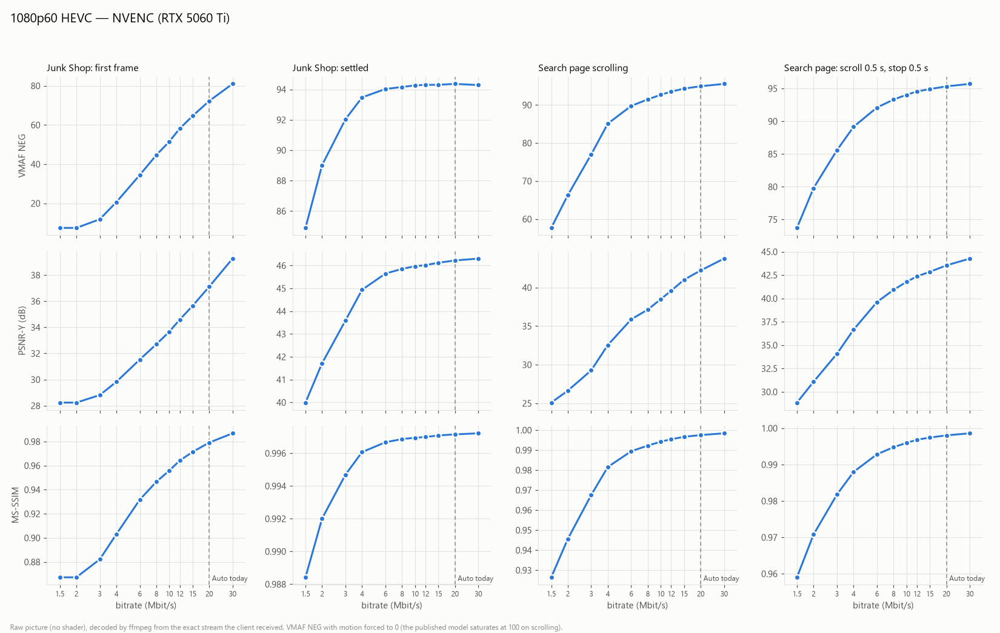

| Set (Mbit/s) | Used while scrolling (Mbit/s) | Still: first frame VMAF | Still: settled VMAF | Still: settled PSNR-Y | Scroll VMAF | Scroll PSNR-Y | Scroll MS-SSIM | Scroll/stop VMAF |
|---:|---:|---:|---:|---:|---:|---:|---:|---:|
| 1.5 | 1.02 | 7.5 | 84.9 | 39.99 | 57.7 | 25.09 | 0.9264 | 73.7 |
| 2 | 1.25 | 7.5 | 89.0 | 41.72 | 66.3 | 26.64 | 0.9456 | 79.8 |
| 3 | 1.89 | 11.9 | 92.0 | 43.59 | 77.0 | 29.27 | 0.9676 | 85.6 |
| 4 | 2.73 | 20.6 | 93.5 | 44.94 | 85.1 | 32.55 | 0.9816 | 89.2 |
| 6 | 4.02 | 34.4 | 94.0 | 45.65 | 89.7 | 35.88 | 0.9894 | 92.1 |
| 8 | 4.64 | 44.6 | 94.2 | 45.86 | 91.5 | 37.15 | 0.9923 | 93.3 |
| 10 | 5.52 | 51.5 | 94.3 | 45.97 | 92.7 | 38.48 | 0.9942 | 94.0 |
| 12 | 6.54 | 58.2 | 94.3 | 46.02 | 93.5 | 39.59 | 0.9955 | 94.5 |
| 15 | 8.02 | 64.6 | 94.3 | 46.12 | 94.3 | 41.01 | 0.9967 | 94.9 |
| 20 | 10.20 | 72.2 | 94.4 | 46.22 | 94.9 | 42.21 | 0.9975 | 95.3 |
| 30 | 14.38 | 81.0 | 94.3 | 46.31 | 95.5 | 43.75 | 0.9984 | 95.7 |

Reading:

- **Still picture:** the settled picture stops improving at **4–6 Mbit/s** (VMAF 93.5–94.0, then flat at 94.3). The first frame after a scene change is the costly one: its quality rises all the way to 30 Mbit/s, because the encoder's rate control spreads a keyframe-sized change over the frames that follow.
- **Scrolling text:** the curve rises steadily to 20 Mbit/s and keeps rising at 30 (PSNR-Y +1.5 dB). This is the content that justifies a high bitrate.
- **Scroll / stop:** in between; the picture sharpens back within the 0.5 s pauses.
- **The encoder does not use the bitrate it is given on this content.** While scrolling, NVENC spends about half the target (10.2 Mbit/s at a 20 Mbit/s target, 14.4 at 30).

## 16.3 Arm A — NVENC, 720p60

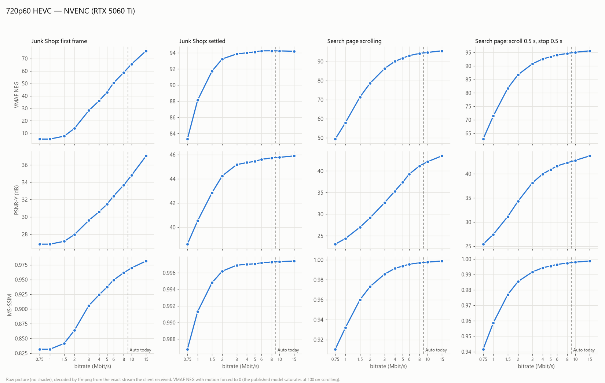

| Set (Mbit/s) | Used while scrolling (Mbit/s) | Still: first frame VMAF | Still: settled VMAF | Still: settled PSNR-Y | Scroll VMAF | Scroll PSNR-Y | Scroll MS-SSIM | Scroll/stop VMAF |
|---:|---:|---:|---:|---:|---:|---:|---:|---:|
| 0.75 | 0.47 | 5.3 | 83.3 | 38.60 | 49.3 | 23.07 | 0.9103 | 62.8 |
| 1 | 0.61 | 5.3 | 88.1 | 40.53 | 58.0 | 24.39 | 0.9321 | 71.4 |
| 1.5 | 0.93 | 7.7 | 91.7 | 42.85 | 71.3 | 26.99 | 0.9598 | 81.7 |
| 2 | 1.28 | 13.8 | 93.2 | 44.24 | 78.7 | 29.18 | 0.9732 | 86.7 |
| 3 | 1.87 | 28.2 | 93.9 | 45.17 | 86.3 | 32.66 | 0.9855 | 90.8 |
| 4 | 2.53 | 36.0 | 94.0 | 45.34 | 90.0 | 35.33 | 0.9913 | 92.6 |
| 5 | 3.09 | 42.9 | 94.1 | 45.43 | 91.8 | 37.42 | 0.9936 | 93.4 |
| 6 | 3.46 | 50.3 | 94.2 | 45.60 | 93.1 | 39.27 | 0.9954 | 94.0 |
| 8 | 3.75 | 58.8 | 94.3 | 45.72 | 94.2 | 41.17 | 0.9969 | 94.6 |
| 10 | 3.86 | 65.6 | 94.2 | 45.77 | 94.7 | 42.13 | 0.9975 | 95.1 |
| 15 | 4.03 | 76.2 | 94.2 | 45.89 | 95.6 | 43.48 | 0.9987 | 95.6 |

Reading:

- **Still picture:** settled at **3 Mbit/s** (VMAF 93.9).
- **Scrolling text:** most of the gain is reached at **6–8 Mbit/s** (VMAF 93.1–94.2); today's Auto (9 Mbit/s) sits on the plateau.
- **Above 8 Mbit/s the encoder stops spending:** 3.75 Mbit/s used while scrolling at an 8 Mbit/s target, 4.03 at 15.

## 16.4 Latency against bitrate

Arm A's setup, without `tap.js` (nothing copied in the client page). The host shows the repository's `scripts/bench/content/scroll.html?band=time` (text scrolling at 600 px/s, every frame stamped with the host clock), and the client page reads the stamp of every frame it draws (`mwContentAge`, calibrated on the host clock as in `scripts/bench/content-age/age.py`). Five bitrates per combination, two passes of 210 s each, the second in reverse order, so each pass covers a full phase cycle between the free-running displays.

- **Host capture:** the picture's age when the host captured it.
- **Decoded:** its age when the client finished decoding it.
- **Shown:** its age while it is on the client's screen, sampled at every refresh (120 Hz).

1920×1080, 60 fps:

| Set (Mbit/s) | Passes | Shown: median (ms) | Shown: p99 (ms) | Decoded: median (ms) | Host capture: median (ms) |
|---:|---:|---:|---:|---:|---:|
| 4 | 2 | 25.1 (24.7 / 25.6) | 37.0 | 15.9 | 7.0 |
| 8 | 2 | 23.2 (19.1 / 27.4) | 32.8 | 15.0 | 8.1 |
| 12 | 2 | 22.9 (24.0 / 21.8) | 32.0 | 14.9 | 9.8 |
| 20 | 2 | 22.5 (24.9 / 20.2) | 31.8 | 14.4 | 9.5 |
| 30 | 2 | 25.7 (27.2 / 24.3) | 34.7 | 17.6 | 10.9 |

1280×720, 60 fps:

| Set (Mbit/s) | Passes | Shown: median (ms) | Shown: p99 (ms) | Decoded: median (ms) | Host capture: median (ms) |
|---:|---:|---:|---:|---:|---:|
| 2 | 2 | 22.2 (18.1 / 26.4) | 31.9 | 13.9 | 7.1 |
| 4 | 2 | 23.9 (27.2 / 20.6) | 33.9 | 15.7 | 8.9 |
| 6 | 2 | 20.5 (20.5 / 20.6) | 30.9 | 11.2 | 6.8 |
| 9 | 2 | 22.9 (22.8 / 23.0) | 34.1 | 14.4 | 7.7 |
| 15 | 2 | 22.6 (22.9 / 22.2) | 33.6 | 14.0 | 7.5 |

Reading: **no effect of the bitrate on latency is measurable on a cable LAN.** The medians move by up to 8 ms between two passes at the same bitrate, more than between bitrates, and in no order. Between 2 and 30 Mbit/s, encoding, sending and decoding a larger frame costs well under a millisecond here. The bitrate matters for latency only when the link is too slow for it (for example Wi-Fi shared with other traffic), which these measurements do not cover.

## 16.5 Arm B — AMF on the Radeon 780M

The same bench in the other direction: the UM790 Pro runs the v0.4.1 release as the host (AMF), the bench-desk's Chrome is the client. Same scenes, same bitrates.

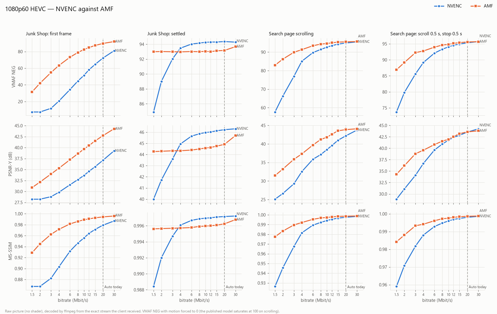

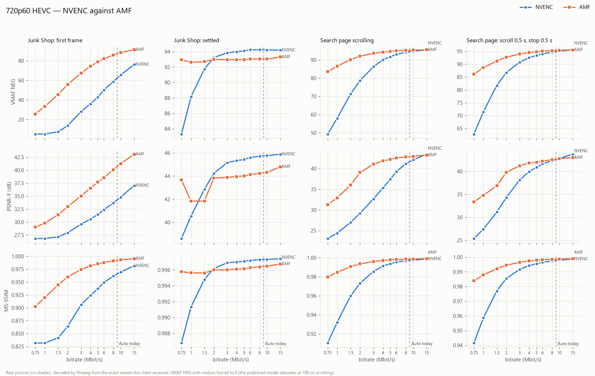

AMF, 1080p60:

| Set (Mbit/s) | Used while scrolling (Mbit/s) | Still: first frame VMAF | Still: settled VMAF | Still: settled PSNR-Y | Scroll VMAF | Scroll PSNR-Y | Scroll MS-SSIM | Scroll/stop VMAF |
|---:|---:|---:|---:|---:|---:|---:|---:|---:|
| 1.5 | 1.79 | 31.5 | 93.0 | 44.26 | 82.9 | 31.47 | 0.9775 | 86.9 |
| 2 | 2.34 | 41.9 | 93.0 | 44.29 | 86.2 | 33.24 | 0.9833 | 89.2 |
| 3 | 3.43 | 54.9 | 93.0 | 44.33 | 89.9 | 35.88 | 0.9897 | 92.2 |
| 4 | 4.45 | 63.4 | 93.0 | 44.34 | 91.3 | 37.31 | 0.9921 | 92.8 |
| 6 | 6.49 | 73.2 | 93.0 | 44.40 | 93.4 | 39.72 | 0.9954 | 94.0 |
| 8 | 8.50 | 78.9 | 93.0 | 44.50 | 94.3 | 41.22 | 0.9968 | 94.6 |
| 10 | 10.47 | 82.5 | 93.1 | 44.58 | 94.6 | 41.82 | 0.9973 | 94.8 |
| 12 | 12.48 | 84.8 | 93.0 | 44.63 | 95.1 | 42.64 | 0.9979 | 95.1 |
| 15 | 15.02 | 87.3 | 93.1 | 44.75 | 95.4 | 43.56 | 0.9984 | 95.4 |
| 20 | 16.18 | 89.7 | 93.2 | 44.91 | 95.5 | 43.88 | 0.9986 | 95.6 |
| 30 | 16.70 | 92.0 | 93.7 | 45.70 | 95.7 | 44.10 | 0.9988 | 95.7 |

AMF, 720p60:

| Set (Mbit/s) | Used while scrolling (Mbit/s) | Still: first frame VMAF | Still: settled VMAF | Still: settled PSNR-Y | Scroll VMAF | Scroll PSNR-Y | Scroll MS-SSIM | Scroll/stop VMAF |
|---:|---:|---:|---:|---:|---:|---:|---:|---:|
| 0.75 | 0.95 | 25.8 | 92.9 | 43.68 | 83.5 | 31.28 | 0.9797 | 86.1 |
| 1 | 1.24 | 33.4 | 92.6 | 41.83 | 86.6 | 32.94 | 0.9847 | 88.6 |
| 1.5 | 1.86 | 45.6 | 92.7 | 41.84 | 90.2 | 36.01 | 0.9905 | 91.2 |
| 2 | 2.24 | 55.7 | 93.0 | 43.83 | 92.1 | 39.07 | 0.9935 | 92.7 |
| 3 | 2.62 | 67.5 | 93.0 | 43.88 | 93.6 | 41.06 | 0.9960 | 94.0 |
| 4 | 2.72 | 74.4 | 93.0 | 43.96 | 94.3 | 41.85 | 0.9971 | 94.5 |
| 5 | 2.67 | 78.8 | 92.9 | 44.02 | 94.7 | 42.26 | 0.9977 | 94.8 |
| 6 | 2.82 | 82.0 | 93.0 | 44.12 | 95.0 | 42.59 | 0.9981 | 95.0 |
| 8 | 2.73 | 86.0 | 93.1 | 44.23 | 95.2 | 42.81 | 0.9985 | 95.3 |
| 10 | 2.76 | 88.3 | 93.0 | 44.32 | 95.3 | 42.96 | 0.9987 | 95.4 |
| 15 | 2.74 | 91.2 | 93.3 | 44.80 | 95.5 | 43.30 | 0.9990 | 95.6 |

**AMF spends the bitrate it is given; NVENC spends about half of it.** Plotted against the bitrate each scene actually used, the two encoders are close:

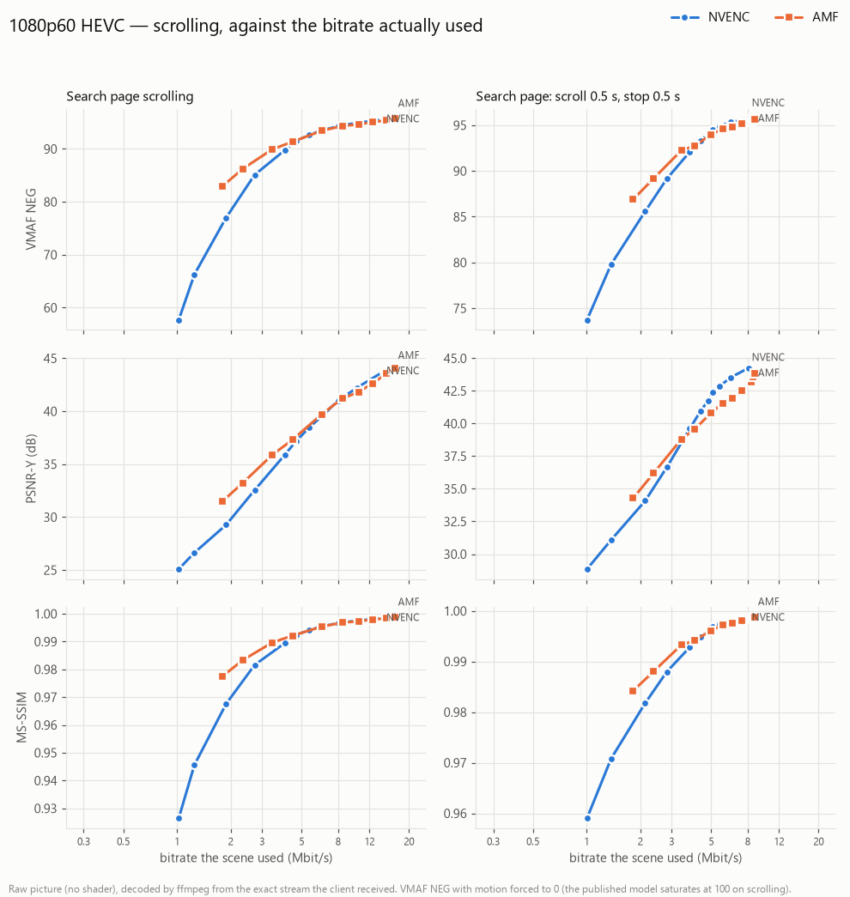

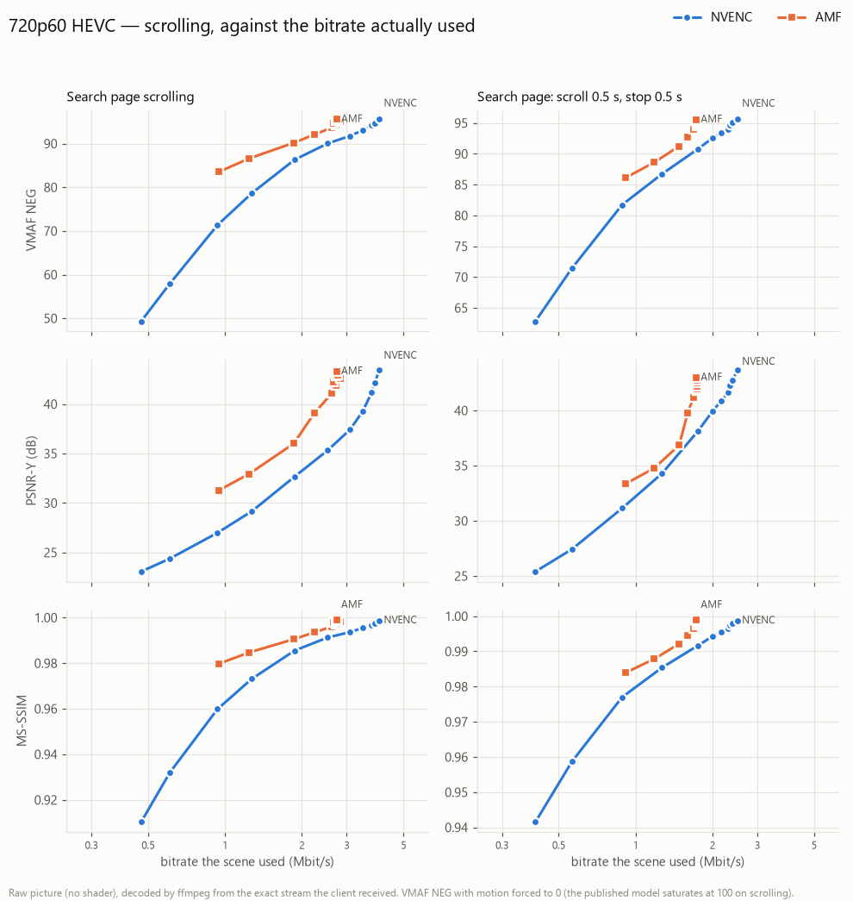

Reading:

- **1080p60:** from about 3 Mbit/s used upwards, NVENC and AMF are within about one VMAF point on the scrolling scenes; below that, AMF is ahead.
- **720p60:** AMF is ahead on the scrolling scenes at equal used bitrate, but stops spending at about 2.7 Mbit/s whatever the target (NVENC: about 4 Mbit/s).
- **Still picture:** AMF settles at VMAF 93.0 from the lowest bitrate on and stays there; NVENC goes up to 94.3. AMF's first frame after a scene change is much better at low bitrates (VMAF 31 against 8 at 1.5 Mbit/s in 1080p60).
- For the Auto rule this means that **one target bitrate does not give the same stream on every host**: the same setting costs AMF about twice what it costs NVENC.

## 16.6 Main bench — ten combinations, NVENC

The bench-desk alone (host and client on the same machine, see §16.1), the five scenes of the main bench, and for every combination **11 bitrates from ×0.075 to ×1.5 of today's Auto**, so the curves of different sizes can be laid side by side. All HEVC, NVENC.

### What each combination needs

The target bitrate (Mbit/s) at which a scene first reaches a VMAF NEG level, read on the curves (interpolated between the two measured points around it, on a log scale). For scale: today's Auto gives VMAF NEG 95.3 on the scrolling search page at 1080p60.

| Combination | Auto today | *Junk Shop* settled ≥ 93.5 | Search page scroll ≥ 93 | Search page scroll ≥ 95 | Scroll / stop ≥ 95 |
|---|---:|---:|---:|---:|---:|
| 1080p60 | 20 | 4.1 | 8.5 | 17.3 | 15.9 |
| 720p60 | 9 | 2.5 | 4.4 | 8.8 | 8.7 |
| 1366×768, 60 fps | 10 | 2.7 | 3.6 | 8.7 | 9.5 |
| 1080p120 | 40 | 7.2 | 7.4 | 16.3 | 17.6 |
| 720p30 | 4 | 1.2 | 3.8 | > 6.0 | > 6.0 |
| 1440p60 | 36 | 5.9 | 11.9 | 28.4 | 24.4 |
| 1920×1200, 60 fps | 22 | 4.3 | 7.9 | 17.1 | 18.1 |
| 1080p30 | 10 | 2.2 | 6.4 | 13.7 | 13.0 |
| 1440p120 | 71 | 11.5 | 12.1 | 23.6 | 25.6 |
| 2160p60 | 80 | 11.3 | 17.7 | 52.4 | 38.5 |

Reading:

- **The frame rate barely matters.** At 1080p, the search page reaches VMAF 95 at 13.7 Mbit/s at 30 fps, 17.3 at 60 and 16.3 at 120; at 1440p, 28.4 at 60 and 23.6 at 120. The page scrolls at the same speed in pixels per second at every frame rate, so at 120 fps each frame moves half as far and costs less. A fit over the combinations gives, for VMAF 95, *needed bitrate ∝ pixels^0.8 × fps^0.05*. Today's Auto is linear in both: it gives twice the 60 fps value at 120 fps, where nothing is gained, and half of it at 30 fps, where the picture falls short (720p30: VMAF 95 is not reached even at ×1.5 of Auto).
- **The pixel count matters less than linearly** (exponent about 0.8): 1440p60 needs 1.6 times the bitrate of 1080p60 for the same quality, not 1.78. 2160p60 lands on the same line: VMAF 95 at 52 Mbit/s, which is 17.3 × 4^0.8 (four times the pixels of 1080p60, three times the bitrate); today's Auto gives it 80.
- **Above a point, NVENC stops spending more.** While the search page scrolls, the bitrate actually used levels off at about 7.4 Mbit/s at 1440p60 from a set 18 Mbit/s, and at about 13 Mbit/s at 2160p60 from a set 24 Mbit/s, while VMAF still creeps up by about one point to the highest setting. At these sizes VMAF 95 lies on that flat part, so the set bitrate it needs (28 and 52 Mbit/s) says more about the encoder's rate control than about the picture. 1080p60 does not level off within the range measured (12.9 Mbit/s used at a set 30). The cause is the host's QP floor (next section).
- **Still pictures are cheap.** A settled still reaches its plateau at 1–12 Mbit/s depending on the combination, well below any scrolling scene. The first frame after a scene change is the exception: its quality rises with the bitrate all the way up, but it lasts a few frames (three to four at today's Auto in 1080p60).
- **The web page scene** is laid out for each size and is not comparable across combinations; at 1080p60 it is the hardest content measured (VMAF 90 at 16 Mbit/s).
- These are NVENC figures. AMF spends the whole target (§16.5), so the same target costs an AMF host about twice the bandwidth for a similar picture.

### The QP floor

The native host gives NVENC a quantizer floor: QP 18 for HEVC and H.264, qindex 32 for AV1 (`backend/native-host/src/encode/windows/NvencConfig.cpp`). It was added so that a still screen is not refined over and over with the whole budget: a page of text with a spinner went from 7.7 to 1.0 Mbit/s at 1080p60 and 20 Mbit/s. It was measured then at 1080p60, where scrolling stays well above QP 18. At 1440p and 2160p, a scrolling page at these bitrates would go below it, so the floor is where the encoder stops.

To check, six points of the main bench were run again with the floor removed (`MW_NATIVE_TUNING=nvminqp=-1`), same scenes and same bench, on 7 November 2026:

| Combination | Set (Mbit/s) | Used while scrolling, floor → none (Mbit/s) | Search page scroll | Web page scroll | Junk Shop: settled | Search page scroll PSNR-Y |
|---|---:|---:|---:|---:|---:|---:|
| 1440p60 | 18 | 7.29 → 10.80 | 94.4 → 94.8 | 93.5 → 94.1 | 94.3 → 95.8 | 43.60 → 46.59 |
| 1440p60 | 27 | 7.42 → 15.92 | 94.9 → 95.7 | 94.6 → 95.4 | 94.4 → 96.2 | 44.08 → 49.78 |
| 1440p60 | 36 | 7.54 → 19.93 | 95.3 → 96.2 | 95.0 → 96.0 | 94.3 → 96.4 | 44.45 → 52.05 |
| 1440p60 | 54 | 7.38 → 25.66 | 95.5 → 96.5 | 95.4 → 96.5 | 94.4 → 96.6 | 44.77 → 53.91 |
| 2160p60 | 48 | 12.66 → 26.22 | 94.9 → 95.9 | 94.8 → 95.4 | 94.4 → 96.2 | 45.51 → 50.92 |
| 2160p60 | 80 | 12.99 → 36.24 | 95.5 → 96.4 | 95.4 → 96.2 | 94.4 → 96.5 | 46.13 → 53.82 |

VMAF NEG unless stated.

- **The floor is the plateau.** Without it, the bitrate used follows the setting, and every scene gains 0.4 to 2.2 points of VMAF NEG. Still pictures gain the most (Junk Shop settles at 96 instead of 94.4), as the floor was designed to cut exactly that refinement.
- **The gain costs about three times the bitrate.** At 1440p60, the picture without the floor at a set 18 Mbit/s is about the one with the floor at 54 (search page 94.8 against 95.5, web page 94.1 against 95.4), for 10.8 Mbit/s used instead of 7.4.
- **The floor stays** (decision of 7 November 2026): VMAF NEG 95 against 96 is a small difference for three times the bandwidth, and the floor keeps still screens cheap. The Auto rule is computed with it. With the floor, a set bitrate above the plateau is not spent while scrolling; it still feeds the first frames after a scene change and the size of the encoder's buffer.

### Per combination

### 1080p60

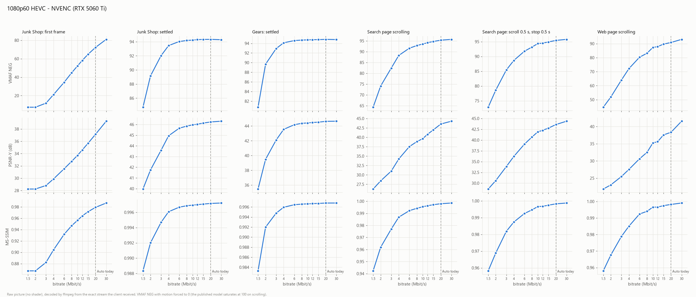

Table

VMAF NEG unless stated.

| Set (Mbit/s) | Used while scrolling (Mbit/s) | Junk Shop: first frame | Junk Shop: settled | Gears: settled | Search page scroll | Scroll/stop | Web page scroll | Search page scroll PSNR-Y |
|---:|---:|---:|---:|---:|---:|---:|---:|---:|
| 1.5 | 0.93 | 7.5 | 84.7 | 80.7 | 64.3 | 72.8 | 44.6 | 26.24 |
| 2 | 1.22 | 7.4 | 89.2 | 89.7 | 74.1 | 78.6 | 51.9 | 28.41 |
| 3 | 1.63 | 11.9 | 92.0 | 92.9 | 82.4 | 85.4 | 64.0 | 31.01 |
| 4 | 2.29 | 21.1 | 93.5 | 94.1 | 88.2 | 88.7 | 72.2 | 34.23 |
| 6 | 3.56 | 34.4 | 94.0 | 94.6 | 91.6 | 91.8 | 80.3 | 37.53 |
| 8 | 4.33 | 44.8 | 94.2 | 94.7 | 92.8 | 93.2 | 83.2 | 38.85 |
| 10 | 4.71 | 52.1 | 94.2 | 94.7 | 93.5 | 94.3 | 87.3 | 39.64 |
| 12 | 5.67 | 58.2 | 94.3 | 94.8 | 94.1 | 94.5 | 87.9 | 40.79 |
| 15 | 6.96 | 64.9 | 94.3 | 94.8 | 94.7 | 94.9 | 89.7 | 41.98 |
| 20 | 9.36 | 72.3 | 94.3 | 94.8 | 95.3 | 95.4 | 90.8 | 43.53 |
| 30 | 12.91 | 81.0 | 94.3 | 94.8 | 95.7 | 95.8 | 93.1 | 44.28 |

### 720p60

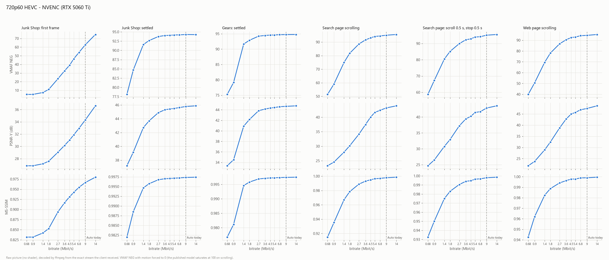

Table

VMAF NEG unless stated.

| Set (Mbit/s) | Used while scrolling (Mbit/s) | Junk Shop: first frame | Junk Shop: settled | Gears: settled | Search page scroll | Scroll/stop | Web page scroll | Search page scroll PSNR-Y |
|---:|---:|---:|---:|---:|---:|---:|---:|---:|
| 0.68 | 0.39 | 5.3 | 78.1 | 75.3 | 51.4 | 58.7 | 39.9 | 23.27 |
| 0.9 | 0.50 | 5.3 | 84.7 | 79.2 | 59.1 | 67.3 | 50.6 | 24.54 |
| 1.4 | 0.83 | 7.5 | 91.6 | 91.6 | 74.9 | 80.4 | 69.5 | 27.95 |
| 1.8 | 1.08 | 11.1 | 92.6 | 92.9 | 81.8 | 85.1 | 78.1 | 30.16 |
| 2.7 | 1.58 | 23.4 | 93.7 | 94.2 | 88.6 | 89.9 | 86.7 | 34.16 |
| 3.6 | 2.15 | 32.5 | 94.0 | 94.4 | 91.6 | 92.3 | 90.4 | 37.46 |
| 4.5 | 2.63 | 39.0 | 94.1 | 94.6 | 93.1 | 92.9 | 92.5 | 40.02 |
| 5.4 | 2.87 | 46.4 | 94.2 | 94.6 | 94.1 | 94.0 | 92.9 | 41.64 |
| 6.8 | 2.96 | 53.9 | 94.2 | 94.7 | 94.5 | 94.2 | 94.2 | 42.38 |
| 9 | 3.02 | 62.8 | 94.3 | 94.7 | 95.0 | 95.1 | 94.5 | 43.21 |
| 14 | 3.07 | 74.6 | 94.3 | 94.8 | 95.6 | 95.5 | 95.3 | 43.93 |

### 1366×768, 60 fps

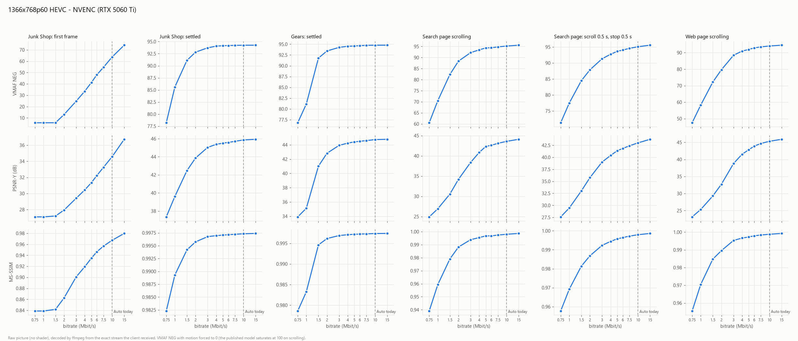

Table

VMAF NEG unless stated.

| Set (Mbit/s) | Used while scrolling (Mbit/s) | Junk Shop: first frame | Junk Shop: settled | Gears: settled | Search page scroll | Scroll/stop | Web page scroll | Search page scroll PSNR-Y |
|---:|---:|---:|---:|---:|---:|---:|---:|---:|
| 0.75 | 0.49 | 5.8 | 78.2 | 76.8 | 60.5 | 71.3 | 47.5 | 24.91 |
| 1 | 0.66 | 5.8 | 85.6 | 81.1 | 70.5 | 77.5 | 58.2 | 26.92 |
| 1.5 | 1.01 | 5.8 | 91.1 | 91.8 | 82.3 | 84.5 | 72.2 | 30.55 |
| 2 | 1.43 | 13.0 | 92.8 | 93.4 | 88.4 | 87.9 | 79.7 | 34.20 |
| 3 | 2.16 | 24.8 | 93.7 | 94.3 | 92.2 | 91.3 | 88.4 | 38.36 |
| 4 | 2.60 | 33.6 | 94.1 | 94.5 | 93.5 | 92.7 | 91.0 | 40.83 |
| 5 | 2.79 | 41.3 | 94.1 | 94.6 | 94.3 | 93.6 | 92.0 | 42.32 |
| 6 | 2.91 | 48.1 | 94.2 | 94.7 | 94.4 | 94.0 | 92.9 | 42.60 |
| 7.5 | 2.94 | 54.7 | 94.2 | 94.7 | 94.8 | 94.6 | 93.5 | 43.09 |
| 10 | 2.96 | 63.7 | 94.3 | 94.8 | 95.2 | 95.1 | 94.0 | 43.58 |
| 15 | 2.97 | 74.1 | 94.3 | 94.8 | 95.6 | 95.6 | 94.5 | 44.08 |

### 1080p120

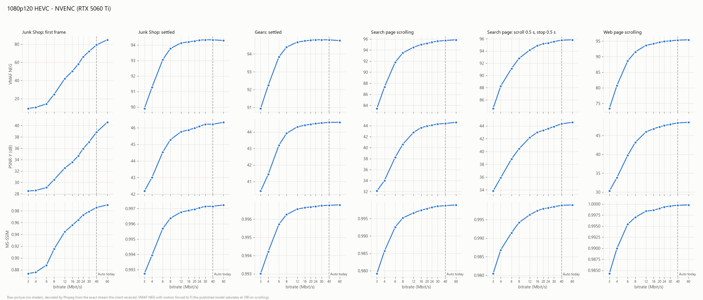

Table

VMAF NEG unless stated.

| Set (Mbit/s) | Used while scrolling (Mbit/s) | Junk Shop: first frame | Junk Shop: settled | Gears: settled | Search page scroll | Scroll/stop | Web page scroll | Search page scroll PSNR-Y |
|---:|---:|---:|---:|---:|---:|---:|---:|---:|
| 3 | 2.32 | 9.1 | 89.9 | 90.9 | 83.4 | 84.6 | 73.4 | 32.09 |
| 4 | 2.71 | 10.5 | 91.3 | 92.2 | 87.3 | 88.2 | 80.8 | 34.02 |
| 6 | 3.97 | 14.2 | 93.0 | 93.8 | 91.8 | 91.1 | 88.6 | 38.25 |
| 8 | 4.79 | 24.7 | 93.8 | 94.4 | 93.5 | 92.8 | 91.5 | 40.61 |
| 12 | 5.90 | 42.0 | 94.1 | 94.7 | 94.5 | 94.2 | 93.6 | 42.78 |
| 16 | 6.25 | 50.3 | 94.2 | 94.7 | 95.0 | 94.9 | 94.1 | 43.65 |
| 20 | 6.26 | 58.0 | 94.3 | 94.8 | 95.2 | 95.2 | 94.6 | 43.92 |
| 24 | 6.26 | 65.9 | 94.3 | 94.8 | 95.4 | 95.3 | 94.9 | 44.09 |
| 30 | 6.26 | 72.0 | 94.3 | 94.8 | 95.6 | 95.5 | 95.1 | 44.31 |
| 40 | 6.24 | 79.2 | 94.3 | 94.8 | 95.7 | 95.8 | 95.3 | 44.41 |
| 60 | 6.25 | 84.8 | 94.3 | 94.8 | 95.9 | 95.8 | 95.4 | 44.62 |

### 720p30

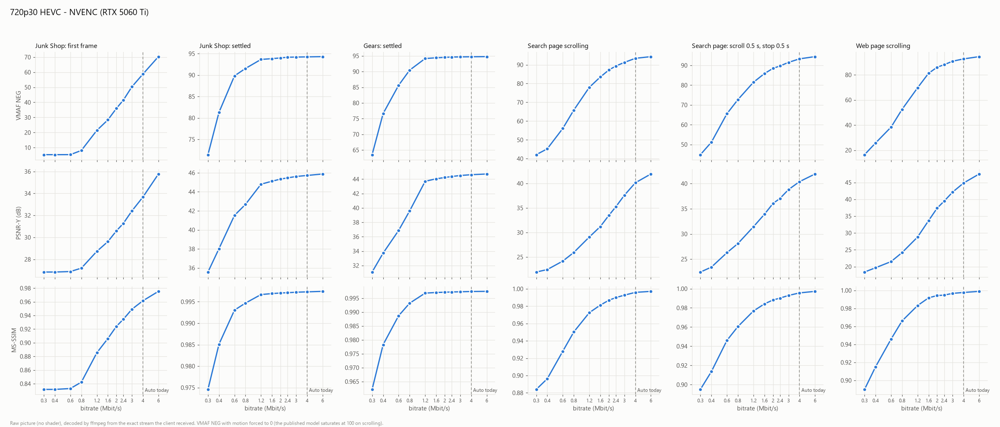

Table

VMAF NEG unless stated.

| Set (Mbit/s) | Used while scrolling (Mbit/s) | Junk Shop: first frame | Junk Shop: settled | Gears: settled | Search page scroll | Scroll/stop | Web page scroll | Search page scroll PSNR-Y |
|---:|---:|---:|---:|---:|---:|---:|---:|---:|
| 0.3 | 0.18 | 5.3 | 71.4 | 63.5 | 42.1 | 44.9 | 16.4 | 21.94 |
| 0.4 | 0.25 | 5.3 | 81.3 | 76.6 | 45.2 | 51.2 | 25.7 | 22.45 |
| 0.6 | 0.39 | 5.3 | 89.8 | 85.6 | 56.1 | 65.5 | 38.4 | 24.17 |
| 0.8 | 0.54 | 8.1 | 91.5 | 90.4 | 65.9 | 72.7 | 52.5 | 25.93 |
| 1.2 | 0.80 | 21.4 | 93.7 | 94.2 | 78.0 | 81.5 | 69.7 | 29.07 |
| 1.6 | 1.04 | 28.4 | 93.8 | 94.4 | 83.5 | 85.9 | 81.3 | 31.20 |
| 2 | 1.30 | 36.0 | 94.0 | 94.5 | 87.2 | 88.5 | 86.0 | 33.48 |
| 2.4 | 1.52 | 41.5 | 94.2 | 94.6 | 89.3 | 89.7 | 88.1 | 35.24 |
| 3 | 1.93 | 50.3 | 94.2 | 94.7 | 91.3 | 91.5 | 90.9 | 37.58 |
| 4 | 2.27 | 58.8 | 94.3 | 94.7 | 93.4 | 93.3 | 92.7 | 40.13 |
| 6 | 2.44 | 70.3 | 94.3 | 94.8 | 94.3 | 94.4 | 94.5 | 41.92 |

### 1440p60

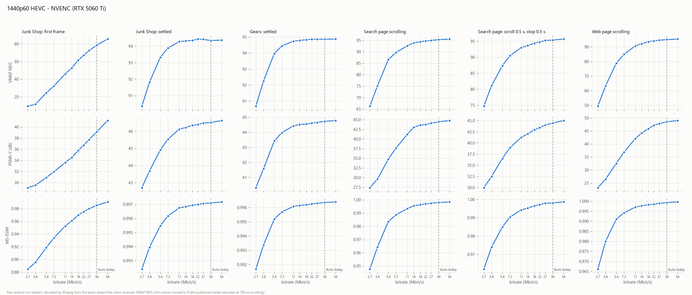

Table

VMAF NEG unless stated.

| Set (Mbit/s) | Used while scrolling (Mbit/s) | Junk Shop: first frame | Junk Shop: settled | Gears: settled | Search page scroll | Scroll/stop | Web page scroll | Search page scroll PSNR-Y |
|---:|---:|---:|---:|---:|---:|---:|---:|---:|
| 2.7 | 1.66 | 9.4 | 90.4 | 90.7 | 66.2 | 74.7 | 49.4 | 27.39 |
| 3.6 | 2.29 | 11.6 | 91.8 | 92.3 | 75.2 | 81.1 | 63.3 | 29.62 |
| 5.4 | 3.63 | 24.5 | 93.3 | 94.0 | 86.6 | 87.4 | 78.9 | 34.78 |
| 7.2 | 4.90 | 32.2 | 93.9 | 94.4 | 89.7 | 90.5 | 85.0 | 37.62 |
| 11 | 6.46 | 46.0 | 94.3 | 94.7 | 92.6 | 93.0 | 90.7 | 41.18 |
| 14 | 6.99 | 52.7 | 94.3 | 94.8 | 93.9 | 93.7 | 92.3 | 43.03 |
| 18 | 7.29 | 61.5 | 94.3 | 94.8 | 94.4 | 94.4 | 93.5 | 43.60 |
| 22 | 7.43 | 67.2 | 94.4 | 94.9 | 94.7 | 94.8 | 94.2 | 43.73 |
| 27 | 7.42 | 72.3 | 94.4 | 94.9 | 94.9 | 95.2 | 94.6 | 44.08 |
| 36 | 7.54 | 78.5 | 94.3 | 94.9 | 95.3 | 95.4 | 95.0 | 44.45 |
| 54 | 7.38 | 85.4 | 94.4 | 94.9 | 95.5 | 95.7 | 95.4 | 44.77 |

### 1920×1200, 60 fps

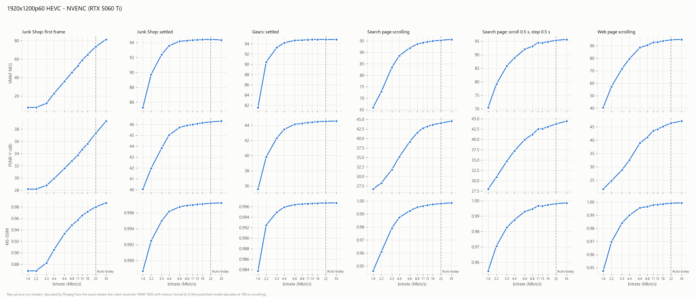

Table

VMAF NEG unless stated.

| Set (Mbit/s) | Used while scrolling (Mbit/s) | Junk Shop: first frame | Junk Shop: settled | Gears: settled | Search page scroll | Scroll/stop | Web page scroll | Search page scroll PSNR-Y |
|---:|---:|---:|---:|---:|---:|---:|---:|---:|
| 1.6 | 1.12 | 7.7 | 85.3 | 81.6 | 66.0 | 70.5 | 40.6 | 26.67 |
| 2.2 | 1.43 | 7.7 | 89.7 | 90.5 | 72.9 | 79.1 | 57.2 | 28.28 |
| 3.3 | 2.14 | 12.2 | 92.4 | 93.3 | 83.4 | 85.9 | 71.5 | 31.78 |
| 4.4 | 2.98 | 22.8 | 93.6 | 94.2 | 88.5 | 88.8 | 79.6 | 35.15 |
| 6.6 | 4.45 | 35.9 | 94.2 | 94.7 | 91.9 | 92.0 | 88.5 | 39.14 |
| 8.8 | 5.24 | 45.6 | 94.3 | 94.7 | 93.6 | 93.1 | 90.5 | 41.51 |
| 11 | 5.73 | 52.6 | 94.3 | 94.8 | 94.2 | 94.4 | 92.6 | 42.71 |
| 13 | 5.86 | 58.8 | 94.4 | 94.8 | 94.5 | 94.4 | 93.0 | 43.13 |
| 16 | 5.98 | 64.7 | 94.4 | 94.9 | 94.9 | 94.8 | 93.8 | 43.63 |
| 22 | 6.03 | 73.5 | 94.4 | 94.9 | 95.3 | 95.3 | 94.7 | 44.04 |
| 33 | 6.08 | 81.4 | 94.4 | 94.8 | 95.6 | 95.7 | 95.1 | 44.55 |

### 1080p30

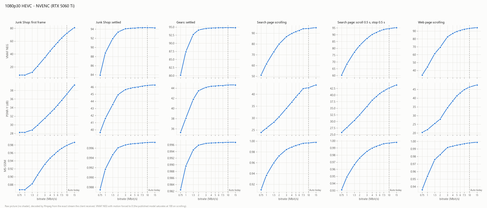

Table

VMAF NEG unless stated.

| Set (Mbit/s) | Used while scrolling (Mbit/s) | Junk Shop: first frame | Junk Shop: settled | Gears: settled | Search page scroll | Scroll/stop | Web page scroll | Search page scroll PSNR-Y |
|---:|---:|---:|---:|---:|---:|---:|---:|---:|
| 0.75 | 0.52 | 7.5 | 83.9 | 80.2 | 51.1 | 60.3 | 34.1 | 24.00 |
| 1 | 0.72 | 7.4 | 88.8 | 87.4 | 61.4 | 68.4 | 44.5 | 25.78 |
| 1.5 | 1.08 | 11.9 | 91.9 | 92.7 | 72.7 | 77.1 | 61.4 | 28.22 |
| 2 | 1.46 | 21.1 | 93.4 | 94.1 | 79.9 | 82.0 | 69.1 | 30.47 |
| 3 | 2.21 | 34.4 | 94.1 | 94.6 | 86.8 | 87.3 | 82.6 | 34.06 |
| 4 | 2.96 | 44.8 | 94.2 | 94.7 | 89.7 | 90.2 | 86.9 | 36.67 |
| 5 | 3.65 | 52.1 | 94.2 | 94.7 | 91.4 | 91.7 | 89.5 | 38.78 |
| 6 | 4.11 | 58.2 | 94.3 | 94.8 | 92.6 | 92.8 | 90.8 | 40.37 |
| 7.5 | 4.50 | 64.9 | 94.3 | 94.8 | 94.1 | 93.9 | 92.2 | 42.34 |
| 10 | 4.65 | 72.3 | 94.3 | 94.8 | 94.3 | 94.5 | 93.3 | 42.72 |
| 15 | 4.82 | 81.0 | 94.3 | 94.8 | 95.2 | 95.3 | 94.4 | 43.89 |

### 1440p120

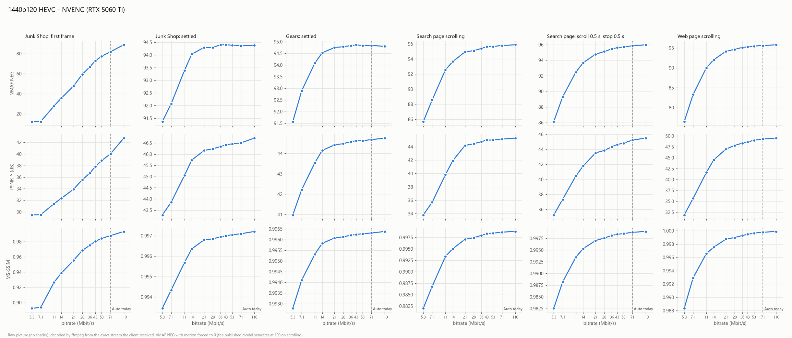

Table

VMAF NEG unless stated.

| Set (Mbit/s) | Used while scrolling (Mbit/s) | Junk Shop: first frame | Junk Shop: settled | Gears: settled | Search page scroll | Scroll/stop | Web page scroll | Search page scroll PSNR-Y |
|---:|---:|---:|---:|---:|---:|---:|---:|---:|
| 5.3 | 3.53 | 12.2 | 91.4 | 91.6 | 85.7 | 86.1 | 76.5 | 33.80 |
| 7.1 | 4.17 | 12.3 | 92.1 | 92.9 | 88.5 | 89.3 | 83.3 | 35.69 |
| 11 | 5.93 | 27.8 | 93.4 | 94.1 | 92.5 | 92.5 | 90.0 | 39.82 |
| 14 | 7.38 | 35.6 | 94.0 | 94.5 | 93.6 | 93.7 | 92.0 | 41.90 |
| 21 | 8.56 | 47.7 | 94.3 | 94.7 | 94.9 | 94.8 | 94.2 | 44.19 |
| 28 | 8.69 | 59.4 | 94.3 | 94.8 | 95.1 | 95.1 | 94.6 | 44.45 |
| 36 | 8.64 | 66.8 | 94.4 | 94.8 | 95.4 | 95.5 | 95.1 | 44.74 |
| 43 | 8.79 | 72.8 | 94.4 | 94.9 | 95.6 | 95.6 | 95.2 | 45.00 |
| 53 | 8.68 | 77.4 | 94.4 | 94.8 | 95.6 | 95.7 | 95.5 | 44.99 |
| 71 | 8.65 | 81.9 | 94.4 | 94.8 | 95.8 | 95.9 | 95.6 | 45.14 |
| 110 | 8.92 | 88.8 | 94.4 | 94.8 | 95.9 | 96.0 | 95.8 | 45.28 |

### 2160p60

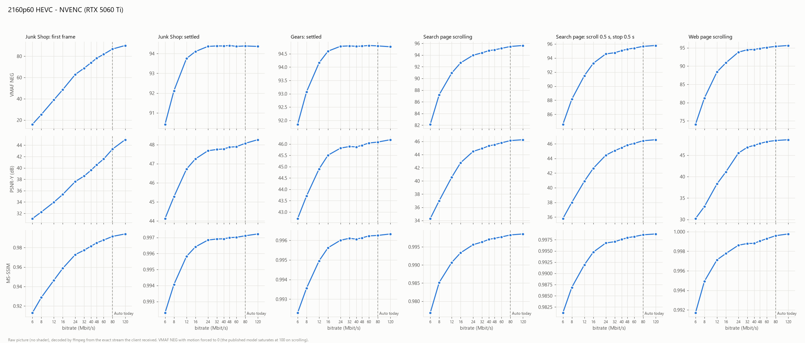

Table

VMAF NEG unless stated.

| Set (Mbit/s) | Used while scrolling (Mbit/s) | Junk Shop: first frame | Junk Shop: settled | Gears: settled | 4K photo: settled | Search page scroll | Scroll/stop | Web page scroll | Search page scroll PSNR-Y |
|---:|---:|---:|---:|---:|---:|---:|---:|---:|---:|
| 6 | 4.37 | 16.0 | 90.4 | 91.9 | 91.0 | 82.1 | 84.6 | 74.1 | 34.29 |
| 8 | 5.79 | 25.2 | 92.1 | 93.1 | 92.7 | 87.2 | 88.1 | 81.2 | 36.99 |
| 12 | 8.46 | 38.9 | 93.8 | 94.2 | 93.9 | 90.9 | 91.5 | 88.4 | 40.56 |
| 16 | 10.39 | 48.6 | 94.1 | 94.6 | 94.3 | 92.7 | 93.3 | 90.9 | 42.77 |
| 24 | 11.97 | 62.9 | 94.4 | 94.8 | 94.4 | 94.0 | 94.6 | 93.8 | 44.48 |
| 32 | 12.41 | 68.8 | 94.4 | 94.8 | 94.5 | 94.4 | 94.8 | 94.5 | 44.93 |
| 40 | 12.70 | 73.9 | 94.4 | 94.8 | 94.5 | 94.8 | 95.1 | 94.5 | 45.32 |
| 48 | 12.66 | 78.2 | 94.4 | 94.8 | 94.5 | 94.9 | 95.3 | 94.8 | 45.51 |
| 60 | 12.88 | 81.8 | 94.4 | 94.8 | 94.5 | 95.1 | 95.4 | 95.1 | 45.79 |
| 80 | 12.99 | 86.8 | 94.4 | 94.8 | 94.5 | 95.5 | 95.7 | 95.4 | 46.13 |
| 120 | 13.04 | 90.1 | 94.4 | 94.8 | 94.5 | 95.6 | 95.8 | 95.6 | 46.26 |

### H.264, 4:4:4 and HDR

The same bench, scenes and bitrates as HEVC 1080p60 (and 720p60 for H.264), NVENC, on 7 November 2026; the client page asks for H.264, for 4:4:4 or for HDR instead of its SDR 4:2:0 HEVC. A 4:4:4 stream is scored against a 4:4:4 reference: VMAF NEG on luma, plus PSNR on each chroma plane and libvmaf's CIEDE2000. An HDR stream is scored against the same page as the host's HDR desktop composes it (BT.2020 PQ, 10 bits, the page at the host's SDR white level): VMAF NEG and PSNR-Y on 10 bits, plus ΔE ITP (ITU-R BT.2124).

The target (Mbit/s) at which a scene first reaches a VMAF NEG level, read as in *What each combination needs*, and its ratio to HEVC 4:2:0 SDR at the same size:

| Stream | Search page scroll ≥ 93 | Search page scroll ≥ 95 | Web page scroll ≥ 93 |
|---|---:|---:|---:|
| HEVC 4:2:0 SDR, 1080p60 | 8.5 | 17.3 | 29.7 |
| H.264, 1080p60 | 9.1 (×1.07) | 17.6 (×1.02) | 14.0 (×0.47) |
| HEVC 4:4:4, 1080p60 | 7.8 (×0.92) | 16.8 (×0.97) | > 30 (93.0 at 30) |
| HEVC HDR, 1080p60 | 6.6 (×0.77) | > 30 (94.95 at 30) | 29.8 (×1.01) |
| HEVC 4:2:0 SDR, 720p60 | 4.4 | 8.8 | 5.5 |
| H.264, 720p60 | 4.1 (×0.93) | 7.8 (×0.88) | 6.0 (×1.09) |

The bitrate actually used while the search page scrolls (Mbit/s), 1080p60:

| Set | HEVC 4:2:0 | H.264 | HEVC 4:4:4 | HEVC HDR |
|---:|---:|---:|---:|---:|
| 10 | 4.7 | 8.1 | 4.1 | 4.1 |
| 15 | 7.0 | 12.3 | 5.1 | 4.7 |
| 30 | 12.9 | 18.8 | 6.2 | 5.4 |

Reading:

- **H.264 needs what HEVC needs** at these sizes: within 12 % either way on the search page, and better on the web page at 1080p60. It spends more of the target to get there (8.1 Mbit/s used at a set 10, against 4.7), but the Auto rule sets the target, not the bitrate used.
- **4:4:4 costs nothing more.** Its luma reaches each level at the same target or slightly below, and its chroma follows its luma: PSNR-Cb 40.3 dB and CIEDE2000 40.2 at a set 10 Mbit/s (a mean ΔE2000 of about 1.7, under the usual threshold of a visible difference), 44.0 and 43.8 at 30. The full chroma of text and flat colours is cheap to code, and the QP floor stops a 4:4:4 stream well short of the target (6.2 Mbit/s used at a set 30).
- **And 4:4:4 delivers its colour at that bitrate.** Scored against the same 4:4:4 reference, a 4:2:0 stream's chroma stops at PSNR-Cb 35.5 dB at a set 10 Mbit/s and 36.5 at 30 (CIEDE2000 37.1 and 39.6, a mean ΔE2000 of about 2.5 and 1.9), where 4:4:4 has 40.3 and 40.2 at 10: 4:4:4 at 8 Mbit/s already gives the colour 4:2:0 does not reach at 30. Below 3 Mbit/s the two are alike (4:2:0 slightly ahead at 1.5 and 2).
- **The HDR desktop costs nothing more either**, but it is not an HDR game. Its curves bend where SDR's do, and the stills settle about 1.3 points of VMAF NEG lower (*Junk Shop* 92.9 against 94.3), flat from 8 to 30 Mbit/s while PSNR-Y is higher than in SDR (48.3 against 46.3 dB): an offset between the reference and what the host composes, not a coding loss, which is also why VMAF NEG 95 is never reached. ΔE ITP falls from 19.2 at 1.5 Mbit/s to 9.2 at 6, 7.8 at 10, 7.2 at 15 and 6.8 at 30, the same bend. What was measured is SDR content shown in HDR mode, which uses only the lower part of the PQ range; a game with real highlights was not measured.

### HDR with highlights

The desktop measured above uses only the lower part of the PQ range. On 12 November 2026 the same bench (HEVC 1080p60, NVENC, 11 bitrates) streamed scenes with real highlights, and the same renders in SDR 4:2:0 for comparison, picture for picture:

- **Content:** the *Junk Shop* and *Gears* renders, drawn by the page into an extended-range WebGPU canvas (`rgba16float`), still (scenes 1 and 4) and scrolling as one tall picture (scene 2, and scene 3 with 30-frame pauses). Highlights by a fixed formula: where the luma Y is over 0.6, the light is multiplied by 1 + 2·((Y − 0.6)/0.4)², so the brightest parts reach 3× the SDR white level (720 nits at the host's 240).
- **Calibration:** Chrome puts the extended canvas's 1.0 at 86 nits, so the page scales its light by 2.783 to put 1.0 on the desktop's SDR white. A calibration scene of known bands is read back from every HDR stream: all bands are carried to 5× (1200 nits) within ±1.5 %.
- **Scoring:** the HDR streams against the same formula applied to the renders (BT.2020 PQ, 10 bits), the SDR streams against the renders; VMAF NEG, PSNR-Y, and ΔE ITP for HDR. The middle 512 columns are left out of both scores (a system dialog covered them on the host's screen during the HDR runs).

The target (Mbit/s) at which a scene first reaches VMAF NEG 93, and the HDR / SDR ratio:

| Scene | SDR | HDR | Ratio |
|---|---:|---:|---:|
| Scroll (2) | 5.6 | 6.0 | ×1.07 |
| Scroll with pauses (3) | 5.0 | 4.8 | ×0.96 |
| *Gears*, still (4) | 7.2 | 9.6 | ×1.32 |
| *Junk Shop*, still (1) | 7.4 | > 30 (92.8 at 30) | — |

VMAF NEG at a set 30 Mbit/s, where every curve is flat: SDR 94.9 / 95.0 / 94.5 / 94.0 (scenes 2, 3, 4, 1), HDR 93.9 / 94.0 / 93.6 / 92.8.

Reading:

- **On moving pictures, HDR with highlights needs what SDR needs** (×0.96 to ×1.07). The scrolling scenes are the ones that set the Auto rule.
- **HDR stops about one point lower on every scene**, flat from 15 to 30 Mbit/s, as the HDR desktop did: an offset between the reference and what the host composes, not a lack of bitrate. Near that ceiling a small loss of score costs a lot of bitrate, which is where the still pictures' ×1.32 and *Junk Shop*'s miss come from. Measured against each format's own ceiling, HDR needs less: to come within one point of it, ×0.67 to ×0.93 of SDR's bitrate.
- ΔE ITP of the scrolling scene falls from 8.9 at 1.5 Mbit/s to 4.7 at 6 and 4.3 at 30.
- The HDR runs had more repeated and missing frames than the SDR ones (48–114 and 7–40 per point, against 0–11): if anything that made HDR's score harder.

### Not measured yet

- **A real HDR game**: the highlights above come from a fixed formula over SDR renders.
- **4:4:4 and HDR on AMF and on Intel**: the figures above are NVENC's.

## 16.7 Hardware decode against the reference decoder

Every 200th decoded frame is copied from the client's hardware decoder and compared, byte for byte, with ffmpeg's decoding of the same recorded stream.

- **AMF streams (arm B), decoded by the RTX 5060 Ti:** identical in all 22 runs.
- **NVENC streams, decoded by the Radeon 780M (arm A):** identical in 8 of the 22 runs. In the other 14, one frame of the scrolling scene differs (frame 500, plus 700 or 900 once): up to 21 luma levels, on up to 0.7 % of the luma bytes, a few chroma bytes.
- **NVENC streams, decoded by an RTX on the bench-desk (main bench, §16.6):** the same pattern. The differing frames are always in a scrolling scene, never in a still one, never at the lowest bitrates; up to 36 luma levels, on 0.01–8 % of the luma bytes.

Two different hardware decoders disagree with ffmpeg on NVENC streams only, in scrolling content only, so the cause lies between what NVENC writes and how ffmpeg 9.0 reads it, not in one decoder. Which side follows the HEVC specification has not been checked (the HM reference decoder would settle it). The scores in this chapter are ffmpeg's; on the sampled frames, the difference is far below what moves a VMAF mean.

## 16.8 What this means for Auto

- On a cable LAN the bitrate costs no latency (§16.4): the reason to keep Auto low is the network's capacity (Wi-Fi, other traffic), not the delay.
- The quality needed for text that moves sets the bitrate; still pictures need far less.
- **The rule should scale with the pixel count to a power below 1 and hardly with the frame rate.** Today's linear rule is about right at 1080p60, too high at 120 fps (×2.5 at 1080p120, ×3 at 1440p120 for the same picture) and too low at 30 fps.
- The same target is spent differently by different encoders (NVENC about half, AMF all of it), so a target picked on one encoder is not a quality level on another.
- On NVENC, the host's QP floor caps what a scrolling page uses at 1440p and above (§16.6, *The QP floor*): past that point, a higher target buys about one point of VMAF NEG at most.

- H.264 and 4:4:4 need no more than HEVC 4:2:0; the HDR desktop needs no more either, and HDR with highlights needs what SDR needs on moving pictures, up to a third more on still ones.

**The rule since v0.4.2** (`computeAutoBitrate()`): 9.5 Mbit/s × P^0.75, P being the stream's pixels over 1920×1080's — VMAF NEG 93 on the scrolling search page, +10 % — ×1.2 for HDR, rounded up to a whole Mbit/s (the slider's step), to 5 above 30, within 1–150. No frame-rate term, no device factor, nothing for 4:4:4 or H.264. HDR took ×1.5 in v0.4.2 and v0.4.3, until HDR with highlights was measured (§16.6): ×1.2 since v0.4.4, a small margin for still pictures and for what a real game may add. In v0.4.2 that Internet target was used everywhere: the page could not tell at launch whether the stream would cross the LAN or the Internet.

**On the host's own network, since v0.4.4**: 20 Mbit/s × P^0.8 — VMAF NEG 95 on the same page, +16 % at 1080p — with the same ×1.2 for HDR and the same rounding. The server tells the page whether it sees the browser on its own network (`viewer_lan` in `GET /api/settings/streaming`, read at every launch): a private address, or a public one that is the host network's own, as the server plans a stream's connection; a mesh VPN counts as the Internet. The value is chosen at launch, so a GameStream host, which takes its bitrate at launch and nowhere else, gets it too. On a cable the bitrate made no measurable difference to the latency (§16.4): the LAN's room goes to the picture.

| Stream | Before v0.4.2 | Internet, since v0.4.2 | Internet HDR, since v0.4.4 | LAN, since v0.4.4 | LAN HDR |
|---|---:|---:|---:|---:|---:|
| 720p60 | 9 | 6 | 7 | 11 | 13 |
| 1080p60 | 20 | 10 | 12 | 20 | 24 |
| 1080p120 | 40 | 10 | 12 | 20 | 24 |
| 1440p60 | 36 | 15 | 18 | 35 | 40 |
| 2160p60 | 80 | 27 | 35 | 65 | 75 |
| 1080p60 4:4:4 | 30 | 10 | 12 | 20 | 24 |
| 1080p60 on a phone | 10 | 10 | 12 | 20 | 24 |

## 16.9 Reproducing

Tools: `scripts/bench/bitrate/` (see its `README.md`). The source pictures are not in the repository (the search page capture is not ours to publish); `prep.py` builds the scene pictures for every resolution from local files.

---

[← Client Presentation Benchmarks](15-Client-Presentation-Benchmarks.md) · [Home](Home.md)
