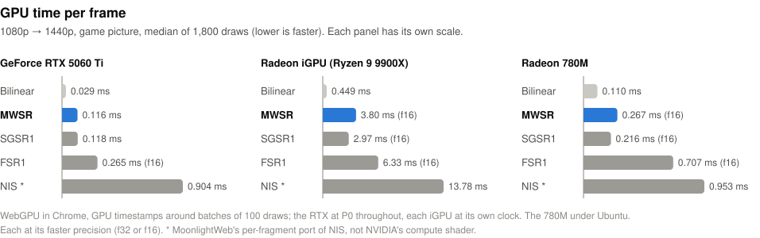

# MWSR — MoonlightWeb Super Resolution

MWSR is a real-time spatial upscaler and downscaler for video, written for
[MoonlightWeb](https://github.com/linckosz/moonlight-web), the game-streaming client that runs in a browser. It turns
each decoded frame into the size of the screen in one fragment pass, from that frame alone: no history, no motion
vectors, no neural network. That keeps it cheap enough for a phone and free of the latency a temporal method adds.

By Bruno Martin, under the [MIT License](LICENSE): you may take it into any program, open or closed, as long as the
copyright and licence notice stay with it. The rest of MoonlightWeb is under the GPL v3; this folder and
`frontend/js/stream/renderers/MwsrShader.js` are not.

## What it does

**Upscaling** (the output is larger than the input), per output pixel:

1. One bilinear sample of the input at the pixel's position.
2. A vote: the screen derivatives of that sample, scaled to a change per input texel, decide for each 2×2 quad of
   pixels whether it sits on an edge. A flat quad keeps a smooth reconstruction (a 5-tap Catmull-Rom by default) and
   stops there.
3. On an edge, four more bilinear samples, laid along the edge and across it. The pair along it smooths the
   staircase; the pair across it, of negative weight, sharpens the ramp.
4. A coherence term (a clean step or ridge across, against all the variation around) doses both, so that grain,
   texture and compression blocks are left alone. The whole fades out near 1:1.
5. The result is bounded by the four input texels around the pixel: no ringing halo, and a line one texel wide keeps
   its depth.

**Downscaling** (the output is smaller): a k×k grid of bilinear samples over the output pixel's footprint in the
input, averaged in linear light. One sample through sRGB views is the whole filter down to ×0.5; 3×3 and 4×4 grids
serve below.

**HDR**: both modes work per channel and clamp nothing to 1.0, so they run unchanged on a float texture whose values go
past 1.0 (1.0 = reference white).

**Cost**: the upscale to 1440p takes 0.09 ms (text) to 0.12 ms (a game picture) per frame on an RTX 5060 Ti, and
0.23 to 0.27 ms (a game picture) on a Radeon 780M, from 720p and from 1080p (GPU timestamps). The edge path, the
costly one, runs only on the quads the vote marks.

The design, the measurements against FSR1, SGSR1, NIS and the host's Lanczos, and every decision behind the defaults
are in the lab journal, [`scripts/bench/scaler-lab/journal.md`](../scripts/bench/scaler-lab/journal.md), and the
design document, [`docs/design/upscaler-mwsr.md`](../docs/design/upscaler-mwsr.md) (both in French).

## Next to FSR1, NIS and SGSR1

FSR1, NIS and SGSR1 are the single-frame upscalers a game or a video player usually reaches for, and MoonlightWeb ships
a port of each beside MWSR. They spend their work in different places:

- **FSR1** (AMD FidelityFX Super Resolution 1) runs two passes. EASU rebuilds each pixel from 12 input texels with a
  Lanczos-like kernel stretched along the local edge, then RCAS sharpens the whole picture. On the game picture it is
  the closest of the four to the native frame. It costs 1.7 to 2.6 times what MWSR costs, and its sharpening leaves
  the local range on 14 % of the pixels: a light halo along strong edges.
- **NIS** (NVIDIA Image Scaling) runs one pass over 6×6 texels: a filter bank chosen by the edge's direction, plus a
  sharpening of the luma. It is the sharpest of the four, which lifts its SSIM at ×2, and it overshoots on 42 % of the
  game picture's pixels: the bright rims and the grain in the zooms.
- **SGSR1** (Snapdragon Game Super Resolution 1) runs one pass of 12 texels read in four gathers, skips the flat
  areas and finds edges on the green channel. It lands about as close to the native frame as MWSR, with a lighter
  halo than FSR1 (6.5 %). In half precision, as Qualcomm writes it, it is the fastest of the four on the two
  integrated GPUs.
- **MWSR** runs one pass and decides per 2×2 quad: a flat quad keeps a smooth cubic, an edge gets four more samples
  along and across it. It bounds every pixel by its four input texels, so nothing rings (0.03 % of the pixels). It is
  the closest to the native frame on text at ×1.33. At ×2 on the game picture it is the softest of the four, where
  the others sharpen harder. It is the only one of the four that reduces and that reads the colour edges of a 4:4:4
  stream, and with NIS the only one that runs on HDR without a tone map around it.

**[Compare them on your own GPU](https://moonlightweb.top/mwsr/)**: the pictures below or your own, in SDR, HDR or
4:4:4, each upscaler's output pixel for pixel, its fidelity, and its GPU time on your device. The page runs these same
ports and uploads nothing.


*1080p → 1440p, zoomed ×4 (nearest neighbour), drawn on the RTX 5060 Ti. Three crops of 0 A.D., then the lab's text
chart.*

<picture>
  <source media="(prefers-color-scheme: dark)" srcset="docs/fidelity-dark.svg">
  
</picture>

<picture>
  <source media="(prefers-color-scheme: dark)" srcset="docs/speed-dark.svg">
  
</picture>

**1080p → 1440p**. Fidelity: the SSIM of the luma against the native frame, ×100 (higher is closer). Overshoot: the
share of pixels that leave the range of their four input texels by more than 2/255, which measures halos and
ringing. FLIP: NVIDIA's ꟻLIP, the mean perceptual difference to the native frame (lower is closer). Times: the game
picture, each at its faster precision.

| | Fidelity, game | Fidelity, text | Overshoot, game | FLIP, game | RTX 5060 Ti | Radeon iGPU (Ryzen 9 9900X) | Radeon 780M |
|---|---|---|---|---|---|---|---|
| MWSR | 85.9 | 96.0 | 0.03 % | 0.048 | 0.116 ms | 3.80 ms (f16) | 0.267 ms (f16) |
| FSR1 | 87.5 | 94.4 | 13.7 % | 0.034 | 0.265 ms (f16) | 6.33 ms (f16) | 0.707 ms (f16) |
| NIS * | 82.8 | 95.6 | 42.6 % | 0.100 | 0.904 ms | 13.78 ms | 0.953 ms |
| SGSR1 | 85.6 | 95.3 | 6.5 % | 0.042 | 0.118 ms | 2.97 ms (f16) | 0.216 ms (f16) |
| Bilinear | 81.8 | 92.6 | 0 % | 0.045 | 0.029 ms | 0.449 ms | 0.110 ms |

**720p → 1440p**, the same columns:

| | Fidelity, game | Fidelity, text | Overshoot, game | FLIP, game | RTX 5060 Ti | Radeon iGPU (Ryzen 9 9900X) | Radeon 780M |
|---|---|---|---|---|---|---|---|
| MWSR | 66.2 | 86.5 | 0.01 % | 0.071 | 0.113 ms | 3.69 ms (f16) | 0.231 ms (f16) |
| FSR1 | 68.0 | 84.7 | 2.9 % | 0.053 | 0.273 ms | 6.32 ms (f16) | 0.685 ms (f16) |
| NIS * | 69.5 | 87.6 | 41.7 % | 0.116 | 0.614 ms | 12.99 ms | 0.886 ms |
| SGSR1 | 66.9 | 87.6 | 6.3 % | 0.062 | 0.118 ms | 2.95 ms (f16) | 0.204 ms (f16) |
| Bilinear | 61.6 | 81.8 | 0 % | 0.073 | 0.029 ms | 0.422 ms | 0.094 ms |

\* MoonlightWeb's per-fragment port of NIS. NVIDIA ships a compute shader with shared memory, which is faster: these
times are those of the port, not of NIS.

What each one does:

<picture>
  <source media="(prefers-color-scheme: dark)" srcset="docs/support-dark.svg">
  
</picture>

<details>
<summary>The same table as text</summary>

| | MWSR | FSR1 | NIS | SGSR1 |
|---|---|---|---|---|
| Upscale | any factor | 1× to 4× the area (2× per axis) | 1× to 2× per axis | yes, no stated limit |
| Downscale | yes: an area filter in linear light, 1 to 16 samples | no | no: refused | no |
| HDR | yes: unchanged on a float texture past 1.0 | through a reversible tone map around it (`FsrSrtm`) | yes: `NIS_HDR_MODE`, linear or PQ | no: its output is clamped to 0..1 |
| 4:4:4 colour edges | yes, with `CHROMA444`: the vote and the weights per channel | no: edges from the luma | no: edges from the luma | no: edges from green |
| Input | an RGB texture: 8-bit, read through sRGB views or not, or 16-bit float | RGB in 0..1, perceptual | RGB, or NV12 (`NIS_NV12_SUPPORT`) | RGB in 0..1 |
| Precision | 32-bit, or 16-bit | 32-bit, or packed 16-bit | 32-bit, or 16-bit | 16-bit (`half`) only |
| Passes | 1 | 2 | 1 (compute) | 1 |
| Licence | MIT | MIT | MIT | BSD-3-Clause |

</details>

**How it was measured** (28/10/2026, the Radeon 780M on 30/10/2026):
- **The pictures.** The native frame is a 4K screenshot of 0 A.D. reduced to 2560×1440, or the lab's text chart drawn
  at 2560×1440. The input is that frame reduced to 1920×1080 or 1280×720. Both reductions are Lanczos-3 in linear
  light. Each upscaler draws the input back at 2560×1440.
- **The times.** WebGPU in Chrome on Windows 11, and on Ubuntu for the Radeon 780M, with the input already in an
  8-bit RGBA texture (no video decoding in it). GPU timestamps wrap batches of 100 draws, in 3 rounds of 6 batches,
  and the figure is the median per draw. The RTX 5060 Ti ran at P0 throughout. The Ryzen 9 9900X's integrated Radeon
  (RDNA 2, 2 compute units) and the Radeon 780M (RDNA 3, 12 compute units) ran at their own clocks, which nothing
  fixed, so read their figures as ratios.
- **The ports.** These are MoonlightWeb's ports, not the vendors' own builds:
  - FSR1: firdawolf's WGSL port of EASU and RCAS (RCAS at 0.75 stops, its noise term on), and the lab's port of
    AMD's 16-bit path (`FsrEasuH`, `FsrRcasH`).
  - NIS: a per-fragment transcription of NVScaler, SDK 1.0.3, with its filter tables, at sharpness 0.5.
  - SGSR1: a port of `sgsr1.h` (mode 1, edge threshold 6/255, edge sharpness 1.5), in 32-bit and in half precision.
  - MWSR: its defaults, in 32-bit and in 16-bit (`mwsr-up-f16.wgsl`).
- **The precision.** Each upscaler is timed at its faster precision on each GPU. On the RTX and the 9900X's iGPU,
  before any timing, each 16-bit text is held to its 32-bit one on that GPU: fewer than 0.05 % of the pixels differ
  by more than 4/255. The Radeon 780M was timed without that check.
- **To run it again**: `scripts/bench/scaler-lab/scaler_lab.py`, its `--quality` mode for the pictures and its
  `cells=` cases for the times (cells `mwsr`, `mwsr:half=1`, `fsr1`, `fsr1h`, `nis`, `sgsr-repo`, `sgsrh`, `tex-s1`).
  In a browser with WebGPU, on your own GPU: [moonlightweb.top/mwsr](https://moonlightweb.top/mwsr/), with the same
  reduction, metrics and timing, and the client's shaders.

FSR and FidelityFX are trademarks of Advanced Micro Devices, NVIDIA is a trademark of NVIDIA Corporation, and
Snapdragon is a trademark of Qualcomm. MoonlightWeb made this comparison with its own ports, and none of these
companies made or endorsed it.

The 0 A.D. picture is © Wildfire Games; the screenshot is by PantheraLeo1359531 on Wikimedia Commons, under
[CC BY-SA 3.0](https://creativecommons.org/licenses/by-sa/3.0/). Its crops in `docs/zoom.png` are under the same licence.

## Files

| File | What it is |
|---|---|
| `wgsl/mwsr-up.wgsl` | The upscale, WebGPU (WGSL). Its parameters are `override` constants, set at pipeline creation. |
| `wgsl/mwsr-up-f16.wgsl` | The same, its edge path in f16. Needs the `shader-f16` feature. |
| `wgsl/mwsr-down-1.wgsl`, `-4`, `-9`, `-16` | The reduction, with 1, 2×2, 3×3 or 4×4 samples. |
| `glsl/mwsr.vert` | The full-screen triangle every GLSL fragment text expects. |
| `glsl/mwsr-up.frag` | The upscale, GLSL ES 3.00 (WebGL2, OpenGL ES 3.0). The parameters are constants at the top. |
| `glsl/mwsr-down-4.frag`, `-9`, `-16` | The reduction, GLSL ES 3.00. |
| `hlsl/mwsr-up.hlsl` | The upscale, HLSL, for Direct3D 11 (FXC, `ps_5_0`) and 12 (DXC, `ps_6_0`). Its parameters are `MWSR_*` defines. |
| `hlsl/mwsr-up-half.hlsl` | The same, its edge path in `min16float`. |
| `hlsl/mwsr-down-1.hlsl`, `-4`, `-9`, `-16` | The reduction, HLSL. |
| `cpp/mwsr.h` | The CPU side for a native renderer, C++17, header only: the mode for a scale and its shader file, the 64 bytes of the constant buffer, the defines to compile with. |
| `cpp/example_d3d11.cpp` | A whole Direct3D 11 integration in one file, which also serves as a test: it reads a PNG, draws it at another size and writes a PNG. |
| `js/MwsrShader.js` | The JavaScript module the shaders come from: it writes the texts with any parameters, picks the mode for a scale and fills the uniform block. |
| `generate.mjs` | Writes this folder from MoonlightWeb's own module (`node mwsr/generate.mjs`). |
| `docs/` | The figures of [the comparison](#next-to-fsr1-nis-and-sgsr1): the zooms, then the two charts and the table, in light and dark. |

Every shader here is generated from the module MoonlightWeb runs, so what you take is what the product draws. The
WGSL, GLSL and HLSL texts are twins, written from the same tables of constants. MoonlightWeb's lab holds the GLSL
one to 2/255 of the WGSL one. The HLSL one, drawn on WARP, against the WGSL one on SwiftShader, on 16 cases (28/10/2026):
- **Bilinear filtering alone:** the two rasterisers differ by 1/255 at most.
- **Upscales:** a few quads near the vote's threshold go the other way, on 0.0001 to 0.02 % of the pixels; PSNR 66 to
  73 dB.
- **Reductions:** 1/255 at most.

The C++ header gives the JavaScript module's modes and floats bit for bit.

## Integrating

### What every version needs

- **The input**: the decoded frame as an RGB texture. SDR: sRGB-encoded values in 0..1. HDR: a float texture,
  sRGB-encoded past 1.0.
- **The sampler**: linear filtering for min and mag, clamp-to-edge on both axes.
- **The draw**: one full-screen triangle, three vertices and no vertex buffer, into a target of the output size.
- **The mode, per frame**, from the scale `s = min(outW / inW, outH / inH)`:

  | Scale | Shader | `R_DOWN` | `LINEAR_LIGHT` |
  |---|---|---|---|
  | exactly 1:1 | none: copy the frame | | |
  | s ≥ 1 | `mwsr-up` | | |
  | 0.5 ≤ s < 1 | `mwsr-down-1` with sRGB views, `mwsr-down-4` without | 1.0 | 0 with sRGB views, 1 without |
  | 0.25 ≤ s < 0.5 | `mwsr-down-9` | 1.25 | 0 with sRGB views, 1 without |
  | s < 0.25 | `mwsr-down-16` | 1.25 | 0 with sRGB views, 1 without |

  "With sRGB views" means the input is read through an `-srgb` view and the output written into one, so that the
  hardware decodes before it filters and encodes on write (WebGPU: `viewFormats` on both textures). That is exact
  and costs nothing. Without them, the shader approximates the light itself (`LINEAR_LIGHT 1`). On an HDR feed that
  already holds linear light, use the grids of the sRGB-view column with `LINEAR_LIGHT 3`.

- **The uniform block**, 16 floats (64 bytes), rewritten when a size changes:

  | Floats | Value |
  |---|---|
  | 0, 1 | `1 / inW`, `1 / inH` |
  | 2, 3 | `outW / inW`, `outH / inH` |
  | 4 | `tau`, the vote's threshold: `0.05` |
  | 5 | `sharp`, the sharpness: see [the sharpness law](#per-frame-values) |
  | 6 | `gaze`, the gaze zone's weight: `0` without one |
  | 7 | `0` |
  | 8 to 15 | the gaze zone (centre, half-axes, ring, its tau and sharpness, `0`), read only with `GAZE 1` |

### WebGPU (WGSL)

Bindings, all in group 0: `0` the sampler, `1` the input (`texture_2d<f32>`), `2` the uniform buffer. Entry points:
`vs` and `fs`.

```js
import { mwsrWgsl, mwsrRegime, mwsrUniforms } from './js/MwsrShader.js';

// 1920×1080 drawn at 2560×1440: the upscale
const reg = mwsrRegime(1920, 1080, 2560, 1440); // { mode: 'up', ... }
const module = device.createShaderModule({ code: mwsrWgsl({ mode: reg.mode, taps: reg.taps }) });
const pipeline = device.createRenderPipeline({
    layout: 'auto',
    vertex: { module, entryPoint: 'vs' },
    fragment: {
        module,
        entryPoint: 'fs',
        targets: [{ format: navigator.gpu.getPreferredCanvasFormat() }],
        // the defaults suit a computer; a reduction takes { R_DOWN: reg.rDown, LINEAR_LIGHT: reg.linearLight }
        constants: {},
    },
    primitive: { topology: 'triangle-list' },
});
const uniforms = device.createBuffer({ size: 64, usage: GPUBufferUsage.UNIFORM | GPUBufferUsage.COPY_DST });
device.queue.writeBuffer(uniforms, 0, mwsrUniforms(1920, 1080, 2560, 1440));
const bindGroup = device.createBindGroup({
    layout: pipeline.getBindGroupLayout(0),
    entries: [
        { binding: 0, resource: device.createSampler({ magFilter: 'linear', minFilter: 'linear' }) },
        { binding: 1, resource: frameTexture.createView() },
        { binding: 2, resource: { buffer: uniforms } },
    ],
});

// each frame, in a render pass on the output
pass.setPipeline(pipeline);
pass.setBindGroup(0, bindGroup);
pass.draw(3);
```

Without the module, take `wgsl/mwsr-up.wgsl` as it is and write the 16 floats yourself (see
[the values](#per-frame-values)).

### WebGL2 and OpenGL ES 3.0 (GLSL)

Link `glsl/mwsr.vert` with one fragment text. Uniforms: `uTex` (the input, on texture unit 0), then the block above
in four `vec4`: `uTexelScale` (floats 0 to 3), `uTauSharp` (4 to 7), `uZone` (8 to 11) and `uZoneBonus` (12 to 15).
Draw with `gl.drawArrays(gl.TRIANGLES, 0, 3)`.

- The vertex shader expects the texture's first row to be the top of the picture, as a `VideoFrame` or an image
  uploads in WebGL. If yours is upside down, flip the texture, not the coordinates.
- GLSL has no pipeline constants: the parameters are the `const` lines at the top of each text. Change them there,
  or write the text with `mwsrGlsl({ mode, taps, overrides })` from the module.
- There is no sRGB-view path here: the reduction uses the `LINEAR_LIGHT 1` grids, already baked into
  `mwsr-down-*.frag`.

```js
import { mwsrGlsl, mwsrUniforms } from './js/MwsrShader.js';

// a phone, 1280×720 drawn at 2340×1080: the 3-tap flat path
// (link: your own compile-and-link helper; vertSource: glsl/mwsr.vert)
const program = link(gl, vertSource, mwsrGlsl({ mode: 'up', overrides: { FLAT_TAPS: 3 } }));
const u = mwsrUniforms(1280, 720, 2340, 1080);
gl.useProgram(program);
gl.uniform1i(gl.getUniformLocation(program, 'uTex'), 0);
gl.uniform4fv(gl.getUniformLocation(program, 'uTexelScale'), u.subarray(0, 4));
gl.uniform4fv(gl.getUniformLocation(program, 'uTauSharp'), u.subarray(4, 8));
gl.uniform4fv(gl.getUniformLocation(program, 'uZone'), u.subarray(8, 12));
gl.uniform4fv(gl.getUniformLocation(program, 'uZoneBonus'), u.subarray(12, 16));
gl.drawArrays(gl.TRIANGLES, 0, 3);
```

### Direct3D 11 and 12 (HLSL, C++)

Each `hlsl/` file holds both stages: `MwsrVS`, the full-screen triangle from `SV_VertexID`, and `MwsrPS`. Registers:
`b0` the constant buffer (`cbuffer MwsrConstants`, the 16 floats above), `t0` the input (`Texture2D<float4>`), `s0`
a sampler with linear filtering and clamp addressing. Each register is a define as well (`MWSR_CB_REGISTER`,
`MWSR_TEX_REGISTER`, `MWSR_SAMPLER_REGISTER`), for a root signature that wants others. Every parameter is a define of
its name prefixed `MWSR_`, at its default unless you pass another: `MWSR_FLAT_TAPS=3`, `MWSR_R_DOWN=1.25`.

`cpp/mwsr.h` does the CPU side, with no dependency:

```cpp
#include "mwsr.h"

// once per size: the mode, the file, the defines
const mwsr::Regime reg = mwsr::regime(inW, inH, outW, outH);   // Mode::Copy at 1:1: copy the frame instead
const std::string file = "hlsl/" + mwsr::shaderFile(reg);        // "mwsr-up.hlsl", "mwsr-down-9.hlsl"...
const std::vector<mwsr::Define> defines = mwsr::defines(reg, {{"FLAT_TAPS", "3"}});  // a phone; {} on a computer
// compile MwsrVS (vs_5_0 / vs_6_0) and MwsrPS (ps_5_0 / ps_6_0) from `file` with `defines`
// (D3D_SHADER_MACRO for D3DCompile, -D NAME=VALUE for DXC)

// the constant buffer, 64 bytes, rewritten when a size changes
const mwsr::Constants cb = mwsr::constants(inW, inH, outW, outH);

// each frame: input SRV on t0, sampler on s0, cb on b0, render target of outW x outH,
// no input layout, triangle list, Draw(3)
```

`cpp/example_d3d11.cpp` is all of it in one file: the device, the textures with their sRGB views, the sampler, the
constant buffer, the compilation and the draw. It runs on WARP, the software rasteriser, unless given `--hardware`.

```
cl /std:c++17 /EHsc /W4 /O2 example_d3d11.cpp d3d11.lib d3dcompiler.lib windowscodecs.lib ole32.lib
example_d3d11 frame_720p.png 2560 1440 out.png --hlsl ../hlsl --define FLAT_TAPS=3
```

**On Direct3D 12**, the same files compile with DXC, `-T ps_6_0 -E MwsrPS`, HLSL 2021 included. With
`-enable-16bit-types` (`ps_6_2`), `mwsr-up-half.hlsl`'s `min16float` becomes a true `half`; DXC says so in a warning.
A root signature for it:
- the 16 floats as root constants at `b0` (16 32-bit values) or a CBV;
- a descriptor table with the input's SRV at `t0`;
- a static sampler at `s0`: `D3D12_FILTER_MIN_MAG_MIP_LINEAR`, `D3D12_TEXTURE_ADDRESS_MODE_CLAMP`.

Draw it as an ordinary pixel pass over the output: viewport and scissor of the output's size, `DrawInstanced(3, 1,
0, 0)`.

**The input on Direct3D**: a decoder hands YUV. Convert it to RGB in a pass before MWSR, at the stream's size, as
MoonlightWeb does: MWSR reads RGB. For the exact reduction, create that RGB texture `DXGI_FORMAT_R8G8B8A8_TYPELESS`,
read it through an `_UNORM_SRGB` view, write the output through one, and pass `srgbViews = true` to `mwsr::regime`.

## Parameters

### Per-frame values

These are the uniform block's values. `mwsrUniforms(inW, inH, outW, outH, { tau, sharp, gaze, zone })` computes
them all.

| Value | Default | What it does |
|---|---|---|
| `tau` | `0.05` | The vote's threshold, in luma per input texel. Lower sends more quads to the edge path (sharper, a little more costly); higher sends more to the flat path (softer, cheaper). |
| `sharp` | the law below | The sharpness: it multiplies `W_ACROSS`. |
| `gaze` | `0` | The gaze zone's weight, 0 to 1. Read only by a text built with `GAZE 1`. |

**The sharpness law** (`mwsrSharpness(s)`, with `s` the smaller axis' scale). The sharpness is `1.85` up to ×1.33.
Above that, it is held so that the across weight stays the one set by eye at ×1.33, then it ramps to `1.5` at ×2:

```
strength(x) = clamp((x - 1) / (S_FULL - 1), 0, 1)
held(s)     = 1.85 * min(1, strength(4/3) / strength(s))     // 1.85 if s <= 4/3
t(s)        = clamp((s - 1.75) / (2 - 1.75), 0, 1)
sharp(s)    = held(s) + t(s) * (1.5 - held(s))
```

That gives `1.85` at ×1.33, `1.542` at ×1.4, `1.233` from ×1.5 to ×1.75, `1.367` at ×1.875 and `1.5` from ×2 up. At
×2, `1.233` is softer than text wants. A reduction does not read it.

**Example**, 1920×1080 drawn at 2560×1440:
`[0.000520833, 0.000925926, 1.333333, 1.333333, 0.05, 1.85, 0, 0, 0.5, 0.5, 0.2, 0.45, 0.75, 0.02, 2.5, 0]`. Floats 8 to
15 are the zone's defaults, and nothing reads them without `GAZE 1`.

### Pipeline constants

They are `override` constants in WGSL, set at pipeline creation; `const` lines in GLSL; defines in HLSL, the name
prefixed `MWSR_`.

| Constant | Type | Default | What it does |
|---|---|---|---|
| `SHOW` | u32 | `0` | Debug: `1` paints the vote (white = edge quad, black = flat), `2` the gaze zone's weight. |
| `W_ALONG` | f32 | `0.15` | The weight of each tap along the edge, at full coherence: it smooths the staircase. |
| `W_ACROSS` | f32 | `0.3` | The weight of each tap across the edge, negated and multiplied by `sharp`: it sharpens. |
| `R_ALONG` | f32 | `0.5` | The distance of the taps along the edge, in input texels. |
| `R_ACROSS` | f32 | `1.0` | The distance of the taps across the edge, in input texels. |
| `S_FULL` | f32 | `1.5` | The scale from which the kernel is at full strength. It fades in from 1:1. |
| `W_MIN` | f32 | `-0.5` | The most negative an across weight may go. |
| `DERING` | u32 | `2` | The edge path's bound. `2`: the four input texels around the pixel, so a one-texel line keeps its depth. `1`: the five samples, then those texels. `0`: the five samples only. |
| `CHROMA444` | u32 | `0` | `1` takes the vote, the coherence and the weights per channel, so that a border between two colours of one luma is sharpened too. For 4:4:4 streams. |
| `FLAT_TAPS` | u32 | `5` | The flat path's reconstruction. `1`: the bilinear sample. `5`: a Catmull-Rom cubic in 5 bilinear taps. `9`: the same with its corners. `3`: Dodgson's quadratic in 3 taps. |
| `FLAT_C` | f32 | `0.5` | The cubic's C, the depth of its negative lobe. `0.5` is Catmull-Rom; higher is steeper, with more ringing (still bounded). |
| `GAZE` | u32 | `0` | `1`: a gaze zone. The vote's threshold and the sharpness slide from the per-frame values at the border to the zone's at its centre, weighted by `gaze`. |
| `FLAT_ZONE` | u32 | `0` | With `GAZE 1`: `1` keeps the flat path's cubic inside the zone only, and the periphery keeps the bilinear sample. |
| `R_DOWN` | f32 | `1.0` | Reduction: the span of the grid, as a fraction of the pixel's footprint. Set it from [the mode table](#what-every-version-needs). |
| `LINEAR_LIGHT` | u32 | `1` | Reduction: the light the samples are averaged in. `0`: the hardware's, through sRGB views. `1`: gamma 2 (a square and a square root). `2`: the exact sRGB curve (at most 0.35 dB better, 15 `pow` per pixel). `3`: the input already holds linear light, and the output is encoded once. WGSL only for `3`. |

### Recommended values

| Case | Set | Why |
|---|---|---|
| A computer | the defaults | They are MoonlightWeb's on desktop and laptop. |
| A phone or a tablet | `FLAT_TAPS 3` | 9 to 13 % faster on an iPhone 13 Pro and a realme Note 60, for a hundredth of SSIM. MoonlightWeb's choice there. |
| A 4:4:4 stream (desktop work, text) | `CHROMA444 1` | Colour borders of one luma, such as red text on green, get sharpened too. |
| An AMD integrated GPU (Ryzen 9 9900X) | `wgsl/mwsr-up-f16.wgsl` | 9 to 10 % faster. Nothing gained on NVIDIA. |
| A softer picture | `sharp` lower, `tau` higher | Less sharpening, and fewer pixels on the edge path. |
| An HDR float input | the defaults | Unchanged for the upscale. A reduction takes `LINEAR_LIGHT 3` if the input holds linear light. |

### Example settings

A 4:4:4 desktop stream, 1280×720 shown on a 2560×1440 screen, mostly text:

```js
const pipeline = device.createRenderPipeline({
    layout: 'auto',
    vertex: { module, entryPoint: 'vs' }, // module: mwsrWgsl({ mode: 'up' })
    fragment: {
        module,
        entryPoint: 'fs',
        targets: [{ format }],
        constants: { CHROMA444: 1 },
    },
    primitive: { topology: 'triangle-list' },
});
// sharp at ×2 is 1.5 by the law; tau stays 0.05
device.queue.writeBuffer(uniforms, 0, mwsrUniforms(1280, 720, 2560, 1440));
```

A 4K stream reduced to a 1440p screen, through sRGB views:

```js
const reg = mwsrRegime(3840, 2160, 2560, 1440, { srgb: true }); // { mode: 'down', taps: 1, rDown: 1, linearLight: 0 }
const module = device.createShaderModule({ code: mwsrWgsl({ mode: 'down', taps: reg.taps }) });
// the canvas configured with viewFormats: [format + '-srgb'], the frame's texture likewise
const fragment = {
    module,
    entryPoint: 'fs',
    targets: [{ format: format + '-srgb' }],
    constants: { R_DOWN: reg.rDown, LINEAR_LIGHT: reg.linearLight },
};
// bind frameTexture.createView({ format: 'rgba8unorm-srgb' }) and draw into the canvas' -srgb view
```

## Credits

MWSR was written from scratch for MoonlightWeb. It takes ideas, and credits them:

- bilinear taps instead of gathers: Atyuwen's mobile EASU, Jimenez, MJP;
- the early out on an edge vote: SGSR1, NEDI;
- the local bound against ringing: EASU, SGSR1;
- sharpening held by the local range: CAS, RCAS.

The vote by screen derivatives and the taps laid along the measured edge are its own. No line, polynomial or
constant of FSR1, SGSR1 or NIS is reproduced, and MoonlightWeb's tests check that none creeps in.
