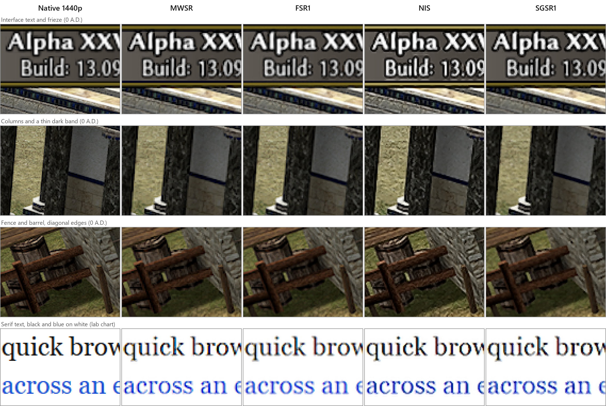
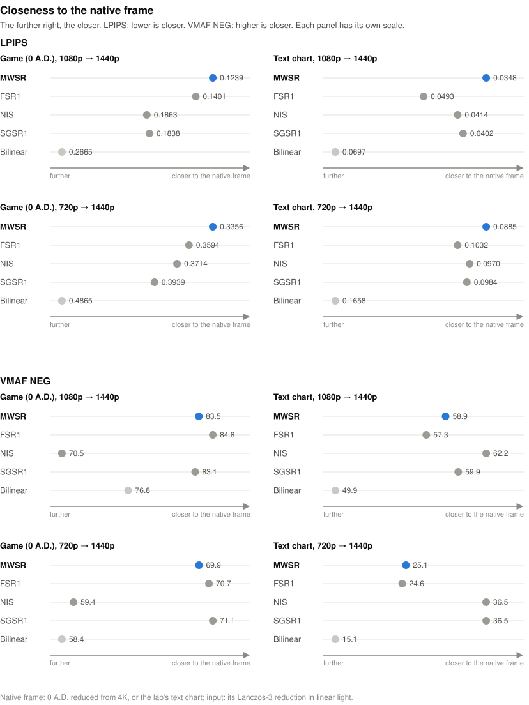
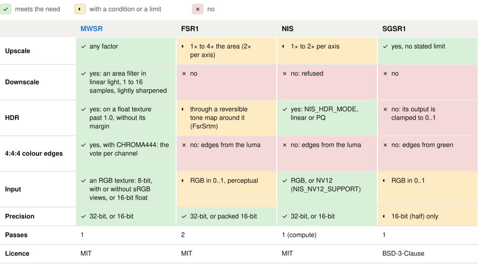

# MWSR — MoonlightWeb Super Resolution

MWSR is a real-time spatial upscaler and downscaler for video, written for
[MoonlightWeb](https://github.com/linckosz/moonlight-web), the game-streaming client that runs in a browser. It turns
each decoded frame into the size of the screen in one fragment pass, from that frame alone: no history, no motion
vectors, no neural network. That keeps it free of the latency a temporal method adds, and light on an iPhone 13 Pro,
though not on an entry-level phone: the figures are under **Cost**.

By Bruno Martin, under the [MIT License](LICENSE): you may take it into any program, open or closed, as long as the
copyright and licence notice stay with it. The rest of MoonlightWeb is under the GPL v3; this folder and
`frontend/js/stream/renderers/MwsrShader.js` are not.

## What it does

**Upscaling** (the output is larger than the input), per output pixel:

1. One bilinear read, at the position that gives the middle of a cubic: the four input texels around the pixel, by
   weights that sharpen with `kc`.
2. A vote: the screen derivatives of that read's luma, scaled to a change per input texel, decide for each 2×2 quad of
   pixels whether it sits on an edge. A flat quad keeps that one read.
3. On an edge, four more reads complete the cubic, one for each outer lobe. Two more lie across the edge, along the
   normal the derivatives measure: the difference between the cubic and their mean is the detail, added back by `kg`,
   and its colour by `kwc`. That makes seven reads.
4. The result stays within the range of the middle read and the pair across the edge, widened by `kl` of that range. So
   a little overshoot is left on purpose, which is what makes it look sharper, and it stays small.

**Downscaling** (the output is smaller): a k×k grid of bilinear samples over the output pixel's footprint in the
input, averaged in linear light. One sample through sRGB views, or a 2×2 grid without them, serves down to ×0.5; 3×3 and
4×4 grids serve below. From ×0.5 to 1:1 a light sharpening follows: where the derivatives of the read's luma see detail, a cross
of 4 reads one output pixel away gives the detail and the bound, the gain falling on a strong edge (`MWSR_DOWN_LAW`).
That makes 5 reads through sRGB views, 8 with the 2×2 grid. Below ×0.5 it does not sharpen.

**HDR**: both modes work per channel and clamp nothing to 1.0, so they run on a float texture whose values go past 1.0
(1.0 = reference white). The upscale then takes no margin on its bound and the reduction does not sharpen (`hdr: true`):
with the margin, 1000-nit text reached about 1400 nits.

**The law**: `kc`, `kg`, `kr` and `kl` follow a curve over the scale ([the law](#per-frame-values)), fitted from ×1.07 to
×4 on LPIPS first, then VMAF NEG, on 15 pictures of games, text and interfaces, clean and through HEVC at a stream's bit
rate, and measured back on 15 others. A person's eye then raised the sharpness above that fit: `kg` and `kl` times a
force that goes from 1 at ×1.33 to 1.35 at ×2. Those two marks and ×1.5 were chosen by eye on six pictures each, the
pictures seen one at a time and not blind, by one person. Between ×1.33 and ×2 the eye and PSNR, SSIM, MS-SSIM and VMAF
NEG can disagree on games: see the tables below.

**Cost** (GPU timestamps, from 720p and from 1080p to 1440p, a game picture and a text chart, 03/11/2026, the Radeon 780M on 04/11/2026): 0.08 to 0.09 ms per
frame on an RTX 5060 Ti, 1.5 to 2.4 ms on the Ryzen 9 9900X's integrated Radeon and 0.41 to 0.61 ms on a Radeon 780M held at 938 MHz, in 32-bit, the text MoonlightWeb runs.
938 MHz is a bench clock, not what a stream gets: left to itself, this GPU moves between 800 and 2800 MHz. That is 3.6 to 3.8 times less than FSR1 at
its faster precision on the RTX, 2.7 to 4.1 times less on that integrated Radeon and 3.3 to 4.8 times less on the 780M. An edge pixel takes seven bilinear reads, a flat
one a single read; after a video encoder, about 70 % of a game's pixels and 45 % of a page's are on the edge path at the law's threshold. A reduction from ×0.75
to ×0.5, through sRGB views, takes 0.023 to 0.063 ms on the RTX, 0.65 to 1.91 ms on the integrated Radeon and 0.25 to 0.56 ms on the Radeon 780M, which is 4.4 to 6.5,
3.3 to 5.7 and 3.1 to 4.6 times less than FSR1.

**On phones** (04/11/2026, the whole draw of a frame, up to the GPU's end, one pass per case): on an iPhone 13 Pro, in Safari and
Chrome, MWSR adds 0.5 to 2.1 ms to a frame, upscaling or reducing, where FSR1 adds 2.8 to 5.4 ms. On a Realme with an entry-level
Mali-G57, it adds 4 to 5 ms from half the screen's size (19 to 22 ms a frame, FSR1 44 ms) and 12 to 13 ms from 720p to 1440p
(35 to 36 ms a frame, FSR1 108 to 115 ms). That does not hold 60 frames a second, and Auto leaves it off on that GPU.

The design, the measurements against FSR1, SGSR1, NIS and the host's Lanczos, and every decision behind the defaults
are in the lab journal, [`scripts/bench/scaler-lab/journal.md`](../scripts/bench/scaler-lab/journal.md), and the
design document, [`docs/design/upscaler-mwsr.md`](../docs/design/upscaler-mwsr.md) (both in French).

## Next to FSR1, NIS and SGSR1

FSR1, NIS and SGSR1 are the single-frame upscalers a game or a video player usually reaches for, and MoonlightWeb ships
a port of each beside MWSR. They spend their work in different places:

- **FSR1** (AMD FidelityFX Super Resolution 1) runs two passes. EASU rebuilds each pixel from 12 input texels with a
  Lanczos-like kernel stretched along the local edge, then RCAS sharpens the whole picture. It has the best FLIP of the four on
  the game picture and the best LPIPS at ×1.33 there, and its sharpening leaves the local range on 14 % of that picture's pixels
  at ×1.33: a light halo along strong edges.
- **NIS** (NVIDIA Image Scaling) runs one pass over 6×6 texels: a filter bank chosen by the edge's direction, plus a
  sharpening of the luma. It is the sharpest of the four, which gives it the best VMAF NEG and PSNR on text at ×2 and the worst
  scores on the game picture, and it overshoots on 42 % of that picture's pixels: the bright rims and the grain in the zooms.
- **SGSR1** (Snapdragon Game Super Resolution 1) runs one pass of 12 texels read in four gathers, skips the flat
  areas and finds edges on the green channel. It shares the best VMAF NEG on text at ×2 with NIS, and has the best MS-SSIM there.
- **MWSR** runs one pass and decides per 2×2 quad: a flat quad keeps a single read, an edge gets a cubic and the detail
  measured across it. It leaves a little overshoot on purpose, on 2 to 7 % of the pixels here, because a person's eye
  preferred it, in a blind test against FSR1, to a harder bound. It has the best LPIPS on text at both scales and on the game
  picture at ×2, and the best VMAF NEG on the game picture and on text at ×1.33. FSR1 keeps the better FLIP on the game picture,
  and on games through a video encoder FSR1 leads most scores at ×1.5 and ×2. It is the fastest of the four on these GPUs, the
  only one that reduces and that reads the colour edges of a 4:4:4 stream, and with NIS the only one that runs on HDR without a
  tone map around it.

**[Compare them on your own GPU](https://moonlightweb.top/mwsr/)**: the pictures below or your own, in SDR, HDR or
4:4:4, each upscaler's output pixel for pixel, its scores, and its GPU time on your device. The page runs these same
ports. Your picture stays on your device; measuring sends technical figures to the server.



*1080p → 1440p, zoomed ×4 (nearest neighbour), drawn on the RTX 5060 Ti. Three crops of 0 A.D., then two bands of the
lab's text chart.*

<picture>
  <source media="(prefers-color-scheme: dark)" srcset="docs/scores-dark.svg">
  
</picture>

<picture>
  <source media="(prefers-color-scheme: dark)" srcset="docs/speed-dark.svg">
  
</picture>

LPIPS (AlexNet, v0.1) says how far a picture looks from the native frame, and was made to judge upscalers and image restoration:
lower is closer. VMAF NEG is Netflix's VMAF without the credit plain VMAF gives to added sharpening, and judges a video stream's
pictures: higher is closer. PSNR, SSIM and MS-SSIM measure the pixels' and the structure's distance: higher is closer. FLIP is
NVIDIA's measure of what a viewer sees when flipping between two pictures: lower is closer. Overshoot: the share of pixels that
leave the range of their four input texels by more than 2/255. Times: MWSR in 32-bit, the text MoonlightWeb runs, the others at their faster precision, each GPU's in one page. In
bold, the best of each score.

**1080p → 1440p (×1.33), game**

|  | LPIPS | VMAF NEG | PSNR | SSIM | MS-SSIM | FLIP | Overshoot | RTX 5060 Ti | Radeon iGPU (Ryzen 9 9900X) | Radeon 780M (938 MHz) |
|---|---|---|---|---|---|---|---|---|---|---|
| MWSR | 0.1624 | **85.9** | **28.54** | **0.8792** | **0.9880** | 0.0360 | 6.6 % | 0.085 ms | 2.35 ms | 0.610 ms |
| FSR1 | **0.1401** | 84.8 | 28.38 | 0.8776 | 0.9878 | **0.0346** | 13.7 % | 0.326 ms | 6.34 ms (f16) | 1.99 ms (f16) |
| NIS * | 0.1863 | 70.5 | 24.68 | 0.8162 | 0.9587 | 0.0997 | 42.6 % | 0.572 ms | 13.74 ms | 3.98 ms |
| SGSR1 | 0.1838 | 83.1 | 27.77 | 0.8554 | 0.9833 | 0.0422 | 6.6 % | 0.146 ms | 2.97 ms (f16) | 0.958 ms |
| Bilinear | 0.2665 | 76.8 | 27.45 | 0.8228 | 0.9794 | 0.0450 | 0 % | 0.034 ms | 0.453 ms | 0.330 ms |

**1080p → 1440p (×1.33), text**

|  | LPIPS | VMAF NEG | PSNR | SSIM | MS-SSIM | FLIP | Overshoot | RTX 5060 Ti | Radeon iGPU (Ryzen 9 9900X) | Radeon 780M (938 MHz) |
|---|---|---|---|---|---|---|---|---|---|---|
| MWSR | **0.0385** | **66.4** | **22.59** | **0.9578** | **0.9915** | 0.0424 | 2.8 % | 0.081 ms | 1.52 ms | 0.418 ms |
| FSR1 | 0.0493 | 57.3 | 21.45 | 0.9422 | 0.9874 | **0.0416** | 0.2 % | 0.307 ms (f16) | 6.27 ms (f16) | 1.97 ms (f16) |
| NIS * | 0.0414 | 62.2 | 22.05 | 0.9488 | 0.9893 | 0.0556 | 4.4 % | 0.443 ms | 10.75 ms | 3.36 ms |
| SGSR1 | 0.0402 | 59.9 | 21.64 | 0.9463 | 0.9891 | 0.0500 | 2.7 % | 0.087 ms | 1.65 ms (f16) | 0.622 ms (f16) |
| Bilinear | 0.0697 | 49.9 | 20.52 | 0.9234 | 0.9845 | 0.0627 | 0 % | 0.047 ms | 0.396 ms | 0.267 ms |

**720p → 1440p (×2), game**

|  | LPIPS | VMAF NEG | PSNR | SSIM | MS-SSIM | FLIP | Overshoot | RTX 5060 Ti | Radeon iGPU (Ryzen 9 9900X) | Radeon 780M (938 MHz) |
|---|---|---|---|---|---|---|---|---|---|---|
| MWSR | **0.3532** | **71.5** | 24.57 | 0.6886 | 0.9617 | 0.0634 | 5.4 % | 0.080 ms | 2.36 ms | 0.594 ms |
| FSR1 | 0.3594 | 70.7 | **24.77** | 0.6880 | **0.9633** | **0.0525** | 2.9 % | 0.287 ms | 6.32 ms (f16) | 1.98 ms (f16) |
| NIS * | 0.3714 | 59.4 | 23.13 | **0.6893** | 0.9307 | 0.1162 | 41.7 % | 0.512 ms | 13.03 ms | 3.67 ms |
| SGSR1 | 0.3939 | 71.1 | 24.52 | 0.6736 | 0.9559 | 0.0621 | 6.3 % | 0.140 ms | 2.95 ms (f16) | 0.935 ms |
| Bilinear | 0.4865 | 58.4 | 24.31 | 0.6261 | 0.9435 | 0.0730 | 0 % | 0.031 ms | 0.420 ms | 0.259 ms |

**720p → 1440p (×2), text**

|  | LPIPS | VMAF NEG | PSNR | SSIM | MS-SSIM | FLIP | Overshoot | RTX 5060 Ti | Radeon iGPU (Ryzen 9 9900X) | Radeon 780M (938 MHz) |
|---|---|---|---|---|---|---|---|---|---|---|
| MWSR | **0.0927** | 29.9 | 18.16 | **0.8730** | 0.9716 | **0.0586** | 2.4 % | 0.078 ms | 1.53 ms | 0.408 ms |
| FSR1 | 0.1032 | 24.6 | 17.57 | 0.8450 | 0.9663 | 0.0677 | 0.3 % | 0.296 ms (f16) | 6.27 ms (f16) | 1.97 ms (f16) |
| NIS * | 0.0970 | **36.5** | **18.30** | 0.8675 | 0.9736 | 0.0769 | 7.1 % | 0.396 ms | 10.73 ms | 3.23 ms |
| SGSR1 | 0.0984 | **36.5** | 18.13 | 0.8693 | **0.9753** | 0.0669 | 4.4 % | 0.084 ms | 1.67 ms (f16) | 0.619 ms (f16) |
| Bilinear | 0.1658 | 15.1 | 16.99 | 0.8157 | 0.9523 | 0.0901 | 0 % | 0.042 ms | 0.389 ms | 0.247 ms |

\* MoonlightWeb's per-fragment port of NIS. NVIDIA ships a compute shader with shared memory, which is faster: these
times are those of the port, not of NIS. Its RTX and iGPU times are from 11/11/2026, after the port was written
out without arrays: the iGPU's measured again, the RTX's the earlier time scaled by the two ports' ratio in one page.

What each one does:

<picture>
  <source media="(prefers-color-scheme: dark)" srcset="docs/support-dark.svg">
  
</picture>

<details>
<summary>The same table as text</summary>

| | MWSR | FSR1 | NIS | SGSR1 |
|---|---|---|---|---|
| Upscale | any factor | 1× to 4× the area (2× per axis) | 1× to 2× per axis | yes, no stated limit |
| Downscale | yes: an area filter in linear light, 1 to 16 samples, lightly sharpened from ×0.5 to 1:1 | no | no: refused | no |
| HDR | yes: on a float texture past 1.0, without its margin | through a reversible tone map around it (`FsrSrtm`) | yes: `NIS_HDR_MODE`, linear or PQ | no: its output is clamped to 0..1 |
| 4:4:4 colour edges | yes, with `CHROMA444`: the vote per channel | no: edges from the luma | no: edges from the luma | no: edges from green |
| Input | an RGB texture: 8-bit, read through sRGB views or not, or 16-bit float | RGB in 0..1, perceptual | RGB, or NV12 (`NIS_NV12_SUPPORT`) | RGB in 0..1 |
| Precision | 32-bit, or 16-bit | 32-bit, or packed 16-bit | 32-bit, or 16-bit | 16-bit (`half`) only |
| Passes | 1 | 2 | 1 (compute) | 1 |
| Licence | MIT | MIT | MIT | BSD-3-Clause |

</details>

**How it was measured** (the times on 03/11/2026, the scores that night, the Radeon 780M's times and the phones on 04/11/2026):
- **The pictures.** The native frame is a 4K screenshot of 0 A.D. reduced to 2560×1440, or the lab's text chart drawn
  at 2560×1440. The input is that frame reduced to 1920×1080 or 1280×720. Both reductions are Lanczos-3 in linear
  light. Each upscaler draws the input back at 2560×1440.
- **The scores.** LPIPS, VMAF NEG (`vmaf_v0.6.1neg`, both pictures in 4:2:0 BT.709 limited range), PSNR and SSIM on RGB,
  MS-SSIM on luma and FLIP (LDR, 67 pixels per degree) against the native frame, on these pictures as they are: reduced, never
  encoded. The law was tuned on pictures that also went through a video encoder, where the order between the upscalers can
  differ.
- **The times.** WebGPU in Chrome on Windows 11, with the input already in an
  8-bit RGBA texture (no video decoding in it). GPU timestamps wrap batches of draws, every upscaler's in one page and
  interleaved, and the figure is the median per draw: on the RTX 5060 Ti, 3 rounds of 6 batches of 100 draws, twice; on the
  9900X's iGPU, 3 rounds of 2 batches of 30; on the Radeon 780M, 3 rounds of 6 batches of 100. The RTX 5060 Ti ran at P0 while it drew. The Ryzen 9 9900X's integrated Radeon
  (RDNA 2, 2 compute units) ran at its own clock, which nothing fixed, so read its figures as ratios.
- **The Radeon 780M's clock.** This GPU (RDNA 3, 12 compute units) was held by D3D12's stable power state: graphics at 938 MHz,
  memory at 2800 MHz and SoC at 1028 MHz, on all 135 readings taken during the run. Against the same GPU at its own clock, on the
  game picture, FSR1 takes 2.2 times as long and MWSR 1.8 times, while bilinear stays within 1 %, with one read per pixel or two.
  That floor moves with the picture and the input (0.19 to 0.42 ms), not with the core, which points to memory traffic: a
  deduction, as the memory clock was not varied. At 938 MHz MWSR's 32-bit text, the one
  MoonlightWeb runs, is 7 to 9 % faster than its 16-bit one, and FSR1's 16-bit text is about 9 % faster than its 32-bit one.
- **The phones.** The lab's `chain-off`, `chain-mwsr` and `chain-fsr1` cells: the product's renderer drawing a `VideoFrame` to a
  canvas, timed from the draw to the GPU's end. An iPhone 13 Pro (iOS 26.5, WebGPU, Safari and Chrome 156, mean of 192 draws on a
  1 ms timer) and a Realme RMX3933 (Mali-G57 MP1, Android 14, Chrome 156, WebGPU and WebGL2, median). One pass per case, on clocks
  nothing fixed: read the differences as orders of magnitude. One reading is left out: Chrome at ×0.67 of the screen put MWSR
  under no filter at all, with a GPU time of 2.50 ms against 4.12 ms on the next pass of the same picture, which is noise.
- **The ports.** These are MoonlightWeb's ports, not the vendors' own builds:
  - FSR1: firdawolf's WGSL port of EASU and RCAS (RCAS at 0.75 stops, its noise term on), and the lab's port of
    AMD's 16-bit path (`FsrEasuH`, `FsrRcasH`).
  - NIS: a per-fragment transcription of NVScaler, SDK 1.0.3, with its filter tables, at sharpness 0.5.
  - SGSR1: a port of `sgsr1.h` (mode 1, edge threshold 6/255, edge sharpness 1.5), in 32-bit and in half precision.
  - MWSR: its defaults, in 32-bit and in 16-bit (`mwsr-up-f16.wgsl`).
- **The precision.** MWSR is timed in 32-bit, the text MoonlightWeb runs. FSR1 and SGSR1 are timed at their faster precision on each GPU. Each 16-bit text is held to its
  32-bit one on that GPU: MWSR's by 2/255 at most in the lab's check, the others' on fewer than 0.05 % of the pixels by more than 4/255.
- **To run it again**: `scripts/bench/scaler-lab/cmp_lab.py` for the scores, and `scaler_lab.py`, its `cells=` cases,
  for the times (cells `mwsr`, `mwsr:half=1`, `fsr1`, `fsr1h`, `nis`, `sgsr-repo`, `sgsrh`, `tex-s1`).
  In a browser with WebGPU, on your own GPU: [moonlightweb.top/mwsr](https://moonlightweb.top/mwsr/), with the same
  reduction and timing, and the client's shaders.

FSR and FidelityFX are trademarks of Advanced Micro Devices, NVIDIA is a trademark of NVIDIA Corporation, and
Snapdragon is a trademark of Qualcomm. MoonlightWeb made this comparison with its own ports, and none of these
companies made or endorsed it.

The 0 A.D. picture is © Wildfire Games; the screenshot is by PantheraLeo1359531 on Wikimedia Commons, under
[CC BY-SA 3.0](https://creativecommons.org/licenses/by-sa/3.0/). Its crops in `docs/zoom.png` are under the same licence.

## Files

| File | What it is |
|---|---|
| `wgsl/mwsr-up.wgsl` | The upscale, WebGPU (WGSL). Its parameters are `override` constants, set at pipeline creation. |
| `wgsl/mwsr-up-f16.wgsl` | The same, its colour arithmetic in f16. Needs the `shader-f16` feature. It depends on the GPU: 11 to 15 % less time on the Ryzen 9 9900X's integrated Radeon, 7 to 9 % more on a Radeon 780M at 938 MHz. MoonlightWeb runs `mwsr-up.wgsl`. |
| `wgsl/mwsr-down-1.wgsl`, `-4`, `-9`, `-16` | The reduction, with 1, 2×2, 3×3 or 4×4 samples. |
| `glsl/mwsr.vert` | The full-screen triangle every GLSL fragment text expects. |
| `glsl/mwsr-up.frag` | The upscale, GLSL ES 3.00 (WebGL2, OpenGL ES 3.0). The parameters are constants at the top. |
| `glsl/mwsr-down-4.frag`, `-9`, `-16` | The reduction, GLSL ES 3.00. |
| `hlsl/mwsr-up.hlsl` | The upscale, HLSL, for Direct3D 11 (FXC, `ps_5_0`) and 12 (DXC, `ps_6_0`). Its parameters are `MWSR_*` defines. |
| `hlsl/mwsr-up-half.hlsl` | The same, its colour arithmetic in `min16float`. |
| `hlsl/mwsr-down-1.hlsl`, `-4`, `-9`, `-16` | The reduction, HLSL. |
| `libplacebo/mwsr-up.hook` | The upscale as a libplacebo / mpv user shader: Vulkan through libplacebo, or mpv's `gpu-next`. One pass that works out its per-draw values from the input's and the output's sizes; `MWSR_HDR` and `MWSR_CHROMA444` are its parameters. No reduction. |
| `metal/mwsr-up.metal` | The upscale, Metal Shading Language: the fragment function `mwsr_up`, the constant buffer of `cpp/mwsr.h` at `buffer(1)`. No reduction. |
| `cpp/mwsr.h` | The CPU side for a native renderer, C++17, header only: the mode for a scale and its shader file, the kernel's values by the law, the 96 bytes of the constant buffer, the defines to compile with. |
| `cpp/example_d3d11.cpp` | A whole Direct3D 11 integration in one file, which also serves as a test: it reads a PNG, draws it at another size and writes a PNG. |
| `js/MwsrShader.js` | The JavaScript module the shaders come from: it writes the texts with any parameters, picks the mode for a scale and fills the uniform block. |
| `generate.mjs` | Writes this folder from MoonlightWeb's own module (`node mwsr/generate.mjs`). |
| `docs/` | The figures of [the comparison](#next-to-fsr1-nis-and-sgsr1): the zooms, then the two charts and the table, in light and dark (`scripts/bench/scaler-lab/mwsr_charts.py` writes the scores chart). |

Every shader here is generated from the module MoonlightWeb runs, so what you take is what the product draws. The
WGSL, GLSL and HLSL texts are twins, written from the same tables of constants. GLSL ES has no coarse derivative, so its
vote falls on other quads: MoonlightWeb's lab holds the GLSL upscale to the WGSL one's quality against the ground truth,
and its reduction to 45 dB of the WGSL one (with the vote out of both, the two are identical on every case). The HLSL one,
drawn on WARP, against the WGSL one on SwiftShader:
- **Bilinear filtering alone:** the two rasterisers differ by 1/255 at most.
- **Upscales, 9 cases (03/11/2026):** a few quads near the vote's threshold go the other way, on 0.01 to 0.07 % of the
  pixels past 1/255; PSNR 60 to 67 dB.
- **Reductions, 9 pictures (03/11/2026):** the same, on 0.04 % of the pixels past 1/255 at most, 58/255 at most on text.

The C++ header gives the JavaScript module's modes and floats bit for bit.

The libplacebo and Metal texts are the HLSL upscale's twins too (06/11/2026):
- **libplacebo:** through ffmpeg's libplacebo filter on lavapipe, Mesa's Vulkan on the CPU, from 1080p and 720p to
  1440p on four pictures, it scores what the HLSL on WARP scores against the native frame, within 0.05 dB. Its PQ and
  4:4:4 settings come through its parameters, as a renderer sets them. Not yet run on a GPU.
- **Metal:** on an Apple M1 Pro (macOS 15.6), Junk Shop from 1080p 4:2:0 to 1440p, LPIPS 0.0154 and PSNR 38.87 dB,
  against the browser's 0.0153 and 38.85 dB on the same input. On that Mac and that picture, Apple's MetalFX spatial
  scaler scored LPIPS 0.0463, PSNR 36.62 dB and VMAF NEG 88.39 (MWSR 90.50), in 0.91 ms per draw against MWSR's
  0.37 ms. One picture on one Mac, the times at the GPU's lowest-latency draws: a first reading, not a table.

## Integrating

### What every version needs

- **The input**: the decoded frame as an RGB texture. SDR: sRGB-encoded values in 0..1. HDR: a float texture,
  sRGB-encoded past 1.0.
- **The sampler**: linear filtering for min and mag, clamp-to-edge on both axes.
- **The draw**: one full-screen triangle, three vertices and no vertex buffer, into a target of the output size.
- **The mode, per frame**, from the scale `s = min(outW / inW, outH / inH)`:

  | Scale | Shader | `R_DOWN` | `LINEAR_LIGHT` |
  |---|---|---|---|
  | exactly 1:1 | none: copy the frame | | |
  | s ≥ 1 | `mwsr-up` | | |
  | 0.5 ≤ s < 1 | `mwsr-down-1` with sRGB views, `mwsr-down-4` without | none for `mwsr-down-1`, 1.0 for `mwsr-down-4` | 0 with sRGB views, 1 without |
  | 0.25 ≤ s < 0.5 | `mwsr-down-9` | 1.25 | 0 with sRGB views, 1 without |
  | s < 0.25 | `mwsr-down-16` | 1.25 | 0 with sRGB views, 1 without |

  "With sRGB views" means the input is read through an `-srgb` view and the output written into one, so that the
  hardware decodes before it filters and encodes on write (WebGPU: `viewFormats` on both textures). That is exact
  and costs nothing. Without them, the shader approximates the light itself (`LINEAR_LIGHT 1`). On an HDR feed that
  already holds linear light, use the grids of the sRGB-view column with `LINEAR_LIGHT 3`. In WebGPU, give
  `mwsr-down-1` no `R_DOWN`: its text does not read it, and WebKit refuses the pipeline if it gets one.
  `mwsrDownConstants(reg)` returns the right constants.

- **The uniform block**, 24 floats (96 bytes), rewritten when a size changes:

  | Floats | Value |
  |---|---|
  | 0, 1 | `1 / inW`, `1 / inH` |
  | 2, 3 | `outW / inW`, `outH / inH` |
  | 4, 5 | `inW`, `inH` |
  | 6, 7 | `kr / inW`, `kr / inH`, the across reads' distance: see [the law](#per-frame-values) |
  | 8 | `kc`, the cubic's sharpness: by the law |
  | 9 | `ft`, the vote's threshold: by the law, `0.003` on a reduction |
  | 10 | `kg * strength`, the sharpness, `strength` going from 0 at 1:1 to 1 at ×1.07; on a reduction, [its gain](#the-reductions-values) |
  | 11 | `kwc * strength`, the colour's sharpness; on a reduction, its gain on a strong edge |
  | 12 to 19 | the gaze zone (centre, half-axes, ring, its `ft`, its `kg`, its weight `gaze`), read only with `GAZE 1` |
  | 20 | `kl`, the bound's margin: by the law, `0` on an HDR feed; on a reduction, its margin |
  | 21 | on a reduction, its margin on a strong edge; otherwise `1`, read by nothing |
  | 22, 23 | `0`, read by nothing |

### WebGPU (WGSL)

Bindings, all in group 0: `0` the sampler, `1` the input (`texture_2d<f32>`), `2` the uniform buffer. Entry points:
`vs` and `fs`.

```js
import { mwsrWgsl, mwsrRegime, mwsrUniforms } from './js/MwsrShader.js';

// 1920×1080 drawn at 2560×1440: the upscale
const reg = mwsrRegime(1920, 1080, 2560, 1440); // { mode: 'up', ... }
const module = device.createShaderModule({ code: mwsrWgsl({ mode: reg.mode, taps: reg.taps }) });
const pipeline = device.createRenderPipeline({
    layout: 'auto',
    vertex: { module, entryPoint: 'vs' },
    fragment: {
        module,
        entryPoint: 'fs',
        targets: [{ format: navigator.gpu.getPreferredCanvasFormat() }],
        // the defaults suit a computer; a reduction takes mwsrDownConstants(reg)
        constants: {},
    },
    primitive: { topology: 'triangle-list' },
});
const uniforms = device.createBuffer({ size: 96, usage: GPUBufferUsage.UNIFORM | GPUBufferUsage.COPY_DST });
device.queue.writeBuffer(uniforms, 0, mwsrUniforms(1920, 1080, 2560, 1440));
const bindGroup = device.createBindGroup({
    layout: pipeline.getBindGroupLayout(0),
    entries: [
        { binding: 0, resource: device.createSampler({ magFilter: 'linear', minFilter: 'linear' }) },
        { binding: 1, resource: frameTexture.createView() },
        { binding: 2, resource: { buffer: uniforms } },
    ],
});

// each frame, in a render pass on the output
pass.setPipeline(pipeline);
pass.setBindGroup(0, bindGroup);
pass.draw(3);
```

Without the module, take `wgsl/mwsr-up.wgsl` as it is and write the 24 floats yourself (see
[the values](#per-frame-values)).

### WebGL2 and OpenGL ES 3.0 (GLSL)

Link `glsl/mwsr.vert` with one fragment text. Uniforms: `uTex` (the input, on texture unit 0), then the block above
in six `vec4`: `uTexelScale` (floats 0 to 3), `uDimsAcross` (4 to 7), `uKernel` (8 to 11), `uZone` (12 to 15),
`uZoneBonus` (16 to 19) and `uBound` (20 to 23).
Draw with `gl.drawArrays(gl.TRIANGLES, 0, 3)`.

- The vertex shader expects the texture's first row to be the top of the picture, as a `VideoFrame` or an image
  uploads in WebGL. If yours is upside down, flip the texture, not the coordinates.
- GLSL has no pipeline constants: the parameters are the `const` lines at the top of each text. Change them there,
  or write the text with `mwsrGlsl({ mode, taps, overrides })` from the module.
- There is no sRGB-view path here: the reduction uses the `LINEAR_LIGHT 1` grids, already baked into
  `mwsr-down-*.frag`.

```js
import { mwsrGlsl, mwsrUniforms } from './js/MwsrShader.js';

// a phone, 1280×720 drawn at 2340×1080
// (link: your own compile-and-link helper; vertSource: glsl/mwsr.vert)
const program = link(gl, vertSource, mwsrGlsl({ mode: 'up' }));
const u = mwsrUniforms(1280, 720, 2340, 1080);
gl.useProgram(program);
gl.uniform1i(gl.getUniformLocation(program, 'uTex'), 0);
gl.uniform4fv(gl.getUniformLocation(program, 'uTexelScale'), u.subarray(0, 4));
gl.uniform4fv(gl.getUniformLocation(program, 'uDimsAcross'), u.subarray(4, 8));
gl.uniform4fv(gl.getUniformLocation(program, 'uKernel'), u.subarray(8, 12));
gl.uniform4fv(gl.getUniformLocation(program, 'uZone'), u.subarray(12, 16));
gl.uniform4fv(gl.getUniformLocation(program, 'uZoneBonus'), u.subarray(16, 20));
gl.uniform4fv(gl.getUniformLocation(program, 'uBound'), u.subarray(20, 24));
gl.drawArrays(gl.TRIANGLES, 0, 3);
```

### Direct3D 11 and 12 (HLSL, C++)

Each `hlsl/` file holds both stages: `MwsrVS`, the full-screen triangle from `SV_VertexID`, and `MwsrPS`. Registers:
`b0` the constant buffer (`cbuffer MwsrConstants`, the 24 floats above), `t0` the input (`Texture2D<float4>`), `s0`
a sampler with linear filtering and clamp addressing. Each register is a define as well (`MWSR_CB_REGISTER`,
`MWSR_TEX_REGISTER`, `MWSR_SAMPLER_REGISTER`), for a root signature that wants others. Every parameter is a define of
its name prefixed `MWSR_`, at its default unless you pass another: `MWSR_CHROMA444=1`, `MWSR_R_DOWN=1.25`.

`cpp/mwsr.h` does the CPU side, with no dependency:

```cpp
#include "mwsr.h"

// once per size: the mode, the file, the defines
const mwsr::Regime reg = mwsr::regime(inW, inH, outW, outH);   // Mode::Copy at 1:1: copy the frame instead
const std::string file = "hlsl/" + mwsr::shaderFile(reg);        // "mwsr-up.hlsl", "mwsr-down-9.hlsl"...
const std::vector<mwsr::Define> defines = mwsr::defines(reg, {{"CHROMA444", "1"}});  // a 4:4:4 stream; {} otherwise
// compile MwsrVS (vs_5_0 / vs_6_0) and MwsrPS (ps_5_0 / ps_6_0) from `file` with `defines`
// (D3D_SHADER_MACRO for D3DCompile, -D NAME=VALUE for DXC)

// the constant buffer, 96 bytes, rewritten when a size changes
const mwsr::Constants cb = mwsr::constants(inW, inH, outW, outH);

// each frame: input SRV on t0, sampler on s0, cb on b0, render target of outW x outH,
// no input layout, triangle list, Draw(3)
```

`cpp/example_d3d11.cpp` is all of it in one file: the device, the textures with their sRGB views, the sampler, the
constant buffer, the compilation and the draw. It runs on WARP, the software rasteriser, unless given `--hardware`.

```
cl /std:c++17 /EHsc /W4 /O2 example_d3d11.cpp d3d11.lib d3dcompiler.lib windowscodecs.lib ole32.lib
example_d3d11 frame_720p.png 2560 1440 out.png --hlsl ../hlsl --define CHROMA444=1
```

**On Direct3D 12**, the same files compile with DXC, `-T ps_6_0 -E MwsrPS`, HLSL 2021 included. With
`-enable-16bit-types` (`ps_6_2`), `mwsr-up-half.hlsl`'s `min16float` becomes a true `half`; DXC says so in a warning.
A root signature for it:
- the 24 floats as root constants at `b0` (24 32-bit values) or a CBV;
- a descriptor table with the input's SRV at `t0`;
- a static sampler at `s0`: `D3D12_FILTER_MIN_MAG_MIP_LINEAR`, `D3D12_TEXTURE_ADDRESS_MODE_CLAMP`.

Draw it as an ordinary pixel pass over the output: viewport and scissor of the output's size, `DrawInstanced(3, 1,
0, 0)`.

**The input on Direct3D**: a decoder hands YUV. Convert it to RGB in a pass before MWSR, at the stream's size, as
MoonlightWeb does: MWSR reads RGB. For the exact reduction, create that RGB texture `DXGI_FORMAT_R8G8B8A8_TYPELESS`,
read it through an `_UNORM_SRGB` view, write the output through one, and pass `srgbViews = true` to `mwsr::regime`.

### Vulkan through libplacebo, and mpv

Parse `libplacebo/mwsr-up.hook` once with `pl_mpv_user_shader_parse()` and put it in `pl_render_params.hooks`. It
hooks `MAIN`, the RGB picture before libplacebo scales it, draws it at the output's size when both axes grow, and
stands aside at 1:1 and on a reduction, where libplacebo's own scalers draw. Its two parameters are set by name
through `hook->parameters[i].data->i`:
- `MWSR_HDR` 1 on PQ frames: the bound then takes no margin. A stream that switches between SDR and HDR keeps two
  hooks, one per setting.
- `MWSR_CHROMA444` 1 on a 4:4:4 stream.

In mpv: `--vo=gpu-next --glsl-shaders=mwsr-up.hook`, and `--glsl-shader-opts=MWSR_HDR=1` on PQ content.

### Metal (MSL)

Compile `metal/mwsr-up.metal` with `newLibraryWithSource:`, with the preprocessor macro `MWSR_CHROMA444` 1 for a 4:4:4
stream, and build a pipeline from your vertex function and `mwsr_up`. The vertex stage hands it `float4 position
[[position]]` and `float2 texCoords`, v down from the picture's top. Bind the RGB input at `texture(0)` and the 96 bytes
of `mwsr::constants()` at `buffer(1)` (`setFragmentBytes:`), with `hdr` set on PQ frames, then draw the output's region.
A decoder's YUV planes go to RGB first, at the stream's size, as on Direct3D.

## Parameters

### Per-frame values

These are what the uniform block is made from. `mwsrUniforms(inW, inH, outW, outH, { kc, ft, kg, kr, kwc, kl, sfull,
gaze, zone, hdr })` computes it all; a value you name replaces the law's.

| Value | Default | What it does |
|---|---|---|
| `ft` | `0.005`, `0.003` on a reduction | The vote's threshold, in luma per input texel. Lower sends more quads to the edge path; higher sends more to the single read (softer, cheaper). |
| `kc` | the law below | The cubic's sharpness: `0.5` is Catmull-Rom's. |
| `kg` | the law below | The sharpness: how much of the detail measured across the edge is added back. |
| `kr` | the law below | The distance of the reads across the edge, in input texels. |
| `kwc` | `0.1` | The colour's sharpness: how much of that detail's colour is added back on top. |
| `kl` | the law below | The bound's margin, as a share of the range of the middle read and the pair across the edge. |
| `sfull` | `1.07` | The scale from which `kg` and `kwc` are whole. They fade in from 1:1. |
| `gaze` | `0` | The gaze zone's weight, 0 to 1. Read only by a text built with `GAZE 1`, whose values no eye or score has judged yet on this kernel. |
| `hdr` | `false` | The feed holds values past 1.0: `kl` 0 unless named, and a reduction does not sharpen. |

**The law** (`mwsrLaw(inW, inH, outW, outH)`). The values follow the scale, and only it:

```
s = min(outW / inW, outH / inH)                 // the scale, held in 1.07 .. 4
x = ln(s)
value = c0 + c1 x + c2 x^2
force = 1 + 0.35 * clamp(ln(s / 1.3333) / ln(2 / 1.3333), 0, 1)
kg = value(kg) * force
kl = value(kl) * force
```

| Value | c0 | c1 | c2 |
|---|---|---|---|
| `kc` | 0.63536 | 0.02185 | 0.12781 |
| `kg` | -0.12884 | 2.58447 | -1.26009 |
| `kr` | 1.00715 | -1.02091 | 0.56996 |
| `kl` | 0.33417 | -0.29620 | 0.08628 |

The law is for the upscale. It was fitted on searches at 13 scales from ×1.07 to ×4 on a 1440p surface, each value
a regular path through the best settings found, then measured back through the shader on pictures the searches never saw.
No term for the surface's size is in it, and no upscale to a 4K surface has been measured with this law: measured at
×2 before the force, that case was the law's weakest.

<a id="the-reductions-values"></a>**The reduction's values** (`MWSR_DOWN_LAW`, `mwsrDownLaw(inW, inH, outW, outH)`), by the scale `s`. The gain and the
margin slide from the first value to the second as the local range grows, a smoothstep from 0.2 to 0.5 of the luma's
square root:

| Scale | Gain | Margin |
|---|---|---|
| below ×0.5 | 0 | 0 |
| ×0.5 | 0.25 to 0.05 | 0.1 to 0 |
| ×2/3 to ×0.93 | 0.45 to 0.2 | 0.25 to 0.1 |
| ×1 | 0 | 0.25 to 0.1 |

Straight lines in `s` between those rows. ×0.5, ×2/3 and ×0.75 were chosen by eye on eleven pictures, seen one at a time
and not blind, by one person, against a reference that favours filters close to Lanczos-3; the ratios between them were
not seen. An `hdr` feed takes a gain of 0: the pixels stay those of the average.

**Example**, 1920×1080 drawn at 2560×1440:
`[0.000520833, 0.000925926, 1.33333, 1.33333, 1920, 1080, 0.000396161, 0.000704286, 0.652221, 0.005, 0.510377, 0.1, 0.5, 0.5, 0.2, 0.45, 0.75, 0.005, 0.765566, 0, 0.256099, 1, 0, 0]`. Floats 12 to 19 are read only with `GAZE 1`.

### Pipeline constants

They are `override` constants in WGSL, set at pipeline creation; `const` lines in GLSL; defines in HLSL, the name
prefixed `MWSR_`.

| Constant | Type | Default | What it does |
|---|---|---|---|
| `SHOW` | u32 | `0` | Debug: `1` paints the vote (white = edge quad, black = flat), `2` the gaze zone's weight. |
| `CHROMA444` | u32 | `0` | `1` takes the vote and the edge's direction from the channel with the steepest ramp, so that a border between two colours of one luma is sharpened too. For 4:4:4 streams. |
| `GAZE` | u32 | `0` | `1`: a gaze zone. The vote's threshold and the sharpness slide from the per-frame values at the border to the zone's at its centre, weighted by `gaze`. Not judged yet on this kernel. |
| `R_DOWN` | f32 | `1.0` | Reduction: the span of the grid, as a fraction of the pixel's footprint. Set it from [the mode table](#what-every-version-needs). |
| `LINEAR_LIGHT` | u32 | `1` | Reduction: the light the samples are averaged in. `0`: the hardware's, through sRGB views. `1`: gamma 2 (a square and a square root). `2`: the exact sRGB curve (at most 0.35 dB better, 15 `pow` per pixel). `3`: the input already holds linear light, and the output is encoded once. WGSL only for `3`. |

### Recommended values

| Case | Set | Why |
|---|---|---|
| A computer, a phone or a tablet | the defaults | They are MoonlightWeb's on all of them. |
| A 4:4:4 stream (desktop work, text) | `CHROMA444 1` | Colour borders of one luma, such as red text on green, get sharpened too. |
| A softer picture | `kg` lower, `ft` higher | Less sharpening, and fewer pixels on the edge path. |
| An HDR float input | `hdr: true` | No margin on the upscale's bound, no sharpening on a reduction. A reduction takes `LINEAR_LIGHT 3` if the input holds linear light. |

### Example settings

A 4:4:4 desktop stream, 1280×720 shown on a 2560×1440 screen, mostly text:

```js
const pipeline = device.createRenderPipeline({
    layout: 'auto',
    vertex: { module, entryPoint: 'vs' }, // module: mwsrWgsl({ mode: 'up' })
    fragment: {
        module,
        entryPoint: 'fs',
        targets: [{ format }],
        constants: { CHROMA444: 1 },
    },
    primitive: { topology: 'triangle-list' },
});
// every value by the law at these sizes (kg 1.427, kr 0.573 at ×2)
device.queue.writeBuffer(uniforms, 0, mwsrUniforms(1280, 720, 2560, 1440));
```

A 4K stream reduced to a 1440p screen, through sRGB views:

```js
const reg = mwsrRegime(3840, 2160, 2560, 1440, { srgb: true }); // { mode: 'down', taps: 1, rDown: 1, linearLight: 0 }
const module = device.createShaderModule({ code: mwsrWgsl({ mode: 'down', taps: reg.taps }) });
// the canvas configured with viewFormats: [format + '-srgb'], the frame's texture likewise
const fragment = {
    module,
    entryPoint: 'fs',
    targets: [{ format: format + '-srgb' }],
    constants: mwsrDownConstants(reg), // { LINEAR_LIGHT: 0 }
};
// bind frameTexture.createView({ format: 'rgba8unorm-srgb' }) and draw into the canvas' -srgb view
```

## Credits

MWSR was written from scratch for MoonlightWeb. It takes ideas, and credits them:

- bilinear taps instead of gathers: Atyuwen's mobile EASU, Jimenez, MJP;
- a cubic read as bilinear taps: Sigg and Hadwiger, GPU Gems 2;
- the early out on an edge vote: SGSR1, NEDI;
- the local bound against ringing: EASU, SGSR1;
- sharpening held by the local range: CAS, RCAS.

The vote by screen derivatives and the reads laid across the measured edge are its own. No line, polynomial or
constant of FSR1, SGSR1 or NIS is reproduced, and MoonlightWeb's tests check that none creeps in.
